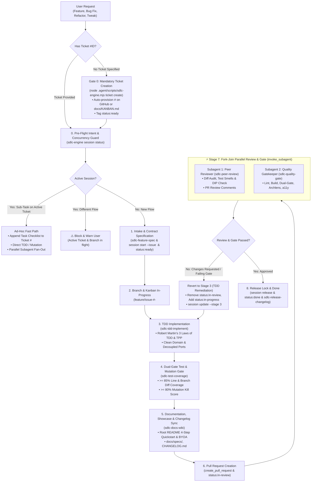

# SDLC Master Lifecycle Orchestrator (`sdlc-flow`)

Use this skill to execute end-to-end software development workflows for GitHub Issues or direct feature requests. `sdlc-flow` coordinates an 8-stage lifecycle enforcing strict session concurrency locks, ad-hoc fast-path routing, contract specification, Robert C. Martin TDD and mutation testing defense, developer onboarding/showcase hygiene, Kanban state tracking (`sdlc-kanban`), and parallel fork-join subagent peer review.

---

## ⚡ 8-Stage Lifecycle & Supervisor Fork-Join Architecture



---

## 🛑 Gate 0: Mandatory Ticket Invariant & Intake Auto-Classification

> [!TIP]
> **Full-Spec / End-to-End Product Handover Routing**: If the user hands over full project specifications, a PRD, or `PRODUCT.md` to build or evolve a complete system end-to-end, automatically delegate to **[`sdlc-product`](../sdlc-product/SKILL.md)** to synthesize `PRODUCT.md` (`CAP-XX`, `INV-XX`, `SPEC-XX`), provision Genesis Ticket `#1`, and schedule the topological DAG waves.

> [!IMPORTANT]
> **HARD FRAMEWORK INVARIANT**: Under NO circumstances may any branch be created or any code/test files be modified without an associated tracking ticket (`#<id>`).
> 
> If the incoming user request does not explicitly reference an existing ticket number (e.g. `#1031`):
> 1. **Do NOT ask the user if they want a ticket** — create it immediately and deterministically.
> 2. Automatically classify the request type:
>    - **Feature (`feat`)**: New functionality or architectural capability.
>    - **Bug Fix (`fix`)**: Defect remediation requiring a failing reproduction test harness in Stage 3.
>    - **Hotfix (`hotfix`)**: Blocker/critical production fix targeting `hotfix/*` with P0 priority.
>    - **Spike (`spike`)**: Timeboxed architectural or research exploration ending in an ADR.
> 3. Execute ticket provisioning:
>    ```bash
>    node .agent/scripts/sdlc-engine.mjs ticket create --title "<type>: <brief description>" --type <feat|bug|hotfix|spike> --body "<problem & scope summary>"
>    ```
>    *(Automatically creates an issue via GitHub/Jira/Linear, or records in `docs/KANBAN.md` as offline fallback).*
> 4. Use the generated `issueId` as the anchor for the workflow session, branch name, and PR.

---

## 🚦 Pre-Flight Concurrency & Intent Routing
 
 Before executing any stage, evaluate the active session status:
 ```bash
 node .agent/scripts/sdlc-engine.mjs session status
 ```
 
- **Session Resume**: If a session was paused or an agent is resuming an in-flight ticket:
  ```bash
  node .agent/scripts/sdlc-engine.mjs session resume
  ```
  *(Displays the visual stage dashboard, manifests, and resumes execution seamlessly).*

1. **Active Session Exists & Request is a Sub-Task on the Active Branch**:
   - **Fast-Path**: The request belongs to the currently active ticket `#<id>`.
   - Post a progress update or append an acceptance criteria checklist item to the existing ticket `#<id>`.
   - Resolve targets using `node .agent/scripts/sdlc-engine.mjs resolve-targets <files...>`.
   - If targets span independent modules, dispatch parallel subagents via `invoke_subagent`.
   - Execute TDD implementation or test coverage fixes directly within the active stage.
2. **Active Session Exists & Request is a NEW Bug, Hotfix, or Urgent Task**:
   - **Git Worktree Isolation**: Instead of blocking, isolate concurrent work into an independent git worktree:
     ```bash
     git worktree add ../worktree-issue-<new-id> -b feature/issue-#<new-id>-<title>
     node .agent/scripts/sdlc-engine.mjs session start --issue <new-id> --branch feature/issue-#<new-id>-<title> --worktree ../worktree-issue-<new-id> --stage 1
     ```
   - *Alternative (Isolated subagent)*: Dispatch a subagent with **`Workspace: 'branch'`** to isolate from the parent workspace, auto-provision a new ticket, and avoid clobbering active uncommitted work.
3. **No Active Session**:
   - Verify ticket exists (or auto-provision via Gate 0).
   - Acquire session lock:
     ```bash
     node .agent/scripts/sdlc-engine.mjs session start --issue <id> --branch feature/issue-#<id>-<title> --type <feat|bug|hotfix|spike> --stage 1
     ```
   - Proceed to Stage 1.

---

## 🛠️ Step-by-Step Lifecycle Execution

### Stage 1: Intake & Contract Specification (`sdlc-feature-spec`)
- **Ticket Verification (Gate 0)**: Confirm ticket `<id>` is resolved. If missing, provision it now via `node .agent/scripts/sdlc-engine.mjs ticket create`.
- Ensure project stack is detected and `.agent/sdlc-config.json` is initialized: `node .agent/scripts/sdlc-engine.mjs detect`.
- **Archlens Clean Architecture Availability Inquiry**:
  Check if Archlens governance is configured via `node .agent/scripts/sdlc-engine.mjs env` or `inspectArchlens`. If `.archlens/policy.json` is not present, proactively prompt the user using `ask_question`:
  - *Question*: "Archlens Clean Architecture governance policy is not configured for this project. Would you like to enable Archlens governance and concentric layer enforcement for this workflow?"
  - *Option 1*: "(Recommended) Yes, scaffold Archlens Clean Architecture policy now (`npx -y @fmatar/archlens-skill --path . --yes`)"
  - *Option 2*: "No, proceed with standard Dual-Gate verification without Archlens"
  If the user chooses Option 1, execute the setup command before proceeding.
- Fetch issue requirements using `issue_read` via `call_mcp_tool` (or native tool).
- Ensure ticket is assigned to the authenticated user (`gh api user -q .login` or `@me`) and linked to the repository's GitHub Project.
- Post initial progress comment: `"🚀 Starting automated execution for ticket #<id>..."`
- Formulate RFC / PRD, architecture schema, and Gherkin acceptance criteria (or concise reproduction steps & fix criteria for bug fixes).
- **Kanban Transition (`sdlc-kanban`)**: Tag ticket with `status:ready`.

### Stage 2: Branch & Kanban Automation (`sdlc-kanban`)
- **Session Update**: `node .agent/scripts/sdlc-engine.mjs session update --stage 2 --name "Branch & Kanban Automation"`.
- **Kanban Transition (`sdlc-kanban`)**: Tag ticket with `status:in-progress`, ensure assigned to the current user, assign to active Milestone, and sync board (`kanban-sync.sh`).
- Verify clean git status (`git status --porcelain`).
- Create and checkout branch: `git checkout -b feature/issue-#<id>-<kebab-case-title>`.

### Stage 3: Clean-Room TDD Implementation (`sdlc-tdd-implement`)
- **Session Update**: `node .agent/scripts/sdlc-engine.mjs session update --stage 3 --name "Clean-Room TDD Implementation"`.
- **Mandatory Bug Reproduction Harness**: If the ticket is classified as `fix` or `bug`, author a reproduction test first. Run the test suite and confirm it **fails** against existing code. If the reproduction test passes initially, re-verify failure conditions before modifying any application logic.
- Strictly apply **Robert Martin's Three Laws of TDD** and the **Transformation Priority Premise (TPP)**.
- If modifying legacy code with $<40\%$ baseline coverage, write characterization tests first.
- Write failing unit tests first for degenerate cases before writing production code.
- Implement business logic adhering to idiomatic standards for the detected stack (clean domain use cases, reactive streams or async where applicable, decoupled external ports).
- Reject test smells (no testing trivial getters/setters, no testing framework plumbing, no mock-heavy interaction verification).
- **Fast-Loop Verification**: Run `node .agent/scripts/sdlc-engine.mjs test --affected-only` during development loops for rapid feedback.

### Stage 4: Dual-Gate Test & Mutation Enforcement (`sdlc-test-coverage`)
- **Session Update**: `node .agent/scripts/sdlc-engine.mjs session update --stage 4 --name "Dual-Gate Test & Mutation Enforcement"`.
- Run directory-scoped tests and Dual-Gate checks via the universal engine:
  ```bash
  node .agent/scripts/sdlc-engine.mjs coverage
  node .agent/scripts/sdlc-engine.mjs mutation
  node .agent/scripts/sdlc-engine.mjs archlens diff
  ```
- Target modified lines: `git diff --name-only main`.
- **Enforce Dual-Gate Threshold**:
  1. $\ge 85\%$ line and branch coverage on diff.
  2. $\ge 80\%$ mutation kill score on modified classes/components.
  3. Archlens layer compliance: Zero concentric layer inversions introduced in git diff.
- Automatically author missing boundary tests or strengthen assertions if mutants survive.
- **Benign Mutant Exemption Ledger**: If an unkillable mutant is a benign compiler bytecode quirk or shutdown hook, document and register it in `.agent/sdlc-exemptions.json`:
  ```bash
  node .agent/scripts/sdlc-engine.mjs exemption add --mutant "<class:line:type>" --reason "<architectural justification>" --by "@reviewer"
  ```

### Stage 5: Documentation, Showcase & Changelog Sync (`sdlc-docs-wiki`)
- **Session Update**: `node .agent/scripts/sdlc-engine.mjs session update --stage 5 --name "Documentation & Showcase Sync"`.
- Synchronize all documentation, Spec-Drift ADRs, and architectural traces before opening the PR to guarantee 100% diff traceability:
  - **Spec-Drift Sentinel & ADR Check**: Verify whether stack dependencies, C4 nodes, DB schemas, or API contracts drifted from `PRODUCT.md` / `docs/specs/`:
    ```bash
    node .agent/scripts/sdlc-engine.mjs drift check
    # If drift is detected, mint a linked ADR and sync PRODUCT.md:
    node .agent/scripts/sdlc-engine.mjs adr create --title "<decision>" --scope <technical|product> --ticket ${id} --supersedes CAP-01
    ```
  - **Causal Decision Graph Sync**: Regenerate `docs/DECISION_MAP.md` and `.agent/decision-graph.jsonl`:
    ```bash
    node .agent/scripts/sdlc-engine.mjs decision-graph sync
    ```
  - **Architectural Mutation Trace**: Record diagram and layer delta:
    ```bash
    node .agent/scripts/sdlc-engine.mjs arch trace --reason "Architectural refinement for #${id}"
    ```
  - **Developer Showcase Invariant**: Update root `README.md` with runnable **5-Minute Developer Quickstart** (install, bootstrap, explore examples, BYOA workflow).
  - **Specs**: Update functional architecture specs in `docs/specs/` and `wiki/`.
  - **Changelog**: Append entry to `CHANGELOG.md` under `[Unreleased]` with ticket URL link.
- Commit documentation and trace updates to the feature branch (never directly to `develop`):
  ```bash
  git add README.md CHANGELOG.md docs/ specs/ wiki/ .agent/arch-trace.jsonl
  git commit -m "docs: sync showcase, specs, arch-trace, and changelog for #${id}"
  ```

### Stage 6: Pull Request Opening (`sdlc-kanban`)
- **Session Update**: `node .agent/scripts/sdlc-engine.mjs session update --stage 6 --name "Pull Request Opening"`.
- **Automated PR Body Generation**: Generate structured PR markdown via the engine:
  ```bash
  node .agent/scripts/sdlc-engine.mjs pr-summary --issue <id>
  ```
- **UI Ephemeral Preview (Frontend / Svelte Modules)**: For UI components, capture screenshot visual artifacts or Lighthouse audit results and attach the image preview link to the PR body.
- Push feature branch to remote origin: `git push -u origin HEAD`.
- Call `create_pull_request` linking `Fixes #<id>` with the compiled PR summary.
- **Kanban Transition (`sdlc-kanban`)**: Tag ticket with `status:in-review`.

### Stage 7: Fork-Join Parallel Review & Quality Gate (`invoke_subagent`)
- **Session Update**:
  ```bash
  node .agent/scripts/sdlc-engine.mjs session update --stage 7 --name "Parallel Review & Quality Gate" --subagents "peer-reviewer,quality-gatekeeper"
  ```
- Launch parallel read-only auditor subagents concurrently using a single `invoke_subagent` call:
```json
{
  "Subagents": [
    {
      "TypeName": "self",
      "Role": "PR Peer Reviewer",
      "Prompt": "Load sdlc-peer-review/SKILL.md. Audit git diff against main, detect Robert Martin test smells (no trivial getter tests, no mock abuse), verify Dual-Gate metrics, verify developer showcase quickstart completeness in README.md and CHANGELOG.md, and MANDATORILY post a formal review comment to GitHub PR (via pull_request_review_write), Jira, Linear, or docs/KANBAN.md (via node .agent/scripts/sdlc-engine.mjs pm comment <issueId> --body ...)."
    },
    {
      "TypeName": "self",
      "Role": "Quality Gatekeeper",
      "Prompt": "Load sdlc-quality-gate/SKILL.md. Execute universal quality gate (node .agent/scripts/sdlc-engine.mjs gate), formatting, static typing, build validation, DevSecOps, and WCAG a11y audit."
    }
  ]
}
```
- Wait for subagents to report results:
  - **Review Rejection / Gate Failure Protocol & Circuit Breaker**:
    If any subagent requests changes or reports a gate failure:
    1. Revert Kanban label: `gh issue edit <id> --remove-label "status:in-review" --add-label "status:in-progress"`.
    2. Check Circuit Breaker budget. If remediation count reaches 3, **do NOT loop infinitely**. Call `ask_question`:
       - *Option 1: "Request exemption: accept current coverage with rationale in sdlc-exemptions.json"*
       - *Option 2: "Extend retry budget: grant 2 additional remediation attempts"*
       - *Option 3: "Abort and rollback: revert ticket to backlog and switch to main"*
    3. If budget remains, roll back session:
       ```bash
       node .agent/scripts/sdlc-engine.mjs session update --stage 3 --name "Remediating Peer Review Feedback" --remediate
       ```
    4. Remediate issues using TDD, re-verify tests, commit, push, and re-trigger review.
  - **Review Approved & Gate Passed**:
    Issue the cryptographic Stage 7 Merkle Gate Receipt (`node .agent/scripts/sdlc-engine.mjs guard receipt`) and proceed to Stage 8.

### Stage 8: Quality Gate Passed, Release & Lock Release (`sdlc-release-changelog`)
- **Session Update**: `node .agent/scripts/sdlc-engine.mjs session update --stage 8 --name "Release & Teardown"`.
- **Remote CI/CD Status Polling**: Before merging, verify all remote CI checks have completed green:
  ```bash
  node .agent/scripts/sdlc-engine.mjs check-ci <pr-number>
  ```
- Merge pull request (squash & merge or rebase).
- Hand off to `sdlc-release-changelog` for version tagging, containerization, and deployment.
- **Kanban Transition (`sdlc-kanban`)**: Tag ticket with `status:done`, close issue, and execute `kanban-sync.sh` to refresh `docs/KANBAN.md`.
- **Release Session Lock**:
  ```bash
  node .agent/scripts/sdlc-engine.mjs session release
  ```

---

## 🛑 Workflow Abort & Rollback Procedure

If an in-flight workflow must be aborted due to unrecoverable errors, invalid requirements, or user cancellation:
1. **Clean Workspace Changes**: `git checkout -- . && git clean -fd`.
2. **Switch to Main**: `git checkout main`.
3. **Revert Issue Kanban State**:
   ```bash
   gh issue edit <id> --remove-label "status:in-progress,status:in-review" --add-label "status:backlog"
   ```
4. **Post Issue Notice**: Post GitHub issue comment documenting the cancellation reason.
5. **Release Session Lock**:
   ```bash
   node .agent/scripts/sdlc-engine.mjs session release
   ```

---

## ⏭️ Next Recommended Step

- When starting an issue, run **`sdlc-flow`** to check concurrency and initiate Stage 1.
- For ad-hoc requests, verify session status and use **`sdlc-tdd-implement`** or **`sdlc-test-coverage`** on the fast-path.
