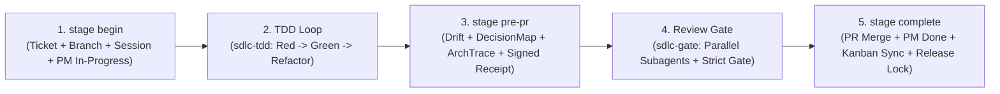

# 🚀 Agentic SDLC Master Orchestrator (`sdlc-flow`)

## 1. Mission & Core Invariants

1. **Zero Direct Pushes (`INV-01`)**: Direct commits, merges, or pushes to `main` or `develop` are blocked by the 4-Layer Git Guard.
2. **Mandatory Ticket & Composite Session (`INV-02`)**: Every code change is governed by an active ticket session started via `sdlc-engine stage begin`.
3. **Spec-Drift ADR Discipline (`INV-03`)**: Any change to `PRODUCT.md`, `docs/specs/*.md`, database migrations, or public API contracts requires an accepted ADR (`sdlc-engine adr create`).
4. **Real Dual-Gate Verification**: All changes must pass unit/integration tests ($\ge 85\%$ diff coverage) and mutation/contract checks ($\ge 80\%$ mutation kill score when configured).

---

## 2. Streamlined Lifecycle Workflow (`sdlc-engine stage`)



### Phase 1: Intake, Branch & Session Initialization (`stage begin`)
Instead of running separate ticket, branch, session, and Kanban commands, execute the single composite `stage begin` command:
```bash
# Existing ticket:
node .agent/scripts/sdlc-engine.mjs stage begin --issue <id> --title "<short-slug>" --type <feat|fix|hotfix> --checkout

# Or auto-provision a new ticket and begin immediately:
node .agent/scripts/sdlc-engine.mjs stage begin --title "<title>" --type <feat|fix> --checkout
```
- **Bug / Hotfix Fast-Path**: If `--type fix` or `hotfix`, generate a failing Red reproduction test first:
  ```bash
  node .agent/scripts/sdlc-engine.mjs reproduce --error "<stack_trace>" --target "<file>"
  ```

### Phase 2: Robert Martin TDD & Clean Code Implementation (`ub-mode` / `sdlc-tdd`)
Execute the coding cycle adhering strictly to **`ub-mode`** (invoking `/ub-mode`):
1. **First Make it Work:**
   - **Model the Domain**: Define pure domain types making illegal states impossible.
   - **TDD (Red -> Green)**: Write the failing test before changing code; write only minimal code to pass.
   - **Attack the Premise**: If two fixes sharing a premise fail a gate, isolate and discard the premise.
   - **Subtract Before You Add**: Simplify or remove complexity before adding new logic.
2. **Then Make it Right:**
   - Run affected tests: `node .agent/scripts/sdlc-engine.mjs test --affected-only`
   - Verify coverage (CRAP < 10, Line Coverage >= 85%): `node .agent/scripts/sdlc-engine.mjs coverage`
   - Eliminate duplication (Dryer similarity < 0.8) and run mutation tests to kill surviving mutants: `node .agent/scripts/sdlc-engine.mjs mutation`
3. **Follow Practice:**
   - Deliver small, ordered, atomic commits explaining *why*, *what changed*, and *how proven*.

### Phase 3: Pre-PR Verification, Cryptographic Receipt & Live Architecture UI (`stage pre-pr`)
Once implementation and docs are updated, execute the composite `stage pre-pr` command:
```bash
node .agent/scripts/sdlc-engine.mjs stage pre-pr --issue <id> --summary "<architectural_summary>"
```
This single command atomically:
- Advances the session to Stage 6 (`Pull Request & CI`).
- Evaluates `drift check` (`PRODUCT.md` & `docs/specs/` vs `docs/adr/`).
- Synchronizes `docs/DECISION_MAP.md` (`decision-graph sync`).
- Appends architectural traceability to `docs/ARCH_TRACE.md` (`arch trace`).
- Pushes the feature branch and resolves or creates the GitHub Pull Request (`gh pr view` / `gh pr create`), saving `prNumber` in `.agent/.sdlc-session.json`.
- Issues the HMAC-SHA256-signed Stage 7 gate receipt if `peerReview` is already recorded in the session (otherwise deferred to Phase 4 `review record`).
- Builds `.agent/workbench/index.html` (start the live, token-protected workbench yourself with `sdlc-engine serve`).
- Generates the standardized PR summary.

**Mandatory Antigravity Inline Architecture UI Presentation**:
After running `stage begin` or `stage pre-pr`, copy `.agent/workbench/index.html` into the conversation's artifact directory (`<artifactDir>/sdlc-architecture-diff.html`) using `write_file` (with `ArtifactMetadata: { UserFacing: true, RequestFeedback: false, Summary: "..." }`) and embed it directly in your response:
```markdown
<agent-embed src="file:///<artifactDir>/sdlc-architecture-diff.html"></agent-embed>
```

### Phase 4: Parallel Fork-Join Review & Quality Gate (`sdlc-gate`)
Dispatch two `invoke_subagent` calls in parallel using valid tool arguments:
- **Call 1 (`PR Peer Reviewer`)**:
  - `TypeName`: `"research"`
  - `Role`: `"PR Peer Reviewer"`
  - `Prompt`: `"Audit git diff against main for Robert Martin test smells, Dual-Gate coverage (>=85%), and clean architecture boundaries. Return a structured review verdict."`
- **Call 2 (`Architecture & Security Gatekeeper`)**:
  - `TypeName`: `"research"`
  - `Role`: `"Architecture & Security Gatekeeper"`
  - `Prompt`: `"Inspect modified files for security leaks, concentric layer inversions (.archlens/policy.json), and documentation completeness. Return a structured gate report."`

Then run the strict quality gate, sign the Stage 7 receipt, and publish the consolidated 4-section review comment directly onto the GitHub Pull Request:
```bash
node .agent/scripts/sdlc-engine.mjs gate --strict
node .agent/scripts/sdlc-engine.mjs review record \
  --verdict approve \
  --reviewer "@sdlc-gate" \
  --peer-review "<subagent_1_verdict>" \
  --arch-review "<subagent_2_verdict>"
```

### Phase 5: Completion & Kanban Synchronization (`stage complete`)
After PR merge or completion verification, close out the lifecycle with one command:
```bash
node .agent/scripts/sdlc-engine.mjs stage complete --issue <id> --pr <pr_number>
```
To refresh the full GitHub Issues traceability matrix in `docs/KANBAN.md`:
```bash
.agent/scripts/kanban-sync.sh
```
