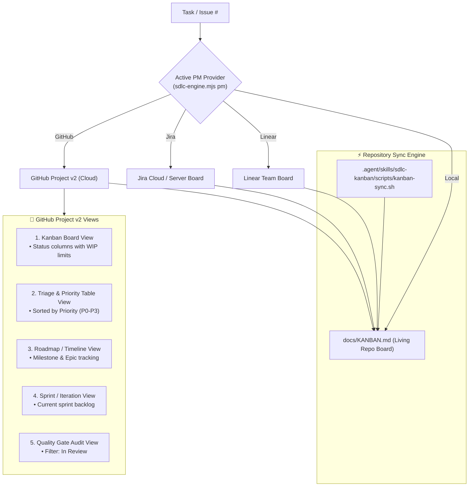
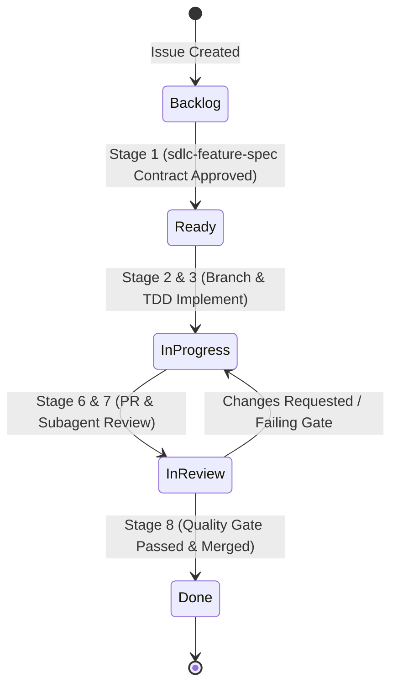

# SDLC GitHub Projects & Kanban Management Skill (`sdlc-kanban`)

Use this skill to orchestrate project boards, manage issue lifecycles, enforce Work-In-Progress (WIP) limits, synchronize GitHub Projects v2, and maintain living Kanban dashboards across GitHub and repository documentation.

---

## 🏗️ Multi-Provider & Dual-Plane Kanban Architecture

`sdlc-kanban` operates dynamically across multiple cloud and offline providers configured via `.agent/sdlc-config.json` or environment variables:
1. **GitHub Projects v2**: Full-featured board with custom fields, multi-view setups (Board, Table, Roadmap, Sprint, Quality Gate), and automated transitions via `gh` CLI or `github-mcp-server`.
2. **Jira (Atlassian)**: Enterprise agile issue tracking mapped to SDLC lifecycle states via `jira-mcp-server` or Jira REST API.
3. **Linear**: High-performance issue tracking mapped via `linear-mcp-server`.
4. **Repository Living Board (`docs/KANBAN.md`)**: Version-controlled, zero-dependency Markdown board rendered in the repo and always updated as an offline, transparent audit trail.



---

## ⚡ 5-Stage Kanban State Machine

Deterministic state transitions enforced across GitHub issue labels and project cards:

| State / Label | Phase in Lifecycle | Description & Exit Criteria |
| :--- | :--- | :--- |
| `status:backlog` | Intake | Triaged, awaiting architectural scoping. |
| `status:ready` | Contract Specification | Specification approved (`sdlc-feature-spec`), Gherkin acceptance criteria defined. |
| `status:in-progress` | TDD & Implementation | Active branch created, TDD implementation underway (`sdlc-tdd-implement`). |
| `status:in-review` | Peer Review & Gates | PR opened, parallel subagent review (`sdlc-peer-review`) & quality gates active. |
| `status:done` | Verification & Release | PR merged, release tagged (`sdlc-release-changelog`), issue closed. |



---

## 🛠️ Core Capabilities & CLI Automation

### 1. Turnkey GitHub Project v2 Setup & Provisioning
Run the automated script to provision the project, link it to the repository, and create all traceability fields:
```bash
# Ensure gh CLI has project scope
gh auth refresh -s project,read:project

# Run turnkey provisioner
.agent/skills/sdlc-kanban/scripts/project-setup.sh
```

### 2. Standardized Traceability Custom Fields
- **`Status`** (Single Select): `Backlog`, `Ready`, `In Progress`, `In Review`, `Done`
- **`Priority`** (Single Select): `P0 - Critical`, `P1 - High`, `P2 - Medium`, `P3 - Low`
- **`Component`** (Single Select): `Backend`, `Frontend`, `DevOps`, `Documentation`, `Architecture`
- **`Estimate`** (Number): Story points (1, 2, 3, 5, 8)
- **`Spec Link`** (Text): Link to `docs/specs/` or `wiki/` specification
- **`Quality Gate`** (Single Select): `Pending`, `Passed`, `Failed`

```bash
# Manual field creation (if scripting manually)
gh project field-create <project-number> --owner <owner> --name "Spec Link" --data-type TEXT
gh project field-create <project-number> --owner <owner> --name "Quality Gate" --data-type SINGLE_SELECT --single-select-options "Pending,Passed,Failed"
```

### 3. Six Recommended GitHub Project Views (100% Traceability)

| View Name | Layout | Group By / Filter | Displayed Fields | Purpose & Best Practice |
|---|---|---|---|---|
| **1. ⚡ Kanban Board** | `Board` | Group by `Status` | Title, Priority, Component, Estimate, PR | Primary execution view. Limits WIP (max 3-5 in "In Progress"). |
| **2. 🎯 Traceability Matrix** | `Table` | Group by `Milestone` or `Component` | Issue #, Title, Status, **Spec Link**, PR, **Quality Gate** | 100% audit trail linking requirements to code and gates. |
| **3. 📥 Backlog & Triage** | `Table` | Filter: `Status: Backlog, Ready`, Sort: `Priority` | Title, Priority, Component, Estimate | Grooming and scoping view for new issues. |
| **4. 🏃 Sprint Iteration** | `Board` | Filter `Iteration: @current` | Title, Priority, Assignee, Linked PR | Daily delivery sprint focus for engineers and agents. |
| **5. 🛡️ Quality Gate & Review** | `Table` | Filter `Status: In Review` | Title, Assignee, Linked PR, Quality Gate | Peer review tracking, catching mutation failures. |
| **6. 🗺️ Epic Roadmap** | `Roadmap` | Group by `Milestone`, Target Date | Milestone, Epics, Issues | Strategic roadmap tracking releases and epics. |

> [!TIP]
> Use `gh project view <number> --owner <owner> --web` to fine-tune layout configurations in the GitHub web interface.

---

## 🔄 Automated Lifecycle State Transitions

The SDLC framework synchronizes both GitHub Issue labels and **actual GitHub Project v2 Status single-select dropdown fields** (and local `docs/KANBAN.md` columns) simultaneously:

```bash
# Unified transition command (updates both GitHub issue labels AND the Project v2 Status dropdown field):
node .agent/scripts/sdlc-engine.mjs pm transition <issueId> <ready|in-progress|in-review|done>
```

> [!TIP]
> **Zero-Touch Stage Synchronization**: Whenever you run `node .agent/scripts/sdlc-engine.mjs session update --stage <n>`, the engine automatically invokes `transitionPMState` under the hood:
> - Stage 1 $\rightarrow$ `Status: Ready` / `Todo`
> - Stages 2-5 $\rightarrow$ `Status: In Progress`
> - Stages 6-7 $\rightarrow$ `Status: In Review`
> - Stage 8 $\rightarrow$ `Status: Done`

### Manual CLI Reference (If bypassing the engine):
```bash
# Transition labels
gh issue edit <id> --remove-label "status:ready,status:backlog" --add-label "status:in-progress"

# Transition Project v2 Status Dropdown field
gh project item-edit --id "$ITEM_ID" --project-id "$PROJECT_ID" --field-id "$STATUS_FIELD_ID" --single-select-option-id "$OPTION_ID"
```

---

## 📊 Synchronizing Living Repo Board (`docs/KANBAN.md`)

Execute the built-in synchronization script to refresh the Markdown board directly from the GitHub API:

```bash
.agent/skills/sdlc-kanban/scripts/kanban-sync.sh
```

### Structure of `docs/KANBAN.md`
```markdown
# 📋 Project Kanban Board

> **Last Synced**: YYYY-MM-DD HH:MM:SS UTC  
> **Repository**: [owner/repo]

| 📥 Backlog | 📋 Ready | ⚡ In Progress | 🔍 In Review | ✅ Done |
| :--- | :--- | :--- | :--- | :--- |
| [#25 Helm](url) | [#24 Scale-to-Zero](url) | [#18 Telemetry](url) `[M2]` | [#17 Workbench](url) | [#16 Shell](url) |
```

---

## 🚦 Work-In-Progress (WIP) Limits

To prevent cognitive fragmentation and subagent saturation:
* **Max 3-5 tickets `status:in-progress`** simultaneously.
* **Max 2-3 tickets `status:in-review`** awaiting peer review.

> [!IMPORTANT]
> If limits are exceeded, halt intake and prioritize clearing review bottlenecks with `sdlc-peer-review`.

---

## ⏭️ Integration with `sdlc-flow`

* **Gate 0 (Mandatory Ticket Invariant)**: `sdlc-flow` guarantees every incoming request (feature or bug fix) resolves or auto-provisions a ticket (`#<id>`) before any branch is cut or code is modified.
* **Stage 1 (Contract)**: `sdlc-flow` verifies issue is scoped and tags `status:ready`.
* **Stage 2 (Branch)**: `sdlc-flow` tags issue `status:in-progress`, assigns Milestone, and runs `kanban-sync.sh`.
* **Stage 6 (PR)**: `sdlc-flow` tags issue `status:in-review`.
* **Stage 8 (Merge)**: `sdlc-flow` tags issue `status:done`, closes issue, and runs `kanban-sync.sh` to update `docs/KANBAN.md`.
