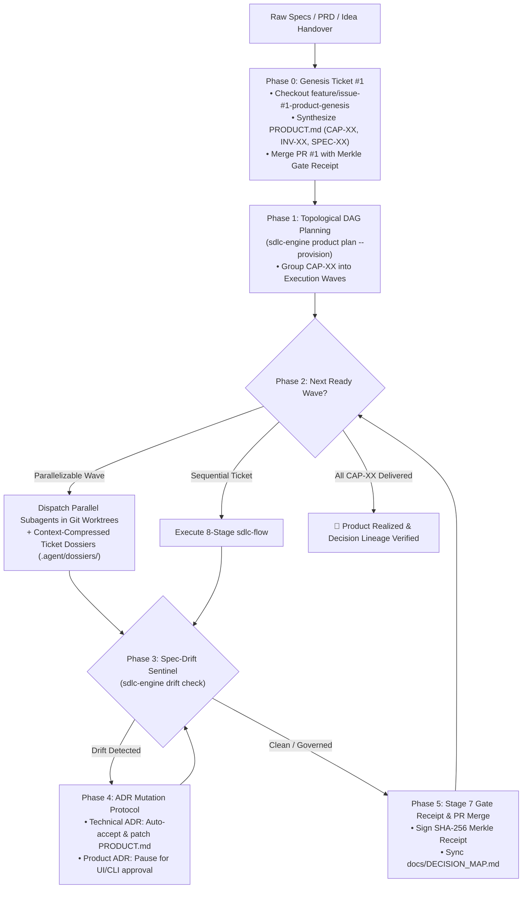

# SDLC End-to-End Product Autopilot (`sdlc-product`)

Use this skill when the user hands over full specifications, PRDs, or an existing `PRODUCT.md` to build or evolve a project end-to-end. `sdlc-product` acts as the **Macro-Orchestrator** above [`sdlc-flow`](../sdlc-flow/SKILL.md), guaranteeing 100% traceability from `PRODUCT.md` capabilities through specs, tickets, Spec-Drift ADRs, and Stage 7 Merkle Gate Receipts.

---

## 🌐 Macro-to-Micro Product Factory Lifecycle



---

## 🛠️ Step-by-Step Execution Protocol

### Phase 0: Genesis Ticket `#1` & `PRODUCT.md` Constitution Synthesis
1. **No Direct Commits to `main`**: Even the initial `PRODUCT.md` constitution and project scaffold must enter via **Ticket `#1`** (`feature/issue-#1-product-genesis`).
2. **Synthesize `PRODUCT.md`**:
   ```bash
   node .agent/scripts/sdlc-engine.mjs product init --title "<Product Name>" --vision "<Product Vision>"
   ```
   Populate `PRODUCT.md` with canonical IDs:
   - `INV-01`, `INV-02`: Hard Domain & System Invariants.
   - `CAP-01`, `CAP-02`: Product Capabilities mapped to `docs/specs/cap-xx.md` (`SPEC-XX`) and explicit topological dependencies (`Depends On`).

### Phase 1: Topological Milestone & Ticket DAG Planning
Compute the dependency waves and provision tickets:
```bash
node .agent/scripts/sdlc-engine.mjs product plan --provision
```
- **Wave 1**: Foundation & Ring 0 Core Domain entities (no dependencies).
- **Wave 2+**: Independent Ring 1/2/3 adapters, APIs, and UI views scheduled in parallel waves.

### Phase 2: Context-Compressed Dossiers & Parallel Worktree Execution
Before launching a subagent or starting Stage 3 TDD for Ticket `#<id>`, generate its compact context dossier:
```bash
node .agent/scripts/sdlc-engine.mjs dossier generate --issue <id> --cap CAP-01 <target-files...>
```
- Subagents read `.agent/dossiers/issue-<id>.md` (~80% token reduction) instead of scanning the entire repository.
- When a wave has multiple independent capabilities (`parallelizable: true`), isolate each ticket in its own Git worktree and invoke parallel subagents via `invoke_subagent`.

### Phase 3: First-Class Spec Drift & ADR Lifecycle
When implementation reveals technical friction or the user pivots requirements:
1. **Mint an ADR**:
   ```bash
   node .agent/scripts/sdlc-engine.mjs adr create \
     --title "<Decision Title>" \
     --scope <technical|product> \
     --ticket <id> \
     --supersedes CAP-01 \
     --context "<Original spec assumption & friction encountered>" \
     --decision "<New architectural or contract decision>" \
     --consequences "<Downstream impact on specs and tickets>"
   ```
2. **Blast-Radius Routing**:
   - **`technical` scope**: Automatically accepted (`status: accepted`), patches `PRODUCT.md` and `docs/DECISION_MAP.md`, and unblocks the Spec-Drift Sentinel.
   - **`product` scope**: Enters `status: pending_approval`. Pause and prompt the user via `ask_question` (or let them approve in the SvelteKit Workbench UI at `http://localhost:4120`), then execute:
     ```bash
     node .agent/scripts/sdlc-engine.mjs adr decide ADR-00X approve
     ```

### Phase 4: 4-Layer Git Guard & Stage 7 Cryptographic Gate Receipt
Before any branch merges into `main`:
1. Verify zero undeclared spec drift:
   ```bash
   node .agent/scripts/sdlc-engine.mjs drift check
   ```
2. Issue the Stage 7 Cryptographic Gate Receipt after Peer Review & Quality Gate pass:
   ```bash
   node .agent/scripts/sdlc-engine.mjs guard receipt
   ```
3. Synchronize the Causal Decision Graph & `docs/DECISION_MAP.md`:
   ```bash
   node .agent/scripts/sdlc-engine.mjs decision-graph sync
   ```
