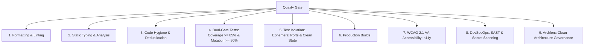

# SDLC Quality Gate & Audit Skill (`sdlc-quality-gate`)

Use this skill before opening or merging pull requests, cutting releases, or completing major feature implementations to ensure zero regressions, clean formatting, strict typing, defect defense via mutation testing, and security compliance across any polyglot stack.

---

## 🛡️ The 9 Pillars of Software Quality & Defect Defense



---

## 🛠️ Step-by-Step Quality Gate Checklist

### 0. Universal Turnkey Gate (Polyglot / Multi-Module)
Run the universal quality gate to execute linting, builds, Dual-Gate tests, and Archlens governance across all configured modules:
```bash
node .agent/scripts/sdlc-engine.mjs gate
```

To enforce this gate automatically on every local commit/push and remote PR, scaffold native hooks and GitHub Actions:
```bash
# Install zero-dependency local pre-commit & pre-push hooks
node .agent/scripts/sdlc-engine.mjs hooks install

# Scaffold GitHub Actions SDLC Quality Gate workflow
node .agent/scripts/sdlc-engine.mjs ci-workflow install
```

### 1. Code Formatting & Style Checks
- [ ] Execute repo linter / formatter (e.g. Spotless, Prettier, Black, `gofmt`, `cargo fmt`).
- [ ] Zero unformatted or unlinted files in the diff.

### 2. Static Typing & Syntax Verification
- [ ] Strict type checking passing with zero errors (e.g. `tsc` / `svelte-check`, `mypy`, Rust `cargo check`, Go `go vet`).
- [ ] Clean module and path alias resolution.

### 3. Static Analysis & Code Hygiene
- [ ] Run static analyzers (e.g. PMD/CPD, Sonar, Clippy, Ruff, ESLint).
- [ ] No dead code, empty catch blocks, concurrency antipatterns, or excessive duplication.

### 4. Dual-Gate Testing & Mutation Defense (Robert Martin Standard)
Run Dual-Gate verification via the universal engine:
```bash
node .agent/scripts/sdlc-engine.mjs coverage
node .agent/scripts/sdlc-engine.mjs mutation
```
- [ ] **Line/Branch Diff Coverage**: $\ge 85\%$ on all net-new and modified lines in the diff.
- [ ] **Mutation Kill Score**: $\ge 80\%$ on changed classes/modules (PITest, Stryker, Mutmut, `cargo-mutants`, `go-mutesting`).
- [ ] Zero surviving mutants on core business logic or domain boundaries.

### 5. Test Suite Execution & Parallel Port Isolation
- [ ] **Test Port Isolation**: Ensure integration tests bind to random/ephemeral ports (e.g. port `0`) to eliminate parallel build collisions.
- [ ] **Transactional Rollback & Fixture Cleanliness**: Ensure tests use transactional rollback or isolated fixtures to prevent shared state leaks.

### 6. Production Build Validation
- [ ] Run full production compilation/packaging via `sdlc-engine.mjs gate` or native build tool with zero compilation errors.

### 7. Accessibility (a11y) Audit (for UI tiers)
- [ ] **Contrast Ratios**: Check contrast in Light and Dark modes (min 4.5:1 for body, 3:1 for large text).
- [ ] **Keyboard Navigation**: Verify interactive controls respond to `Space`, `Enter`, `Esc`, `Tab`.
- [ ] **ARIA & Screen Readers**: Ensure dynamic state updates announce through `aria-live` regions.

### 8. Security & DevSecOps Scanning
- [ ] **Secret Scanning**: Verify zero plaintext secrets, tokens, or private keys in git status/diff.
- [ ] **Dependency Audits**: Zero Critical/High vulnerabilities reported in dependencies.

### 9. Clean Architecture Governance (Archlens)
When `.archlens/policy.json` exists in the repository:
```bash
node .agent/scripts/sdlc-engine.mjs archlens check
```
- [ ] **Concentric Dependency Rule**: Verify all source code dependencies point strictly inward:
  `Infrastructure (Level 3) -> Adapters (Level 2) -> Application (Level 1) -> Domain Core (Level 0)`.
- [ ] **Domain Port Inversion (DIP)**: Inner core entities must NEVER import database, framework, or transport packages.
- [ ] **Zero Circular Layer Cycles**: Fail gate on any circular dependencies detected between modules.

---

## ⏭️ Next Recommended Step

- If all quality checks pass and release is planned:
  👉 **Transition to [`sdlc-release-changelog`](../sdlc-release-changelog/SKILL.md)** to bump SemVer, update `CHANGELOG.md`, and publish a release.
- If invoked during a Pull Request:
  👉 Present the quality audit report and proceed to merge.
