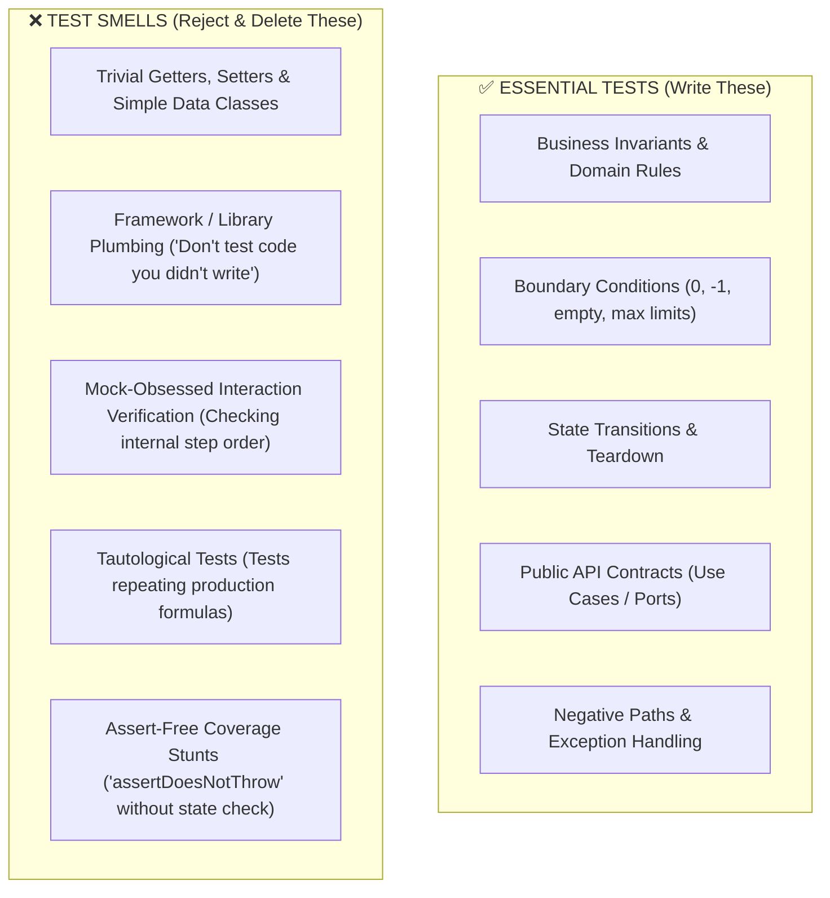

# SDLC TDD & Clean Code Implementation Skill (`sdlc-tdd-implement`)

Use this skill when implementing new features, services, UI components, or refactoring existing code across polyglot codebases. This skill strictly enforces **Robert C. Martin's (Robert Martin)** software craftsmanship, the **Three Laws of TDD**, the **Transformation Priority Premise (TPP)**, and the elimination of test waste.

---

## 📜 Robert C. Martin's Three Laws of TDD

TDD is a disciplined rhythm with a feedback cycle measured in seconds, not hours:

1. **First Law**: *You may not write any production code until you have written a failing unit test.*
2. **Second Law**: *You may not write more of a unit test than is sufficient to fail; and not compiling is failing.*
3. **Third Law**: *You may not write more production code than is sufficient to pass the currently failing test.*

The cycle: **Red $\rightarrow$ Green $\rightarrow$ Refactor**. Refactoring is not an optional afterthought; it is the phase where duplicate code is eliminated and design is cleaned while all tests are green.

---

## 🧭 The Transformation Priority Premise (TPP)

Robert Martin's TPP establishes that *as the tests get more specific, the code gets more generic*. Guide algorithm implementation using the lowest-priority transformations first:

$$\begin{aligned}
\text{1. } & (\{ \} \rightarrow \text{nil}) & \text{None to null} \\
\text{2. } & (\text{nil} \rightarrow \text{constant}) & \text{Return a hardcoded value} \\
\text{3. } & (\text{constant} \rightarrow \text{scalar}) & \text{Substitute constant with variable/parameter} \\
\text{4. } & (\text{statement} \rightarrow \text{statements}) & \text{Add simple linear sequence} \\
\text{5. } & (\text{unconditional} \rightarrow \text{conditional}) & \text{Introduce if-statement for boundary} \\
\text{6. } & (\text{scalar} \rightarrow \text{collection}) & \text{Generalize variable into list/array} \\
\text{7. } & (\text{statement} \rightarrow \text{recursion / loop}) & \text{Iterate over collection}
\end{aligned}$$

Never jump immediately to complex loops or recursion before simpler scalar or conditional transformations pass the test.

---

## ⚖️ Useful Tests vs. Useless Tests Heuristics

Test code is a **first-class citizen** with the same maintenance cost as production code. Writing low-value tests creates a brittle test suite that discourages refactoring.

### Forbidden Anti-Patterns:
- **Don't Test Code You Didn't Write**: Do not write tests verifying that an ORM/database library persists to SQL, that a framework runtime triggers reactivity, or that a serialization library serializes JSON. The framework developers already tested that.
- **No Getter/Setter Tests**: Never write unit tests for plain DTOs, records, or structs without custom logic.
- **Avoid Mock Abuse**: Mocking is only for external architectural boundaries (databases, third-party REST APIs, message brokers, system clock). Never mock internal domain entities or collaborators—test state and behavior, not mechanical method calls.
- **Single Concept per Test**: Never write "Grand Tour" monster tests that test 10 unrelated scenarios in one method. If step 2 fails, the remaining 8 never run.

---

## ⚡ F.I.R.S.T. Test Harness Architecture

Every test written must adhere to Robert Martin's **F.I.R.S.T.** rules:
- **Fast**: Millisecond execution. Use in-memory mocks only at I/O boundaries.
- **Independent**: Tests must never depend on the execution order of previous tests. Use dynamic port isolation (e.g. test port `0`) and isolated database transactions/fixtures.
- **Repeatable**: Deterministic in any environment (local, CI, container) without network dependencies.
- **Self-Validating**: Exactly one boolean result (Pass or Fail) with expressive assertions.
- **Timely**: Authored immediately before the code that makes it pass.

---

## 💎 Polyglot Clean Architecture & Language Patterns

Apply idiomatic, modern patterns according to the repository's detected stack in `.agent/sdlc-config.json`:

### Reference Pattern A: Reactive Backend Services (e.g. Java / Quarkus / Spring Boot)
- **Modern Syntax**: Records, sealed interfaces, pattern matching, non-blocking asynchronous execution.
- **Clean Architecture Boundaries**: Implement business logic in domain use cases; decouple database access into repository ports (Dependency Inversion Principle).
- **Test Isolation**: Clean database transactions per test, ephemeral random ports.

### Reference Pattern B: Modern Reactive Frontend (e.g. Svelte 5 / React / Vue)
- **Reactive State**: Encapsulated fine-grained reactivity (e.g. Svelte 5 Runes `$state`, `$derived`, `$props`). Never manually sync state.
- **Side Effects**: Isolate side effects to lifecycle hooks with mandatory teardown.
- **Strict Typing**: Type contracts on all component props and state models.

### Reference Pattern C: Systems & Microservices (e.g. Go / Rust / Python)
- **Go**: Table-driven tests (`t.Run`), minimal interfaces, explicit error handling.
- **Rust**: Functional pipeline validation, error propagating `Result<T, E>`, in-module unit test suites (`#[cfg(test)]`).
- **Python**: Type annotations (`dataclasses` / Pydantic models), `pytest` fixtures with clean teardown.

---

## 🛠️ Step-by-Step TDD Workflow

1. **Review Specification Contract**: Load the RFC / Issue generated by `sdlc-feature-spec`.
2. **Write Failing Test First (First Law)**:
   - Formulate test for the simplest degenerate case (TPP step 1 & 2).
   - Ensure the test fails for the expected reason (or fails compilation).
3. **Write Minimum Production Code (Third Law)**:
   - Provide minimal logic to make the test pass.
4. **Refactor**:
   - Clean up naming, extract methods, eliminate duplication.
5. **Next TPP Iteration**:
   - Add next test driving from scalar to boundary condition to generalization.
6. **Static Verification & Build Check**:
   - Run stack compilation: `node .agent/scripts/sdlc-engine.mjs test` or language compiler.
   - Verify formatting and clean typing.

---

## ⏭️ Next Recommended Step

Once implementation passes initial TDD checks:
👉 **Transition to [`sdlc-test-coverage`](../sdlc-test-coverage/SKILL.md)** to enforce the **Dual-Gate Threshold** ($\ge 85\%$ diff coverage AND $\ge 80\%$ mutation kill score).
