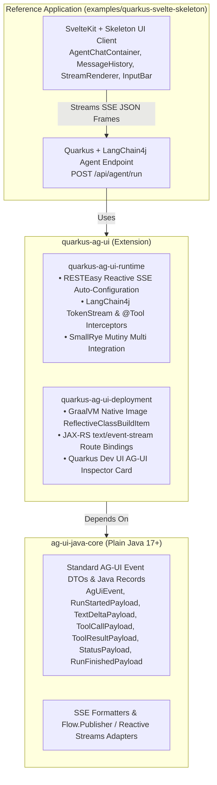

# 🏛️ Product Constitution: Java/Quarkus Implementation of the AG-UI Protocol (quarkus-agui)

> **Single Source of Truth (`PRODUCT.md`)**
> Generated & governed by **Agentic SDLC Framework (`sdlc-product`)**.
> Any architectural or contract deviation from this constitution requires a linked **ADR (`docs/adr/ADR-00X.md`)**.

---

## 1. Product Vision
Fill the gap in Java/JVM ecosystems for the AG-UI (Agent-User Interaction Protocol) standard by building an open-source, zero-dependency Java 17+ Core Library (`ag-ui-java-core`), a dedicated Quarkus Extension (`quarkus-ag-ui`) with LangChain4j `TokenStream`/`@Tool` interceptors, GraalVM native reflection, and Dev UI Inspector, and a full-stack Reference Application using SvelteKit + Skeleton UI.

### Strategic 3-Phase Roadmap
1. **End-to-End Reference Prototype:** Implement a manual AG-UI SSE endpoint in Quarkus with LangChain4j and a Svelte/Skeleton UI client.
2. **Core Java Library Extraction (`ag-ui-java-core`):** Extract protocol records, event models, serialization logic, and stream mappers into a zero-dependency Java 17+ library (`ag-ui-core`).
3. **Quarkus Extension Packaging (`quarkus-ag-ui`):** Package build-time reflection metadata, automatic RESTEasy Reactive SSE binding, LangChain4j bridge utilities, and Dev UI tooling.

---

## 2. Hard Domain & System Invariants (`INV-XX`)
- **INV-01**: Zero direct commits, merges, or pushes to main or develop; 100% of changes flow via tracked ticket branches and Stage 7 SHA-256 Merkle Gate Receipts.
- **INV-02**: Dual-Gate TDD Craftsmanship: >= 85% line and branch diff coverage AND >= 80% mutation kill score (PITest / Stryker) adhering to Robert C. Martin Three Laws of TDD.
- **INV-03**: Clean Architecture Concentric Layer Governance (Archlens): Dependencies strictly point inward (Adapters -> Application -> Domain Core) with zero domain leaks.
- **INV-04**: Zero-Dependency Core Library: ag-ui-core must remain plain Java 17+ records, stream adapters, and formatters without Quarkus or web framework dependencies.
- **INV-05**: Sub-10ms Serialization Overhead: Java core AG-UI event processing and SSE framing must add < 10ms p99 latency overhead.
- **INV-06**: GraalVM Native Footprint: Native executable compiled with quarkus-ag-ui reflection build items must maintain < 50MB RSS baseline memory footprint.
- **INV-07**: Zero-Configuration Extension Defaults: Importing quarkus-ag-ui auto-configures Jackson, RESTEasy Reactive text/event-stream SSE bindings, and LangChain4j bridges under Apache License 2.0.

---

## 3. Product Capabilities & Spec Traceability Matrix (`CAP-XX`)

| Capability ID | Capability Title | Functional Spec | Depends On | Status |
| :--- | :--- | :--- | :--- | :--- |
| CAP-01 | AG-UI Core Event Schema & Payload Records (ag-ui-core) | `docs/specs/cap-01-core-events.md` | None | `AMENDED (ADR-001)` |
| CAP-02 | AG-UI SSE Frame Formatter & Flow.Publisher Reactive Adapters (ag-ui-core) | `docs/specs/cap-02-sse-reactive-adapters.md` | CAP-01 | `PLANNED` |
| CAP-03 | Quarkus AG-UI Runtime & LangChain4j TokenStream/Tool Bridge (quarkus-ag-ui-runtime) | `docs/specs/cap-03-quarkus-runtime-bridge.md` | CAP-01, CAP-02 | `AMENDED (ADR-001)` |
| CAP-04 | Quarkus AG-UI Deployment Processor, GraalVM Reflection & Dev UI Inspector (quarkus-ag-ui-deployment) | `docs/specs/cap-04-quarkus-deployment-devui.md` | CAP-01, CAP-02 | `AMENDED (ADR-001)` |
| CAP-05 | Quarkus AG-UI Extension JVM & GraalVM Native Integration Test Suite (quarkus-ag-ui-integration-tests) | `docs/specs/cap-05-extension-integration-tests.md` | CAP-03, CAP-04 | `PLANNED` |
| CAP-06 | Reference Quarkus + LangChain4j Agent Backend (examples/quarkus-svelte-skeleton) | `docs/specs/cap-06-reference-backend.md` | CAP-03, CAP-04 | `PLANNED` |
| CAP-07 | Reference SvelteKit + Skeleton UI Streaming Client (examples/quarkus-svelte-skeleton) | `docs/specs/cap-07-reference-svelte-client.md` | CAP-01, CAP-02 | `AMENDED (ADR-001)` |
| CAP-08 | Full-Stack E2E Verification, Performance Benchmarks & Developer Showcase | `docs/specs/cap-08-e2e-benchmarks-showcase.md` | CAP-05, CAP-06, CAP-07 | `PLANNED` |

---

## 4. Genesis & Milestone Execution Rules
- **Genesis Ticket `#1`**: `feature/issue-#1-product-genesis` initializes `PRODUCT.md`, baseline specs, and project scaffolding.
- **Zero-Bypass Merge Rule**: No PR merges to `main` without a signed Stage 7 SHA-256 Merkle Gate Receipt.

---

## 5. Architectural Decision Log Index (`ADR-XXX`)
<!-- ADR_INDEX_START -->
| ADR ID | Title | Scope | Status | Ticket | Supersedes |
| :--- | :--- | :--- | :--- | :--- | :--- |
| ADR-001 | Multi-Module Maven & SvelteKit Clean Architecture for AG-UI Protocol | `technical` | `accepted` | #1 | CAP-01, CAP-03, CAP-04, CAP-07 |
<!-- ADR_INDEX_END -->
