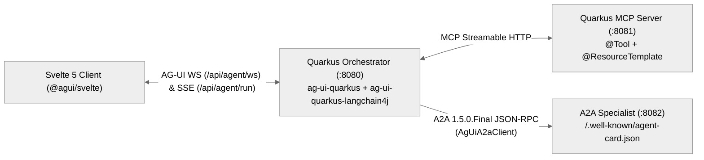

<div align="center">

<picture>
  <source media="(prefers-color-scheme: dark)" srcset="docs/logo-dark.svg">
  
</picture>

# Quarkus AG-UI

**Bring real-time, stateful AI agents to Quarkus, LangChain4j, and Svelte 5 using open protocols (`AG-UI` + `MCP` + `A2A`).**

[](.github/workflows/sdlc-quality-gate.yml)
[](./CHANGELOG.md)
[](./LICENSE)
[](./wiki/Home.md)

[Why Quarkus AG-UI?](#why-quarkus-ag-ui) · [How It Works](#how-it-works) · [Modules](#module-overview) · [Quickstart](#quickstart) · [Docs](#documentation--roadmap) · [Contributing](#contributing--license)

</div>

## Why Quarkus AG-UI?

Modern AI agents do far more than stream plain chat text—they call external tools, delegate work to specialist agents, synchronize live application state, render rich UI cards, and pause for human approval. On the JVM, teams usually end up hand-rolling custom SSE or WebSocket JSON envelopes, duplicating protocol DTOs, or coupling HTTP transport directly to a single LLM library.

**Quarkus AG-UI** eliminates that custom streaming glue. It provides focused, modular **Java 17** adapters built directly on the official [AG-UI Java SDK](https://github.com/ag-ui-protocol/ag-ui) (`com.ag-ui.community`) alongside a headless **Svelte 5 Runes** SDK (`@agui/svelte`) built on [`@ag-ui/client`](https://www.npmjs.com/package/@ag-ui/client), uniting agent-to-user streaming, tool access, and multi-agent delegation into one cohesive stack:

- ⚡ **Sub-10ms Reactive Streaming & GraalVM Native** — Streams canonical AG-UI events over SmallRye Mutiny SSE or full-duplex Quarkus WebSockets Next, backed by auto-configured Jackson MixIns and a 57-type GraalVM reflection config (`< 50MB` native RSS) with zero custom Quarkus `-deployment` build-time overhead.
- 🧩 **Three Open Protocols, Clear Boundaries** — Combines **AG-UI** (agent-to-user interaction), **MCP** (Model Context Protocol tools & resources), and **A2A `1.5.0.Final`** (agent-to-agent discovery & task delegation) without proprietary wire formats.
- 🎨 **Stateful Generative UI & Human-in-the-Loop** — Synchronizes live client state via RFC 6902 JSON Patch (`STATE_DELTA`), projects typed interactive UI surfaces (`ACTIVITY_SNAPSHOT`), and pauses/resumes sensitive actions via native HITL `Interrupt` flows.
- 🔒 **Orthogonal Clean Architecture** — Pull in only the adapters your service needs (`Quarkus`, plain `LangChain4j`, `Quarkus LangChain4j`, `A2A`, or `@agui/svelte`), governed by strict inward-pointing package boundaries and zero duplicated upstream POJOs.

## How It Works

In a Tri-Protocol application, each open specification handles one distinct boundary of an agent turn while **Quarkus AG-UI** translates everything into a single reactive event stream for the user interface:



1. **Agent <-> User (`AG-UI`)**: The browser sends a canonical `RunAgentInput` turn (or HITL resume payload) over WebSockets or HTTP POST and receives live token deltas, reasoning steps, `ACTIVITY_SNAPSHOT` cards, and RFC 6902 `STATE_DELTA` patches.
2. **Agent <-> Tools & Resources (`MCP`)**: The orchestrator invokes domain `@Tool` endpoints and URI `@ResourceTemplate`s over MCP Streamable HTTP, surfacing tool arguments, results, and provenance directly on the AG-UI timeline.
3. **Agent <-> Specialist Agents (`A2A`)**: `AgUiA2aClient` resolves remote `AgentCard` metadata (`/.well-known/agent-card.json`), delegates structured tasks over JSON-RPC 2.0 / SSE, and maps remote artifacts into AG-UI `STEP_*` and activity events.

### Module Overview

| Module | Target | When to Use It |
| :--- | :--- | :--- |
| [`ag-ui-bom`](ag-ui-bom/pom.xml) | Maven BOM | Aligns versions across `org.agui:0.2.0`, `com.ag-ui.community:0.1.1` & `a2a-java-sdk-bom:1.5.0.Final` |
| [`ag-ui-quarkus`](ag-ui-quarkus/pom.xml) | Java 17 | Exposing AG-UI over Quarkus Mutiny SSE (`AgUiQuarkusBridge`) or WebSockets (`AgUiWebSocketHandler`) + GraalVM native |
| [`ag-ui-langchain4j`](ag-ui-langchain4j/pom.xml) | Java 17 | Adapting standard `dev.langchain4j` `TokenStream`s, RFC 6902 state patches, activities & HITL interrupts on any JVM |
| [`ag-ui-quarkus-langchain4j`](ag-ui-quarkus-langchain4j/pom.xml) | Java 17 | Bridging Quarkiverse `@RegisterAiService` (`Multi<ChatEvent>`) directly into AG-UI event streams |
| [`ag-ui-a2a`](ag-ui-a2a/pom.xml) | Java 17 | Delegating tasks to official A2A `1.5.0.Final` specialist agents and mapping `Task`/`Artifact` updates to AG-UI |
| [`packages/agui-svelte`](packages/agui-svelte/package.json) | Svelte 5 / JS | Connecting a Svelte 5 Runes or JS frontend via `WebSocketAgent`, `HttpAgent`, `createAgUiStore` & activity registries |
| [`examples/quarkus-svelte-skeleton`](examples/quarkus-svelte-skeleton/README.md) | Java 25 + SPA | Exploring the full 3-service **Nomad Concierge** Tri-Protocol reference app (`:8080`, `:8081`, `:8082`) |

## Quickstart

> [!TIP]
> **Want to explore a working app before writing code?** Run `./examples/quarkus-svelte-skeleton/run-showcase.sh --docker` to launch the complete 3-service **Nomad Cultural & Architectural Concierge** on `http://localhost:8080` (see the [Showcase Guide](./examples/quarkus-svelte-skeleton/README.md)), or follow the three steps below to add Quarkus AG-UI to your own project.

### 1. Install Dependencies

Import `org.agui:ag-ui-bom` in your Maven `pom.xml` (Java 17+) and add `@agui/svelte` to your frontend workspace:

```xml
<dependencyManagement>
    <dependencies>
        <dependency>
            <groupId>org.agui</groupId>
            <artifactId>ag-ui-bom</artifactId>
            <version>0.2.0</version>
            <type>pom</type>
            <scope>import</scope>
        </dependency>
    </dependencies>
</dependencyManagement>

<dependencies>
    <dependency><groupId>org.agui</groupId><artifactId>ag-ui-quarkus</artifactId></dependency>
    <dependency><groupId>org.agui</groupId><artifactId>ag-ui-quarkus-langchain4j</artifactId></dependency>
    <dependency><groupId>org.agui</groupId><artifactId>ag-ui-a2a</artifactId></dependency>
</dependencies>
```

```bash
pnpm add @agui/svelte @ag-ui/client @ag-ui/core
```

### 2. Stream an Agent from Quarkus

Inject `AgUiQuarkusLangChain4jBridge` to adapt a reactive `@RegisterAiService` (`Multi<ChatEvent>`) into canonical AG-UI Server-Sent Events (or pair an `Agent` with `AgUiWebSocketHandler` for full-duplex WebSockets):

```java
import com.agui.community.core.agent.RunAgentInput;
import io.smallrye.mutiny.Multi;
import jakarta.inject.Inject;
import jakarta.ws.rs.*;
import jakarta.ws.rs.core.MediaType;
import org.agui.langchain4j.adapters.AgUiRunOptions;
import org.agui.quarkus.langchain4j.adapters.AgUiQuarkusLangChain4jBridge;

@Path("/api/agent")
public class ConciergeResource {
    @Inject AgUiQuarkusLangChain4jBridge bridge;
    @Inject ConciergeAiService ai; // @RegisterAiService returning Multi<ChatEvent>

    @POST @Path("/run") @Produces(MediaType.SERVER_SENT_EVENTS)
    public Multi<String> stream(RunAgentInput input) {
        return bridge.adaptToSse(input.threadId(), ai.chat(input.threadId(), extractUserPrompt(input)),
            AgUiRunOptions.builder().runId(input.runId()).build());
    }
}
```

### 3. Connect a Svelte 5 Client

Create a reactive AG-UI store over WebSockets (or `HttpAgent` over SSE) and trigger a streaming turn:

```javascript
import { WebSocketAgent, AGUI_ACTIVITY_TYPES, createAgUiStore, createActivityRegistry } from '@agui/svelte';

const agent = new WebSocketAgent({ url: 'ws://localhost:8080/api/agent/ws', threadId: 'thread-1' });
const store = createAgUiStore({ agent, threadId: 'thread-1' });
const activities = createActivityRegistry().register(AGUI_ACTIVITY_TYPES.WEATHER, 'WeatherCard');

await store.runAgent('Plan a 4-night architecture and tea trip in Kyoto with a $2,400 USD budget', {
    forwardedProps: { llmMode: 'ollama:llama3.2:latest' }
});
```

Expected canonical AG-UI wire frames streamed back to the client:

```text
data: {"type":"RUN_STARTED","threadId":"thread-1","runId":"run-demo-1"}
data: {"type":"TOOL_CALL_START","toolCallId":"tc-1","toolCallName":"fetchCityWeather"}
data: {"type":"ACTIVITY_SNAPSHOT","messageId":"act-weather-kyoto","activityType":"agui:weather","content":{"city":"Kyoto"},"replace":true}
data: {"type":"STATE_DELTA","delta":[{"op":"replace","path":"/activeCity","value":"Kyoto"}]}
data: {"type":"TEXT_MESSAGE_CONTENT","messageId":"msg-1","delta":"Here is your 4-night Kyoto architectural itinerary..."}
data: {"type":"RUN_FINISHED","threadId":"thread-1","runId":"run-demo-1","outcome":"success"}
```

<details>
<summary><strong>Tri-Protocol Showcase CLI Recipes, Native Builds & Runtime Configuration</strong></summary>

### Run the Nomad Tri-Protocol Showcase

```bash
# Option A: Build & launch all 3 Jib containers (with SvelteKit 5 SPA bundled via Quarkus Quinoa on :8080)
./examples/quarkus-svelte-skeleton/run-showcase.sh --docker

# Option B: GraalVM / Mandrel native Jib containers (~25-45ms startup, <50MB RSS)
./examples/quarkus-svelte-skeleton/run-showcase.sh --docker-native

# Option C: Local Quarkus hot-reload dev mode (Quinoa auto-manages Vite on :8080)
./examples/quarkus-svelte-skeleton/run-showcase.sh --local
```

### Verify All Three Protocols from Your Terminal

```bash
# 1. MicroProfile SmallRye Readiness (:8080, :8081, :8082)
curl -s http://localhost:8080/q/health/ready | jq .
curl -s http://localhost:8081/q/health/ready | jq .
curl -s http://localhost:8082/q/health/ready | jq .

# 2. MCP Tools & City Dossier Resource (:8081/mcp + Companion REST Bridge)
curl -s http://localhost:8081/api/mcp/tools | jq .
curl -s http://localhost:8081/api/mcp/resources/city/Kyoto | jq .

# 3. Official A2A 1.5.0.Final AgentCard & JSON-RPC 2.0 SendMessage (:8082)
curl -s http://localhost:8082/.well-known/agent-card.json | jq .
curl -s -X POST http://localhost:8082/ \
  -H "Content-Type: application/json" \
  -H "A2A-Version: 1.0" \
  -d '{"jsonrpc":"2.0","id":"req-1","method":"SendMessage","params":{"message":{"role":"ROLE_USER","messageId":"msg-1","parts":[{"text":"Verify Paris advisory"},{"data":{"skillId":"verify-travel-advisory","city":"Paris","country":"France"}}]}}}' | jq .

# 4. Stream Canonical AG-UI SSE Events (:8080)
curl -N -X POST http://localhost:8080/api/agent/run \
  -H "Content-Type: application/json" \
  -d '{"threadId":"thread-demo-1","runId":"run-demo-1","state":{},"messages":[{"id":"u-1","role":"user","content":"Plan a 4-night architecture and tea trip in Kyoto with a $2,400 USD budget"}],"tools":[],"context":[],"forwardedProps":{"llmMode":"ollama:llama3.2:latest"}}'
```

### Key Runtime & Showcase Configuration

| Variable / Profile | Default | Description |
| :--- | :--- | :--- |
| `RESTCOUNTRIES_API_KEY` | `.env` | Bearer token for authenticated REST Countries v5 advisories (`api.restcountries.com`) on `a2a-server` |
| `QUARKUS_LANGCHAIN4J_OLLAMA_BASE_URL` | `http://localhost:11434` | Local Ollama endpoint for `@RegisterAiService` streaming (`llama3.2:latest`) |
| `AGUI_A2A_BASE_URL` | `http://localhost:8082` | Base URL resolved by `AgUiA2aClient` (`A2ACardResolver` + `VertxA2AHttpClient`) |
| `-Dnative` / `-Dnative-container` | JVM mode | Compiles portable GraalVM 25 native binary locally or via `ubi9-quarkus-mandrel-builder-image:jdk-25` |

</details>

## Documentation & Roadmap

- **Project Wiki (Diátaxis Suite)**: [`wiki/Home.md`](./wiki/Home.md) · [`Architecture`](./wiki/Architecture.md) · [`API & Skills Reference`](./wiki/Skills-Reference.md) · [`Traceability`](./wiki/Traceability.md) · [`Codebase Map`](./wiki/Codebase-Map.md)
- **Nomad Tri-Protocol Showcase Guide**: [`examples/quarkus-svelte-skeleton/README.md`](./examples/quarkus-svelte-skeleton/README.md)
- **AI Coding Agent Context**: [`llms.txt`](./llms.txt)
- **Constitution, Specs & Roadmap**: [`PRODUCT.md`](./PRODUCT.md) · [`PRD`](./docs/specs/PRD.md) · [`SRS`](./docs/specs/SRS.md) · [`C4 Architecture`](./docs/specs/C4_ARCHITECTURE.md) · [`KANBAN.md`](./docs/KANBAN.md) · [`DECISION_MAP.md`](./docs/DECISION_MAP.md)

## Contributing & License

Local development, Dual-Gate TDD (`>= 85%` coverage, `>= 80%` mutation score), GraalVM 25 native compilation, and pull request guidelines live in [`CONTRIBUTING.md`](./CONTRIBUTING.md).
Dual-licensed under the [Apache License, Version 2.0](./LICENSE) and [MIT License](./LICENSE-MIT).
