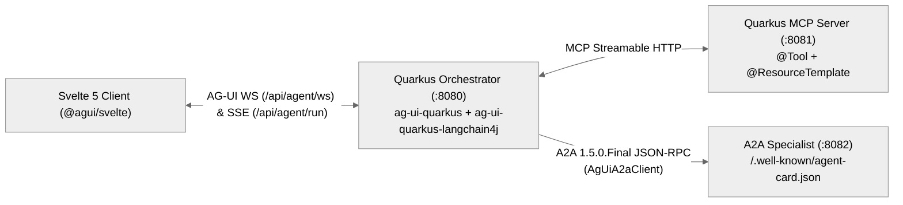

<div align="center">

<picture>
  <source media="(prefers-color-scheme: dark)" srcset="docs/logo-dark.svg">
  
</picture>

# Quarkus AG-UI

**Orthogonal Java 17 Quarkus, LangChain4j & A2A (`1.5.0.Final`) adapters plus a headless Svelte 5 Runes SDK for the AG-UI protocol.**

[](.github/workflows/sdlc-quality-gate.yml)
[](./CHANGELOG.md)
[](./LICENSE)
[](./wiki/Home.md)

[Quickstart](#quickstart) · [Why Quarkus AG-UI?](#why-quarkus-ag-ui) · [How It Works](#how-it-works) · [Docs](#documentation--roadmap) · [Contributing](#contributing--license)

</div>

```java
import com.agui.community.core.agent.RunAgentInput;
import io.smallrye.mutiny.Multi;
import jakarta.inject.Inject;
import jakarta.ws.rs.*;
import jakarta.ws.rs.core.MediaType;
import org.agui.langchain4j.adapters.AgUiRunOptions;
import org.agui.quarkus.langchain4j.adapters.AgUiQuarkusLangChain4jBridge;

@Path("/api/agent")
public class ConciergeResource {
    @Inject AgUiQuarkusLangChain4jBridge bridge;
    @Inject ConciergeAiService ai; // @RegisterAiService returning Multi<ChatEvent>

    @POST @Path("/run") @Produces(MediaType.SERVER_SENT_EVENTS)
    public Multi<String> stream(RunAgentInput input) {
        return bridge.adaptToSse(input.threadId(), ai.chat(input.threadId(), lastUserPrompt(input)),
            AgUiRunOptions.builder().runId(input.runId()).build());
    }
}
```

## Why Quarkus AG-UI?

Building interactive AI agent frontends on the JVM usually forces teams to hand-roll custom SSE/WebSocket JSON envelopes, duplicate upstream protocol POJOs, or lock HTTP transport directly into a single LLM framework. **Quarkus AG-UI** provides focused, `--release 17` adapters directly on top of the official [`com.ag-ui.community`](https://github.com/ag-ui-protocol/ag-ui) Java SDK (`0.1.1`) and [`@ag-ui/client`](https://www.npmjs.com/package/@ag-ui/client) (`^1.0.4`), paired with a Java 25 + Quarkus `3.40.1.1` **Tri-Protocol (`AG-UI + MCP + A2A`)** reference stack.

- ⚡ **Sub-10ms Streaming & GraalVM 25 Native** — Auto-configured Jackson MixIns (`@ag-ui/core` Zod-compatible), SmallRye Mutiny SSE, full-duplex Quarkus WebSockets Next (`AgUiWebSocketHandler`), and a 57-type GraalVM `reflect-config.json` (`< 50MB` native RSS) with zero `-deployment` build-time overhead.
- 🔒 **Orthogonal Clean Architecture (`INV-03`, `INV-07`)** — Pull only the modules you need (`ag-ui-quarkus`, `ag-ui-langchain4j`, `ag-ui-quarkus-langchain4j`, `ag-ui-a2a`) governed by inward-pointing Archlens concentric rings (`adapters -> application -> domain`) and zero duplicate event POJOs.
- 🧩 **Tri-Protocol (`AG-UI + MCP + A2A`) & Svelte 5 Runes** — Bridges `@McpToolBox` tools, official A2A `1.5.0.Final` `AgentCard` / JSON-RPC delegation (`AgUiA2aClient`), RFC 6902 `STATE_DELTA` JSON Patches, `ACTIVITY_SNAPSHOT` UI surfaces, and native HITL `Interrupt` resume into headless `@agui/svelte`.

## Quickstart

> [!TIP]
> Launch the full 3-service **Nomad Tri-Protocol Showcase** (`:8080` Quinoa Svelte 5 Studio + Orchestrator, `:8081` MCP Server, `:8082` A2A Specialist) in one command with `./examples/quarkus-svelte-skeleton/run-showcase.sh --docker`, or wire the libraries directly into your own app below.

### 1. Install

Add `org.agui:ag-ui-bom` to your Maven `<dependencyManagement>` (Java 17+) and install `@agui/svelte` in your Svelte 5 / JS client:

```xml
<dependencyManagement>
    <dependencies>
        <dependency>
            <groupId>org.agui</groupId>
            <artifactId>ag-ui-bom</artifactId>
            <version>0.2.0</version>
            <type>pom</type>
            <scope>import</scope>
        </dependency>
    </dependencies>
</dependencyManagement>

<dependencies>
    <dependency><groupId>org.agui</groupId><artifactId>ag-ui-quarkus</artifactId></dependency>
    <dependency><groupId>org.agui</groupId><artifactId>ag-ui-quarkus-langchain4j</artifactId></dependency>
    <dependency><groupId>org.agui</groupId><artifactId>ag-ui-a2a</artifactId></dependency>
</dependencies>
```

```bash
pnpm add @agui/svelte @ag-ui/client @ag-ui/core
```

### 2. Minimal Working Example

Connect a Svelte 5 client over full-duplex WebSockets (with automatic SSE fallback) using `@agui/svelte`:

```javascript
import { WebSocketAgent, createAgUiStore, createActivityRegistry } from '@agui/svelte';

const agent = new WebSocketAgent({ url: 'ws://localhost:8080/api/agent/ws', threadId: 'thread-1' });
const activities = createActivityRegistry();
const store = createAgUiStore({ agent, activityRegistry: activities });

await store.runAgent('Plan a 4-night architecture and tea trip in Kyoto with a $2,400 USD budget', {
    forwardedProps: { llmMode: 'ollama:llama3.2:latest' }
});
```

Expected output (canonical AG-UI wire frames on `/api/agent/ws` or `POST /api/agent/run`):

```text
data: {"type":"RUN_STARTED","threadId":"thread-1","runId":"run-demo-1"}
data: {"type":"TOOL_CALL_START","toolCallId":"tc-1","toolCallName":"fetchCityWeather"}
data: {"type":"ACTIVITY_SNAPSHOT","messageId":"act-weather-kyoto","activityType":"agui:weather","content":{"city":"Kyoto"},"replace":true}
data: {"type":"STATE_DELTA","delta":[{"op":"replace","path":"/activeCity","value":"Kyoto"}]}
data: {"type":"TEXT_MESSAGE_CONTENT","messageId":"msg-1","delta":"Here is your 4-night Kyoto architectural itinerary..."}
data: {"type":"RUN_FINISHED","threadId":"thread-1","runId":"run-demo-1","outcome":"success"}
```

## How It Works



| Module | Target | Role & Key Capabilities |
| :--- | :--- | :--- |
| [`ag-ui-bom`](ag-ui-bom/pom.xml) | Maven BOM | Unified versions for `org.agui:0.2.0`, `com.ag-ui.community:0.1.1` & `a2a-java-sdk-bom:1.5.0.Final` |
| [`ag-ui-quarkus`](ag-ui-quarkus/pom.xml) | Java 17 | CDI Jackson MixIns, `AgUiQuarkusBridge` (Mutiny SSE), `AgUiWebSocketHandler` & 57-type GraalVM reflection |
| [`ag-ui-langchain4j`](ag-ui-langchain4j/pom.xml) | Java 17 | Framework-agnostic `TokenStream` & `Agent` adapter, RFC 6902 `AgUiStatePatch`, `ACTIVITY_SNAPSHOT` & HITL `Interrupt` |
| [`ag-ui-quarkus-langchain4j`](ag-ui-quarkus-langchain4j/pom.xml) | Java 17 | Quarkiverse `@RegisterAiService` (`Multi<ChatEvent>`) reactive bridge (`AgUiQuarkusLangChain4jBridge`) |
| [`ag-ui-a2a`](ag-ui-a2a/pom.xml) | Java 17 | Official A2A `1.5.0.Final` `AgUiA2aClient`, `A2aDelegationResult` & `AgUiA2aBridge` (`Step*` / `ActivitySnapshot`) |
| [`packages/agui-svelte`](packages/agui-svelte/package.json) | Svelte 5 / JS | Headless `HttpAgent`, `WebSocketAgent`, `createAgUiStore`, CWE-1321-safe `applyJsonPatch` & activity registry |
| [`examples/quarkus-svelte-skeleton`](examples/quarkus-svelte-skeleton/README.md) | Java 25 + SPA | Nomad Concierge 3-service showcase (`mcp-server :8081`, `a2a-server :8082`, `backend + Quinoa SPA :8080`) |

<details>
<summary><strong>Tri-Protocol Showcase CLI Recipes, Native Builds & Runtime Configuration</strong></summary>

### Run the Nomad Tri-Protocol Showcase

```bash
# Option A: Build & launch all 3 Jib containers (with SvelteKit 5 SPA bundled via Quarkus Quinoa on :8080)
./examples/quarkus-svelte-skeleton/run-showcase.sh --docker

# Option B: GraalVM / Mandrel native Jib containers (~25-45ms startup, <50MB RSS)
./examples/quarkus-svelte-skeleton/run-showcase.sh --docker-native

# Option C: Local Quarkus hot-reload dev mode (Quinoa auto-manages Vite on :8080)
./examples/quarkus-svelte-skeleton/run-showcase.sh --local
```

### Verify All Three Protocols from Your Terminal

```bash
# 1. MicroProfile SmallRye Readiness (:8080, :8081, :8082)
curl -s http://localhost:8080/q/health/ready | jq .
curl -s http://localhost:8081/q/health/ready | jq .
curl -s http://localhost:8082/q/health/ready | jq .

# 2. MCP Tools & City Dossier Resource (:8081/mcp + Companion REST Bridge)
curl -s http://localhost:8081/api/mcp/tools | jq .
curl -s http://localhost:8081/api/mcp/resources/city/Kyoto | jq .

# 3. Official A2A 1.5.0.Final AgentCard & JSON-RPC 2.0 SendMessage (:8082)
curl -s http://localhost:8082/.well-known/agent-card.json | jq .
curl -s -X POST http://localhost:8082/ \
  -H "Content-Type: application/json" \
  -H "A2A-Version: 1.0" \
  -d '{"jsonrpc":"2.0","id":"req-1","method":"SendMessage","params":{"message":{"role":"ROLE_USER","messageId":"msg-1","parts":[{"text":"Verify Paris advisory"},{"data":{"skillId":"verify-travel-advisory","city":"Paris","country":"France"}}]}}}' | jq .

# 4. Stream Canonical AG-UI SSE Events (:8080)
curl -N -X POST http://localhost:8080/api/agent/run \
  -H "Content-Type: application/json" \
  -d '{"threadId":"thread-demo-1","runId":"run-demo-1","state":{},"messages":[{"id":"u-1","role":"user","content":"Plan a 4-night architecture and tea trip in Kyoto with a $2,400 USD budget"}],"tools":[],"context":[],"forwardedProps":{"llmMode":"ollama:llama3.2:latest"}}'
```

### Key Runtime & Showcase Configuration

| Variable / Profile | Default | Description |
| :--- | :--- | :--- |
| `RESTCOUNTRIES_API_KEY` | `.env` | Bearer token for authenticated REST Countries v5 advisories (`api.restcountries.com`) on `a2a-server` |
| `QUARKUS_LANGCHAIN4J_OLLAMA_BASE_URL` | `http://localhost:11434` | Local Ollama endpoint for `@RegisterAiService` streaming (`llama3.2:latest`) |
| `AGUI_A2A_BASE_URL` | `http://localhost:8082` | Base URL resolved by `AgUiA2aClient` (`A2ACardResolver` + `VertxA2AHttpClient`) |
| `-Dnative` / `-Dnative-container` | JVM mode | Compiles portable GraalVM 25 native binary locally or via `ubi9-quarkus-mandrel-builder-image:jdk-25` |

</details>

## Documentation & Roadmap

- **Project Wiki (Diátaxis Suite)**: [`wiki/Home.md`](./wiki/Home.md) · [`Architecture`](./wiki/Architecture.md) · [`API & Skills Reference`](./wiki/Skills-Reference.md) · [`Traceability`](./wiki/Traceability.md) · [`Codebase Map`](./wiki/Codebase-Map.md)
- **Nomad Tri-Protocol Showcase Guide**: [`examples/quarkus-svelte-skeleton/README.md`](./examples/quarkus-svelte-skeleton/README.md)
- **AI Coding Agent Context**: [`llms.txt`](./llms.txt)
- **Constitution, Specs & Roadmap**: [`PRODUCT.md`](./PRODUCT.md) · [`PRD`](./docs/specs/PRD.md) · [`SRS`](./docs/specs/SRS.md) · [`C4 Architecture`](./docs/specs/C4_ARCHITECTURE.md) · [`KANBAN.md`](./docs/KANBAN.md) · [`DECISION_MAP.md`](./docs/DECISION_MAP.md)

## Contributing & License

Local development, Dual-Gate TDD (`>= 85%` coverage, `>= 80%` mutation score), GraalVM 25 native compilation, and pull request guidelines live in [`CONTRIBUTING.md`](./CONTRIBUTING.md).
Dual-licensed under the [Apache License, Version 2.0](./LICENSE) and [MIT License](./LICENSE-MIT).
