# 🗺️ Causal Decision Graph & Architecture Lineage (`DECISION_MAP.md`)

> **Auto-Generated by Agentic SDLC Engine**: Tracks how product capabilities (`PRODUCT.md`), specifications, tickets, and Spec-Drift ADRs evolved into the current system state.

---

## 🧬 Causal Decision Lineage Graph

```mermaid
flowchart TD
  INV_01["INV-01: Zero direct commits, merges, or pushes to main or develop; 100% of changes flow via tracked ticket branches and Stage 7 SHA-256 Merkle Gate Receipts."]
  INV_02["INV-02: Dual-Gate TDD Craftsmanship: >= 85% line and branch diff coverage AND >= 80% mutation kill score (PITest / Stryker) adhering to Robert C. Martin Three Laws of TDD."]
  INV_03["INV-03: Clean Architecture Concentric Layer Governance (Archlens): Dependencies strictly point inward (Adapters -> Application -> Domain Core) with zero domain leaks."]
  INV_04["INV-04: Zero-Dependency Core Library: ag-ui-core must remain plain Java 25 records, stream adapters, and formatters without Quarkus or web framework dependencies."]
  INV_05["INV-05: Sub-10ms Serialization Overhead: Java core AG-UI event processing and SSE framing must add < 10ms p99 latency overhead."]
  INV_06["INV-06: Portable GraalVM 25 Native Footprint: Native executable compiled with quarkus-ag-ui (-Dnative local GraalVM 25 or Mandrel JDK 25 container fallback) must maintain < 50MB RSS baseline memory footprint."]
  INV_07["INV-07: Zero-Configuration Extension Defaults: Importing quarkus-ag-ui auto-configures Jackson, RESTEasy Reactive text/event-stream SSE bindings, and LangChain4j/MCP/A2A bridges under Apache License 2.0."]
  INV_08["INV-08: Modern Frontend & Toolchain Standards: Java 25 + Quarkus 3.40.1.1 via ./mvnw on backend; pnpm + Svelte 5 Runes + @skeletonlabs/skeleton-svelte + @lucide/svelte (zero deprecated modules) on frontend."]
  CAP_01["CAP-01: Wave 1 — Quarkus MCP Server (:8081) & Quarkus A2A Server (:8082)"]
  SPEC_01["SPEC-01 (docs/specs/cap-01-mcp-a2a-servers.md)"]
  CAP_02["CAP-02: Wave 1 — OpsPilot Orchestrator (:8080) & SvelteKit/Skeleton Baseline UI (:5173)"]
  SPEC_02["SPEC-02 (docs/specs/cap-02-orchestrator-svelte-baseline.md)"]
  CAP_03["CAP-03: Wave 2 — Full In-Place AG-UI Protocol Engine in Showcase Backend (:8080)"]
  SPEC_03["SPEC-03 (docs/specs/cap-03-inplace-agui-backend.md)"]
  CAP_04["CAP-04: Wave 2 — Full AG-UI SvelteKit + Skeleton UI Workbench (:5173)"]
  SPEC_04["SPEC-04 (docs/specs/cap-04-svelte-agui-workbench.md)"]
  CAP_05["CAP-05: Wave 3 — Extract Plain Java 25 Zero-Dependency Library (ag-ui-core)"]
  SPEC_05["SPEC-05 (docs/specs/cap-05-extract-agui-core.md)"]
  CAP_06["CAP-06: Wave 4 — Extract Quarkus AG-UI Runtime & Bridges (quarkus-ag-ui)"]
  SPEC_06["SPEC-06 (docs/specs/cap-06-extract-quarkus-runtime.md)"]
  CAP_07["CAP-07: Wave 4 — Quarkus AG-UI Deployment Processor, GraalVM 25 Reflection & Dev UI"]
  SPEC_07["SPEC-07 (docs/specs/cap-07-extract-quarkus-deployment-it.md)"]
  CAP_08["CAP-08: Wave 4 — Migrate Showcase to quarkus-ag-ui Extension, Benchmarks & Native Verification"]
  SPEC_08["SPEC-08 (docs/specs/cap-08-migrate-showcase-e2e-benchmarks.md)"]
  ADR_001["ADR-001: Multi-Module Maven & SvelteKit Clean Architecture for AG-UI Protocol"]
  _1["Ticket #1 (feature/issue-#1-product-genesis)"]
  ADR_002["ADR-002: Example-First Tri-Protocol (AG-UI + MCP + A2A) Evolution on Java 25, Quarkus 3.40.1.1 & pnpm"]
  _2["Ticket #2"]
  CAP_01 -->|specified_by| SPEC_01
  CAP_02 -->|specified_by| SPEC_02
  CAP_01 -->|depends_on| CAP_02
  CAP_03 -->|specified_by| SPEC_03
  CAP_02 -->|depends_on| CAP_03
  CAP_04 -->|specified_by| SPEC_04
  CAP_02 -->|depends_on| CAP_04
  CAP_05 -->|specified_by| SPEC_05
  CAP_03 -->|depends_on| CAP_05
  CAP_04 -->|depends_on| CAP_05
  CAP_06 -->|specified_by| SPEC_06
  CAP_05 -->|depends_on| CAP_06
  CAP_07 -->|specified_by| SPEC_07
  CAP_06 -->|depends_on| CAP_07
  CAP_08 -->|specified_by| SPEC_08
  CAP_07 -->|depends_on| CAP_08
  _1 -->|triggered_drift_adr| ADR_001
  CAP_01 -.->|ADR Drift| ADR_001
  CAP_03 -.->|ADR Drift| ADR_001
  CAP_04 -.->|ADR Drift| ADR_001
  CAP_07 -.->|ADR Drift| ADR_001
  _2 -->|triggered_drift_adr| ADR_002
  CAP_01 -.->|ADR Drift| ADR_002
  CAP_02 -.->|ADR Drift| ADR_002
  CAP_03 -.->|ADR Drift| ADR_002
  CAP_04 -.->|ADR Drift| ADR_002
  CAP_05 -.->|ADR Drift| ADR_002
  CAP_06 -.->|ADR Drift| ADR_002
  CAP_07 -.->|ADR Drift| ADR_002
  CAP_08 -.->|ADR Drift| ADR_002
  CAP_01 -->|realized_by| CAP_02
  CAP_01 -->|realized_by| CAP_03
  CAP_02 -->|realized_by| CAP_03
  CAP_01 -->|realized_by| CAP_04
  CAP_02 -->|realized_by| CAP_04
  CAP_03 -->|realized_by| CAP_05
  CAP_04 -->|realized_by| CAP_05
  CAP_03 -->|realized_by| CAP_06
  CAP_04 -->|realized_by| CAP_06
  CAP_01 -->|realized_by| CAP_07
  CAP_02 -->|realized_by| CAP_07
  CAP_05 -->|realized_by| CAP_08
  CAP_06 -->|realized_by| CAP_08
  CAP_07 -->|realized_by| CAP_08
  _1 -.->|ADR Drift| ADR_001
  _2 -.->|ADR Drift| ADR_002
  CAP_01 -->|realized_by| ADR_002
  CAP_02 -->|realized_by| ADR_002
  CAP_03 -->|realized_by| ADR_002
  CAP_04 -->|realized_by| ADR_002
  CAP_05 -->|realized_by| ADR_002
  CAP_06 -->|realized_by| ADR_002
  CAP_07 -->|realized_by| ADR_002
  CAP_08 -->|realized_by| ADR_002
```

---

## ⚡ Spec Drift & ADR Pivot Ledger

| ADR ID | Decision Title | Scope | Status | Triggered By | Supersedes / Amends |
| :--- | :--- | :--- | :--- | :--- | :--- |
| **ADR-001** | Multi-Module Maven & SvelteKit Clean Architecture for AG-UI Protocol | `technical` | `accepted` | #1 | CAP-01, CAP-03, CAP-04, CAP-07 |
| **ADR-002** | Example-First Tri-Protocol (AG-UI + MCP + A2A) Evolution on Java 25, Quarkus 3.40.1.1 & pnpm | `product` | `accepted` | #2 | CAP-01, CAP-02, CAP-03, CAP-04, CAP-05, CAP-06, CAP-07, CAP-08 |

---

## 🎯 Product Capability Realization Matrix

| Capability ID | Description | Current Status |
| :--- | :--- | :--- |
| **CAP-01** | Wave 1 — Quarkus MCP Server (`:8081`) & Quarkus A2A Server (`:8082`) | `IMPLEMENTED` |
| **CAP-02** | Wave 1 — OpsPilot Orchestrator (`:8080`) & SvelteKit/Skeleton Baseline UI (`:5173`) | `PLANNED` |
| **CAP-03** | Wave 2 — Full In-Place AG-UI Protocol Engine in Showcase Backend (`:8080`) | `PLANNED` |
| **CAP-04** | Wave 2 — Full AG-UI SvelteKit + Skeleton UI Workbench (`:5173`) | `PLANNED` |
| **CAP-05** | Wave 3 — Extract Plain Java 25 Zero-Dependency Library (`ag-ui-core`) | `PLANNED` |
| **CAP-06** | Wave 4 — Extract Quarkus AG-UI Runtime & Bridges (`quarkus-ag-ui`) | `PLANNED` |
| **CAP-07** | Wave 4 — Quarkus AG-UI Deployment Processor, GraalVM 25 Reflection & Dev UI | `PLANNED` |
| **CAP-08** | Wave 4 — Migrate Showcase to `quarkus-ag-ui` Extension, Benchmarks & Native Verification | `PLANNED` |
