# 🗺️ Causal Decision Graph & Architecture Lineage (`DECISION_MAP.md`)

> **Auto-Generated by Agentic SDLC Engine**: Tracks how product capabilities (`PRODUCT.md`), specifications, tickets, and Spec-Drift ADRs evolved into the current system state.

---

## 🧬 Causal Decision Lineage Graph

```mermaid
flowchart TD
  INV_01["INV-01: Zero direct commits, merges, or pushes to main or develop; 100% of changes flow via tracked ticket branches and Stage 7 SHA-256 Merkle Gate Receipts."]
  INV_02["INV-02: Dual-Gate TDD Craftsmanship: >= 85% line and branch diff coverage AND >= 80% mutation kill score (PITest / Stryker) adhering to Robert C. Martin Three Laws of TDD."]
  INV_03["INV-03: Clean Architecture Concentric Layer Governance (Archlens): Dependencies strictly point inward (Adapters -> Application -> Domain Core) with zero domain leaks."]
  INV_04["INV-04: Upstream Protocol Fidelity & Java 17 Library Baseline (`ADR-007`): Reusable library modules (`ag-ui-quarkus`, `ag-ui-langchain4j`, `ag-ui-quarkus-langchain4j`, `ag-ui-a2a`) adopt upstream `com.ag-ui.community:{java-core,java-server}:0.1.1` compiled with `--release 17` and zero duplicate event POJOs."]
  INV_05["INV-05: Sub-10ms Serialization Overhead: AG-UI Jackson MixIn serialization and SSE/WebSocket framing must add < 10ms p99 latency overhead."]
  INV_06["INV-06: Portable GraalVM 25 Native Footprint: Native executable compiled with `ag-ui-quarkus` (`-Dnative` local GraalVM 25 or Mandrel JDK 25 container fallback) must maintain < 50MB RSS baseline memory footprint."]
  INV_07["INV-07: Orthogonal Zero-Boilerplate Quarkus Adapters (`ADR-007`): Importing `ag-ui-quarkus` auto-configures `ObjectMapperCustomizer` MixIns, RESTEasy Reactive SSE bindings, reusable `AgUiWebSocketHandler`, and GraalVM `reflect-config.json` without pulling LangChain4j; `ag-ui-quarkus-langchain4j` bridges `Multi<ChatEvent>`; dual-licensed as `Apache-2.0 OR MIT`."]
  INV_08["INV-08: Modern Multi-Release & Frontend Toolchain Standards: Java 17 for reusable libraries and Java 25 + Quarkus 3.40.1.1 for `examples/quarkus-svelte-skeleton` via `./mvnw`; `pnpm` workspaces + headless `@agui/svelte` (`@ag-ui/client` + `@ag-ui/core`) + Svelte 5 Runes + `@skeletonlabs/skeleton-svelte` + `@lucide/svelte` on frontend."]
  CAP_01["CAP-01: AG-UI Core Event Schema & Payload Records (ag-ui-core)"]
  SPEC_01["SPEC-01 (docs/specs/cap-01-mcp-a2a-servers.md)"]
  CAP_02["CAP-02: AG-UI SSE Frame Formatter & Flow.Publisher Reactive Adapters (ag-ui-core)"]
  SPEC_02["SPEC-02 (docs/specs/cap-02-orchestrator-svelte-baseline.md)"]
  CAP_03["CAP-03: Quarkus AG-UI Runtime & LangChain4j TokenStream/Tool Bridge (quarkus-ag-ui-runtime)"]
  SPEC_03["SPEC-03 (docs/specs/cap-03-inplace-agui-backend.md)"]
  CAP_04["CAP-04: Quarkus AG-UI Deployment Processor, GraalVM Reflection & Dev UI Inspector (quarkus-ag-ui-deployment)"]
  SPEC_04["SPEC-04 (docs/specs/cap-04-svelte-agui-workbench.md)"]
  CAP_05["CAP-05: Quarkus AG-UI Extension JVM & GraalVM Native Integration Test Suite (quarkus-ag-ui-integration-tests)"]
  SPEC_05["SPEC-05 (docs/specs/cap-05-extract-agui-core.md)"]
  CAP_06["CAP-06: Reference Quarkus + LangChain4j Agent Backend (examples/quarkus-svelte-skeleton)"]
  SPEC_06["SPEC-06 (docs/specs/cap-06-extract-quarkus-runtime.md)"]
  CAP_07["CAP-07: Reference SvelteKit + Skeleton UI Streaming Client (examples/quarkus-svelte-skeleton)"]
  SPEC_07["SPEC-07 (docs/specs/cap-07-extract-quarkus-deployment-it.md)"]
  CAP_08["CAP-08: Full-Stack E2E Verification, Performance Benchmarks & Developer Showcase"]
  SPEC_08["SPEC-08 (docs/specs/cap-08-migrate-showcase-e2e-benchmarks.md)"]
  ADR_001["ADR-001: Multi-Module Maven & SvelteKit Clean Architecture for AG-UI Protocol"]
  _1["Ticket #1 (feature/issue-#1-product-genesis)"]
  ADR_002["ADR-002: Example-First Tri-Protocol (AG-UI + MCP + A2A) Evolution on Java 25, Quarkus 3.40.1.1 & pnpm"]
  _2["Ticket #2 (feature/issue-#2-mcp-a2a-servers-and-adr-002)"]
  ADR_003["ADR-003: Multi-Extension BOM and Concentric Transport Architecture (Core, SSE, WebSockets)"]
  _30["Ticket #30 (feat/bom-multi-extension-clean-arch)"]
  ADR_004["ADR-004: ADR-004: Nomad Cultural Concierge Showcase & Modular Svelte 5 AG-UI Component Kit"]
  ADR_005["ADR-005: ADR-005: Quarkus LangChain4j Reactive AG-UI Bridge, Declarative `@McpToolBox` & SmallRye Health + REST Countries v5"]
  ADR_006["ADR-006: Framework-Agnostic Module Topology (ag-ui-core, ag-ui-a2a, ag-ui-langchain4j, ag-ui-quarkus) and Removal of Quarkus Deployment Processors"]
  _74["Ticket #74"]
  ADR_007["ADR-007: Adopt Upstream AG-UI SDKs (com.ag-ui.community & @ag-ui/client) and Orthogonal Java 17 Quarkus Modules"]
  _81["Ticket #81 (feature/issue-#81-adopt-upstream-ag-ui-java-sdks)"]
  __9450["##9450"]
  _66["Ticket #66 (feature/issue-#66-nomad-travel-chatbot-mcp-health)"]
  _68["Ticket #68 (feature/issue-#68-quarkus-langchain4j-mcp-v5)"]
  _72["Ticket #72 (fix/issue-#72-healthcheck-ttl-and-tool-prompts)"]
  _70["Ticket #70 (chore/issue-#70-sync-develop-kanban-state)"]
  CAP_01 -->|specified_by| SPEC_01
  CAP_02 -->|specified_by| SPEC_02
  CAP_01 -->|depends_on| CAP_02
  CAP_03 -->|specified_by| SPEC_03
  CAP_02 -->|depends_on| CAP_03
  CAP_04 -->|specified_by| SPEC_04
  CAP_02 -->|depends_on| CAP_04
  CAP_05 -->|specified_by| SPEC_05
  CAP_03 -->|depends_on| CAP_05
  CAP_04 -->|depends_on| CAP_05
  CAP_06 -->|specified_by| SPEC_06
  CAP_05 -->|depends_on| CAP_06
  CAP_07 -->|specified_by| SPEC_07
  CAP_06 -->|depends_on| CAP_07
  CAP_08 -->|specified_by| SPEC_08
  CAP_07 -->|depends_on| CAP_08
  _1 -->|triggered_drift_adr| ADR_001
  CAP_01 -.->|ADR Drift| ADR_001
  CAP_03 -.->|ADR Drift| ADR_001
  CAP_04 -.->|ADR Drift| ADR_001
  CAP_07 -.->|ADR Drift| ADR_001
  _2 -->|triggered_drift_adr| ADR_002
  CAP_01 -.->|ADR Drift| ADR_002
  CAP_02 -.->|ADR Drift| ADR_002
  CAP_03 -.->|ADR Drift| ADR_002
  CAP_04 -.->|ADR Drift| ADR_002
  CAP_05 -.->|ADR Drift| ADR_002
  CAP_06 -.->|ADR Drift| ADR_002
  CAP_07 -.->|ADR Drift| ADR_002
  CAP_08 -.->|ADR Drift| ADR_002
  _30 -->|triggered_drift_adr| ADR_003
  CAP_06 -.->|ADR Drift| ADR_003
  CAP_07 -.->|ADR Drift| ADR_003
  _74 -->|triggered_drift_adr| ADR_006
  CAP_06 -.->|ADR Drift| ADR_006
  CAP_07 -.->|ADR Drift| ADR_006
  ADR_003 -.->|ADR Drift| ADR_006
  _81 -->|triggered_drift_adr| ADR_007
  CAP_05 -.->|ADR Drift| ADR_007
  CAP_06 -.->|ADR Drift| ADR_007
  ADR_006 -.->|ADR Drift| ADR_007
  CAP_01 -->|realized_by| CAP_02
  CAP_01 -->|realized_by| CAP_03
  CAP_02 -->|realized_by| CAP_03
  CAP_01 -->|realized_by| CAP_04
  CAP_02 -->|realized_by| CAP_04
  CAP_03 -->|realized_by| CAP_05
  CAP_04 -->|realized_by| CAP_05
  CAP_03 -->|realized_by| CAP_06
  CAP_04 -->|realized_by| CAP_06
  CAP_01 -->|realized_by| CAP_07
  CAP_02 -->|realized_by| CAP_07
  CAP_05 -->|realized_by| CAP_08
  CAP_06 -->|realized_by| CAP_08
  CAP_07 -->|realized_by| CAP_08
  _1 -.->|ADR Drift| ADR_001
  _2 -.->|ADR Drift| ADR_002
  CAP_01 -->|realized_by| ADR_002
  CAP_02 -->|realized_by| ADR_002
  CAP_03 -->|realized_by| ADR_002
  CAP_04 -->|realized_by| ADR_002
  CAP_05 -->|realized_by| ADR_002
  CAP_06 -->|realized_by| ADR_002
  CAP_07 -->|realized_by| ADR_002
  CAP_08 -->|realized_by| ADR_002
  _30 -.->|ADR Drift| ADR_003
  __9450 -.->|ADR Drift| ADR_006
  _81 -.->|ADR Drift| ADR_007
```

---

## ⚡ Spec Drift & ADR Pivot Ledger

| ADR ID | Decision Title | Scope | Status | Triggered By | Supersedes / Amends |
| :--- | :--- | :--- | :--- | :--- | :--- |
| **ADR-001** | Multi-Module Maven & SvelteKit Clean Architecture for AG-UI Protocol | `technical` | `accepted` | #1 | CAP-01, CAP-03, CAP-04, CAP-07 |
| **ADR-002** | Example-First Tri-Protocol (AG-UI + MCP + A2A) Evolution on Java 25, Quarkus 3.40.1.1 & pnpm | `product` | `accepted` | #2 | CAP-01, CAP-02, CAP-03, CAP-04, CAP-05, CAP-06, CAP-07, CAP-08 |
| **ADR-003** | Multi-Extension BOM and Concentric Transport Architecture (Core, SSE, WebSockets) | `technical` | `accepted` | #30 | CAP-06, CAP-07 |
| **ADR-004** | ADR-004: Nomad Cultural Concierge Showcase & Modular Svelte 5 AG-UI Component Kit | `technical` | `accepted` | N/A | None |
| **ADR-005** | ADR-005: Quarkus LangChain4j Reactive AG-UI Bridge, Declarative `@McpToolBox` & SmallRye Health + REST Countries v5 | `technical` | `accepted` | N/A | None |
| **ADR-006** | Framework-Agnostic Module Topology (ag-ui-core, ag-ui-a2a, ag-ui-langchain4j, ag-ui-quarkus) and Removal of Quarkus Deployment Processors | `technical` | `accepted` | #74 | CAP-06, CAP-07, ADR-003 |
| **ADR-007** | Adopt Upstream AG-UI SDKs (com.ag-ui.community & @ag-ui/client) and Orthogonal Java 17 Quarkus Modules | `technical` | `accepted` | #81 | CAP-05, CAP-06, ADR-006 |

---

## 🎯 Product Capability Realization Matrix

| Capability ID | Description | Current Status |
| :--- | :--- | :--- |
| **CAP-01** | AG-UI Core Event Schema & Payload Records (ag-ui-core) | `PLANNED` |
| **CAP-02** | AG-UI SSE Frame Formatter & Flow.Publisher Reactive Adapters (ag-ui-core) | `PLANNED` |
| **CAP-03** | Quarkus AG-UI Runtime & LangChain4j TokenStream/Tool Bridge (quarkus-ag-ui-runtime) | `PLANNED` |
| **CAP-04** | Quarkus AG-UI Deployment Processor, GraalVM Reflection & Dev UI Inspector (quarkus-ag-ui-deployment) | `PLANNED` |
| **CAP-05** | Quarkus AG-UI Extension JVM & GraalVM Native Integration Test Suite (quarkus-ag-ui-integration-tests) | `PLANNED` |
| **CAP-06** | Reference Quarkus + LangChain4j Agent Backend (examples/quarkus-svelte-skeleton) | `PLANNED` |
| **CAP-07** | Reference SvelteKit + Skeleton UI Streaming Client (examples/quarkus-svelte-skeleton) | `PLANNED` |
| **CAP-08** | Full-Stack E2E Verification, Performance Benchmarks & Developer Showcase | `PLANNED` |
