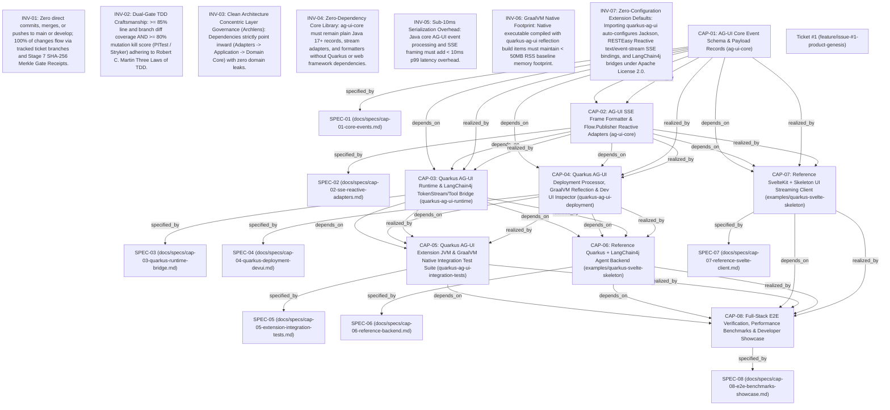

# 🗺️ Causal Decision Graph & Architecture Lineage (`DECISION_MAP.md`)

> **Auto-Generated by Agentic SDLC Engine**: Tracks how product capabilities (`PRODUCT.md`), specifications, tickets, and Spec-Drift ADRs evolved into the current system state.

---

## 🧬 Causal Decision Lineage Graph

---

## ⚡ Spec Drift & ADR Pivot Ledger

| ADR ID | Decision Title | Scope | Status | Triggered By | Supersedes / Amends |
| :--- | :--- | :--- | :--- | :--- | :--- |
| *None* | No architectural drift ADRs recorded yet | - | - | - | - |

---

## 🎯 Product Capability Realization Matrix

| Capability ID | Description | Current Status |
| :--- | :--- | :--- |
| **CAP-01** | AG-UI Core Event Schema & Payload Records (ag-ui-core) | `PLANNED` |
| **CAP-02** | AG-UI SSE Frame Formatter & Flow.Publisher Reactive Adapters (ag-ui-core) | `PLANNED` |
| **CAP-03** | Quarkus AG-UI Runtime & LangChain4j TokenStream/Tool Bridge (quarkus-ag-ui-runtime) | `PLANNED` |
| **CAP-04** | Quarkus AG-UI Deployment Processor, GraalVM Reflection & Dev UI Inspector (quarkus-ag-ui-deployment) | `PLANNED` |
| **CAP-05** | Quarkus AG-UI Extension JVM & GraalVM Native Integration Test Suite (quarkus-ag-ui-integration-tests) | `PLANNED` |
| **CAP-06** | Reference Quarkus + LangChain4j Agent Backend (examples/quarkus-svelte-skeleton) | `PLANNED` |
| **CAP-07** | Reference SvelteKit + Skeleton UI Streaming Client (examples/quarkus-svelte-skeleton) | `PLANNED` |
| **CAP-08** | Full-Stack E2E Verification, Performance Benchmarks & Developer Showcase | `PLANNED` |
