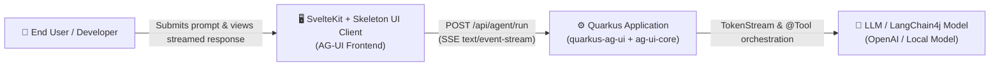
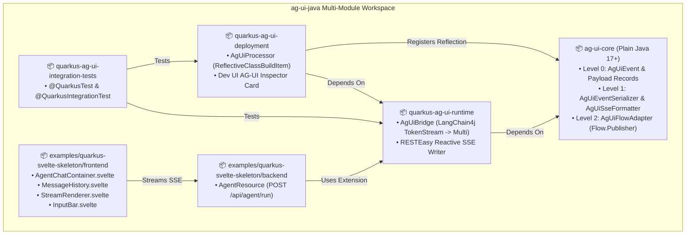
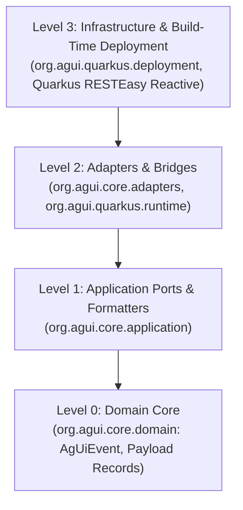

# C4 Architecture Specification: `quarkus-agui`

## 1. System Context Diagram (C4 Level 1)

## 2. Container & Module Diagram (C4 Level 2)

## 3. Clean Architecture Concentric Rings (Archlens Governance)

