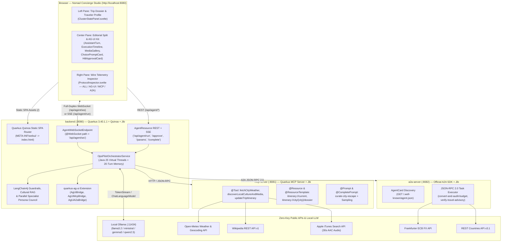
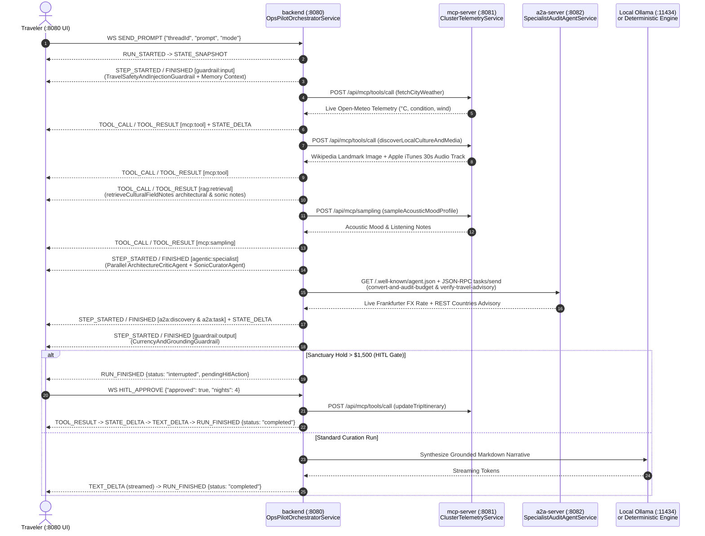

# 🧭 Nomad — Cultural & Architectural Concierge (`quarkus-svelte-skeleton`)

> **Reference Tri-Protocol (`AG-UI + MCP + A2A`) Showcase for `quarkus-agui`**  
> Built with **Java 25**, **Quarkus `3.40.1.1`**, **Quarkus LangChain4j (`1.15.0.CR1`)**, **Quarkus MCP Server (`2.1.0.Beta1`)**, **Official A2A Java SDK (`1.4.0.Final`)**, **Quarkus Quinoa (`2.9.3`)**, **Quarkus Container Image Jib (`3.40.1.1`)**, and a **SvelteKit 5 (Runes) + Skeleton UI v3 + GSAP** 3-Pane Workbench.

---

## 1. What This Module Does

`quarkus-svelte-skeleton` is a complete, production-grade reference application demonstrating how three open agentic protocols collaborate in real time inside a single cohesive developer experience:

1. **AG-UI (Agent–User Interaction Protocol — `:8080`)**: Streams fine-grained lifecycle, state synchronization (`STATE_SNAPSHOT`, `STATE_DELTA`), tool execution (`TOOL_CALL`, `TOOL_RESULT`), reasoning steps (`STEP_STARTED`, `STEP_FINISHED`), Human-in-the-Loop interrupts (`HitlApprovalCard`), and token deltas (`TEXT_DELTA`) between the Quarkus orchestrator and the Svelte 5 frontend over **Full-Duplex WebSockets (`/api/agent/ws`)** with automatic **SSE (`/api/agent/run`)** fallback.
2. **MCP (Model Context Protocol — `:8081`)**: Provides standardized domain tools (`@Tool`), URI resources (`@Resource`), parameterized resource templates (`@ResourceTemplate`), prompt templates (`@Prompt`), slash-command argument autocompletion (`@CompletePrompt`), and server-initiated LLM sampling (`mcp:sampling`) for live destination weather, architectural landmarks, and regional 30-second acoustic masters.
3. **A2A (Agent-to-Agent Protocol — `:8082`)**: Exposes an autonomous specialist auditor agent (`Nomad-A2A-Specialist`) discoverable via `GET /.well-known/agent.json` and invoked over JSON-RPC 2.0 (`POST /`) to perform multi-currency FX conversion (`convert-and-audit-budget`) and visa/safety advisory verification (`verify-travel-advisory`).

With **Quarkus Quinoa**, the SvelteKit 5 SPA (`@sveltejs/adapter-static`) is compiled and bundled directly into the `backend` Quarkus artifact (`META-INF/webui/`), so **port `:8080` serves both the Nomad Studio UI and all AG-UI REST/WebSocket endpoints from a single JVM or Jib container**.

---

## 2. System Architecture & Tri-Protocol Topology

### 2.1 High-Level Component Architecture



### 2.2 End-to-End Tri-Protocol Execution Sequence

Every concierge turn executes a deterministic or Ollama-backed 10-stage pipeline, emitting typed `callType` metadata so the UI renders distinct protocol badges (`MCP Tool`, `MCP Resource`, `MCP Sampling`, `Guardrail`, `Cultural RAG`, `Specialist`, `A2A Discovery`, `A2A Task`, `HITL Gate`):



---

## 3. Module Structure & Key Source Files

```text
examples/quarkus-svelte-skeleton/
├── pom.xml                          # Showcase parent POM (manages quarkus-quinoa, quarkus-container-image-jib, -Pnative profile)
├── docker-compose.yml               # 3-service Jib container stack (mcp-server :8081, a2a-server :8082, backend :8080)
├── run-showcase.sh                  # Unified launcher (--docker, --docker-native, --local)
├── mcp-server/                      # Port :8081 — Quarkus MCP Server
│   └── src/main/java/org/agui/showcase/mcp/
│       ├── ClusterTelemetryService.java   # @Tool, @Resource, @ResourceTemplate, @Prompt, @CompletePrompt, Sampling
│       ├── McpServerResource.java         # HTTP bridge (/api/mcp/tools, /resources/template, /prompts/complete, /sampling)
│       └── ServiceNodeStatus.java         # Destination dossier & itinerary domain record
├── a2a-server/                      # Port :8082 — Official A2A Specialist Server
│   └── src/main/java/org/agui/showcase/a2a/
│       ├── SentinelA2aAgentConfiguration.java # @Produces AgentCard (/.well-known/agent.json) & AgentExecutor
│       ├── SpecialistAuditAgentService.java   # Live Frankfurter FX & REST Countries v3.1 verification skills
│       └── A2aServerResource.java             # REST/JSON-RPC task inspection endpoints
├── backend/                         # Port :8080 — Quarkus Orchestrator + Quinoa SPA Host
│   └── src/main/java/org/agui/showcase/backend/
│       ├── AgentWebSocketEndpoint.java        # @WebSocket(path = "/api/agent/ws") full-duplex AG-UI endpoint
│       ├── AgentResource.java                 # REST + SSE endpoints (/api/agent/run, /approve, /params, /memory/reset)
│       ├── OpsPilotOrchestratorService.java   # Tri-Protocol orchestrator, 20-turn memory, guardrails, RAG, HITL
│       ├── NomadConciergeAiService.java       # @RegisterAiService LangChain4j declarative AI service
│       ├── McpGatewayClient.java              # HTTP client to mcp-server (:8081) with resilient fallbacks
│       └── A2aGatewayClient.java              # Official A2A JSON-RPC client to a2a-server (:8082)
└── frontend/                        # SvelteKit 5 (Runes) SPA packaged via Quarkus Quinoa
    ├── svelte.config.js             # @sveltejs/adapter-static (fallback: 'index.html' for Quinoa SPA routing)
    ├── src/lib/
    │   ├── agui-client.js           # Pure state reducer (reduceAgUiEvent), SSE parser, Markdown exporter
    │   ├── markdown.js              # Sanitized Markdown-to-HTML renderer with tabular-nums cost tables
    │   └── components/
    │       ├── AgentChatContainer.svelte  # Top-level 3-pane studio, WebSocket lifecycle, slash command palette
    │       ├── ClusterStatePanel.svelte   # Left pane: Trip Dossier, FX toggle, -/+ nights stepper, Traveler Profile
    │       ├── MessageHistory.svelte      # Center pane: Scrollable editorial conversation stream
    │       ├── InputBar.svelte            # Prompt composer with /, ⌘K, and MCP @CompletePrompt suggestions
    │       ├── ProtocolInspector.svelte   # Right pane: Live Wire Telemetry (OUT/IN direction, latency, JSON payloads)
    │       └── agui/                      # Reusable Svelte 5 AG-UI Component Kit
    │           ├── AssistantTurn.svelte           # Container-query (@container > 820px) 2-column editorial split
    │           ├── ExecutionTimeline.svelte       # 2-column collapsible Bento spine with GSAP stagger
    │           ├── ProtocolCallBadge.svelte       # Semantic badges for all 10 callType categories
    │           ├── MediaGallery.svelte            # 16:10 photo plate, top-layer <dialog> lightbox, 30s audio waveform
    │           ├── ChoicePromptCard.svelte        # Interactive single/multi-select concierge option cards
    │           ├── HitlApprovalCard.svelte        # Human-in-the-Loop sanctuary hold approval gate
    │           └── StructuredResponseBlock.svelte # Deep-linked Verified Sources & follow-up prompt chips
    └── tests/
        ├── agui-client.test.mjs     # Unit tests for AG-UI reducer, WebSocket frames, memory, and .md export
        ├── docker-compose.test.mjs  # Topology assertions for Quinoa, Jib, -Pnative, and docker-compose.yml
        └── markdown.test.mjs        # Unit tests for Markdown table & code block rendering
```

---

## 4. Feature Deep-Dive

### 4.1 Full-Duplex WebSockets (`/api/agent/ws`) & Sub-50ms State Sync
- [`AgentWebSocketEndpoint`](file:///Users/fady/workspace/labs/quarkus-agui/examples/quarkus-svelte-skeleton/backend/src/main/java/org/agui/showcase/backend/AgentWebSocketEndpoint.java) uses Quarkus WebSockets Next (`@WebSocket(path = "/api/agent/ws")`) to multiplex bidirectional JSON frames over a single persistent connection:
  - **Outbound Client Actions (`OUT` $\uparrow$)**: `SEND_PROMPT`, `UPDATE_TRIP_PARAMS` (clicking `- 4N +` or switching `USD`/`EUR`/`GBP` in the Trip Dossier updates budget math in `<50ms` without an LLM round-trip), `HITL_APPROVE`, `CANCEL_RUN`, `RESET_MEMORY`, and `PING`.
  - **Inbound Server Events (`IN` $\downarrow$)**: Standard AG-UI events (`RUN_STARTED`, `STATE_SNAPSHOT`, `TOOL_CALL`, `TOOL_RESULT`, `STEP_STARTED`, `STEP_FINISHED`, `STATE_DELTA`, `TEXT_DELTA`, `RUN_FINISHED`).
- If WebSockets are unavailable, [`AgentChatContainer.svelte`](file:///Users/fady/workspace/labs/quarkus-agui/examples/quarkus-svelte-skeleton/frontend/src/lib/components/AgentChatContainer.svelte) automatically falls back to `POST /api/agent/run` (`text/event-stream`).

### 4.2 Multi-Turn Conversational Memory & Traveler Profile Extraction
- [`OpsPilotOrchestratorService`](file:///Users/fady/workspace/labs/quarkus-agui/examples/quarkus-svelte-skeleton/backend/src/main/java/org/agui/showcase/backend/OpsPilotOrchestratorService.java) maintains a thread-safe 20-turn sliding window per `threadId` (`CONVERSATION_MEMORY`) and automatically extracts persistent traveler preferences (`Style`, `Dietary / Terroir`, `Sonic Mood`, `Home Currency`) into `TRAVELER_PREFERENCES`.
- Follow-up prompts like *"What should I pack for the current weather there?"* automatically resolve the active city from conversational memory even when the city name is omitted.

### 4.3 Quarkus LangChain4j Guardrails, Cultural RAG & Specialist Council
- **Input Guardrail (`guardrail:input`)**: Validates prompt safety, blocks prompt-injection patterns (`ignore previous instructions`, `system prompt`), and enriches the prompt with sliding-window memory context.
- **Cultural Field Notes RAG (`rag:retrieval`)**: Retrieves curated architectural and acoustic field notes (`Tadao Ando`, `Siza Vieira`, `Levantine limestone`, `Koto`, `Fado`, `Oud`) grounded to the destination.
- **Specialist Persona Council (`agentic:specialist`)**: Runs parallel `ArchitectureCriticAgent` and `SonicCuratorAgent` critiques before synthesizing the final itinerary.
- **Output Guardrail (`guardrail:output`)**: Verifies live FX rate grounding and destination source links before emitting `RUN_FINISHED`.

### 4.4 Wide-Resolution (`2560x1440`) Editorial Layout & Deep-Linked Sources
- On wide viewports (`@container turn-card (inline-size > 820px)`), [`AssistantTurn.svelte`](file:///Users/fady/workspace/labs/quarkus-agui/examples/quarkus-svelte-skeleton/frontend/src/lib/components/agui/AssistantTurn.svelte) switches into a 2-column **Editorial Split**: narrative prose and budget breakdown table on the left (`1.38fr`), paired with a sticky right-hand companion rail (`0.92fr`) housing the `16:10` architectural photograph, native `<dialog>` top-layer lightbox, 30-second Apple iTunes audio preview player, and interactive choice cards.
- Every turn includes parameterized, zero-auth **Verified Sources** deep links (`api.open-meteo.com/v1/forecast?...`, `en.wikipedia.org/wiki/...`, `itunes.apple.com/search?...`, `api.frankfurter.dev/v1/latest?...`, `restcountries.com/v3.1/name/...`).

---

## 5. How to Build & Run

### Prerequisites
- **Java 25** (`java -version`)
- **pnpm** (`pnpm -v`)
- **Docker** (optional, required only for Jib container modes)
- **Ollama** (optional, required only when selecting a live local Ollama model instead of the built-in `Deterministic Concierge Engine`)

---

### Mode 1: Local Production JVM Mode (`fast-jar` — Recommended for Fast Local Execution)

Build the entire reactor (Quinoa automatically runs `pnpm install && pnpm run build` and packages the SvelteKit 5 SPA into `backend/target/quarkus-app/`):

```bash
# From the repository root:
./mvnw clean package -DskipTests

# Start all 3 JVM services (starts in ~0.4s - 0.5s each):
java -Dquarkus.http.port=8081 -jar examples/quarkus-svelte-skeleton/mcp-server/target/quarkus-app/quarkus-run.jar &
java -Dquarkus.http.port=8082 -jar examples/quarkus-svelte-skeleton/a2a-server/target/quarkus-app/quarkus-run.jar &
java -Dquarkus.http.port=8080 -jar examples/quarkus-svelte-skeleton/backend/target/quarkus-app/quarkus-run.jar &
```

Open **http://localhost:8080** in your browser.

---

### Mode 2: Local Hot-Reload Dev Mode (`quarkus:dev` + Quinoa Auto-Managed Vite)

In `quarkus:dev` mode, **Quarkus Quinoa** automatically starts the Vite dev server (`:5173`) and proxies non-API requests from `:8080` with live HMR:

```bash
./examples/quarkus-svelte-skeleton/run-showcase.sh --local
```

---

### Mode 3: Jib Layered JVM Containers + Docker Compose (`--docker`)

Builds daemonless layered JVM container images (`eclipse-temurin:25-jre`) for all 3 services via `quarkus-container-image-jib` (`nomad-agui-showcase/mcp-server:latest`, `nomad-agui-showcase/a2a-server:latest`, `nomad-agui-showcase/backend:latest`) and starts the stack on `:8080`:

```bash
./examples/quarkus-svelte-skeleton/run-showcase.sh --docker
```

---

### Mode 4: GraalVM / Mandrel Native Jib Containers (`--docker-native` / `-Pnative`)

For scale-to-zero serverless deployments (`~25–45ms` cold startup, `~50MB` RSS per service), use the opt-in `-Pnative` profile:

```bash
./examples/quarkus-svelte-skeleton/run-showcase.sh --docker-native
```

---

## 6. How to Use the Nomad Studio Workbench (`http://localhost:8080`)

### 6.1 Header Controls
- **`WS Connected` / `SSE Mode` Toggle**: Switch live between full-duplex WebSockets (`/api/agent/ws`) and HTTP Server-Sent Events (`/api/agent/run`).
- **`Memory: N` Badge & Reset (`↺`)**: Inspect how many conversational turns are stored for the active thread, or click `↺` to clear thread memory and extracted traveler preferences.
- **LLM Engine Selector**: Choose between live local Ollama models (`Llama 3.2`, `Ministral 8B`, `Gemma 3`, `Qwen 2.5 3B`) or the instant **`Deterministic Concierge Engine`**.
- **Scenario Presets**: Click **`Kyoto`**, **`Lisbon`**, **`Reykjavik`**, or **`Tokyo`** in the header, or type any city in the world (e.g., *"Plan a 4-day architectural & culinary trip to Beirut"*).

### 6.2 Left Pane: Trip Dossier & Traveler Profile
- **Interactive Nights Stepper (`- 4N +`)**: Adjusts trip duration in real time (`<50ms` over WebSocket), recalculating total budget and per-night accommodation math.
- **Home Currency Switcher (`USD` / `EUR` / `GBP`)**: Re-anchors the budget bar and live Frankfurter ECB exchange rate badge immediately.
- **Concierge Verifications**: Trigger targeted 1-click actions:
  - **Live Weather & Terroir (`MCP`)**
  - **Verify Entry & Safety (`A2A`)**
  - **Hold Sanctuary Suite (`HITL`)** — triggers the Human-in-the-Loop approval gate (`>$1,500`).
- **`Export .md`**: Downloads the current destination's curated itinerary, weather telemetry, FX rates, and traveler profile as a Markdown file (`nomad-kyoto-dossier.md`).

### 6.3 Slash Commands (`/`) & Keyboard Shortcuts
Press `/` in the prompt bar (or `⌘K` / `Ctrl+K` anywhere) to open the keyboard-navigable command palette (`↑` `↓` to navigate, `Enter` to select, `Esc` to close):

| Command | Protocol Action | Example |
| :--- | :--- | :--- |
| `/weather` | Invokes MCP `fetchCityWeather` + `@ResourceTemplate` dossier | `/weather in Kyoto` |
| `/culture` | Invokes MCP `discoverLocalCultureAndMedia` + `mcp:sampling` | `/culture in Lisbon` |
| `/fx` | Delegates A2A `convert-and-audit-budget` via Frankfurter FX | `/fx for Reykjavik` |
| `/advisory` | Delegates A2A `verify-travel-advisory` via REST Countries | `/advisory for Tokyo` |
| `/book` | Triggers the `>$1,500` HITL Sanctuary Reservation Gate | `/book sanctuary in Kyoto` |
| `/compare` | Generates interactive single-select or multi-select Choice Cards | `/compare evening options` |
| `/memory` | Recalls extracted traveler profile traits in a multi-turn run | `/memory pack list` |
| `/clear` | Resets thread conversational memory and traveler preferences | `/clear` |

---

## 7. Direct API & CLI Verification Recipes

You can inspect all three protocol servers directly from your terminal while the stack is running:

```bash
# 1. MCP Server (:8081) — List registered @Tools, @ResourceTemplates & @CompletePrompt
curl -s http://localhost:8081/api/mcp/tools | jq .
curl -s "http://localhost:8081/api/mcp/resources/template?city=Kyoto" | jq .
curl -s "http://localhost:8081/api/mcp/prompts/complete?prefix=Li" | jq .

# 2. A2A Specialist Server (:8082) — Discover Official AgentCard & Delegate FX Audit Task
curl -s http://localhost:8082/.well-known/agent.json | jq .
curl -s -X POST http://localhost:8082/api/a2a/tasks/send \
  -H "Content-Type: application/json" \
  -d '{"taskId":"demo-fx-1","skillId":"convert-and-audit-budget","prompt":"Convert 1840 USD for Kyoto Japan"}' | jq .

# 3. AG-UI Orchestrator (:8080) — Stream AG-UI SSE Frames
curl -N -X POST http://localhost:8080/api/agent/run \
  -H "Content-Type: application/json" \
  -d '{"threadId":"thread-cli-1","prompt":"Curate a 4-night architectural escape in Kyoto","mode":"deterministic"}'
```

---

## 8. Running the Showcase Test Suite

```bash
# Run Frontend Unit & Topology Tests (Node.js built-in test runner):
pnpm --dir examples/quarkus-svelte-skeleton/frontend test

# Run Quarkus @QuarkusTest Unit/Integration Tests + JaCoCo Coverage across all 3 modules:
./mvnw -f examples/quarkus-svelte-skeleton/pom.xml test jacoco:report

# Run PITest Mutation Testing across all 3 modules:
./mvnw -f examples/quarkus-svelte-skeleton/pom.xml test-compile org.pitest:pitest-maven:mutationCoverage
```
