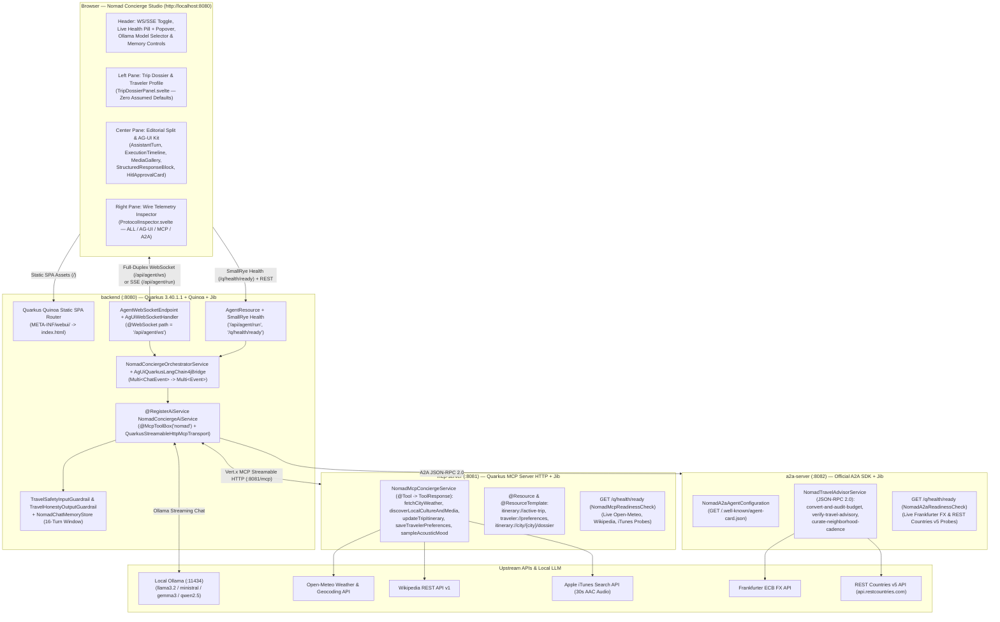
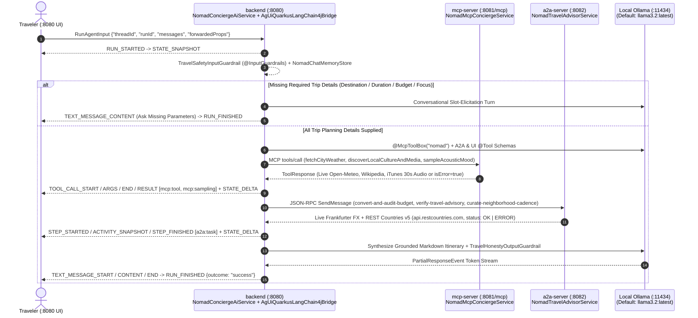

# 🧭 Nomad — Cultural & Architectural Concierge (`quarkus-svelte-skeleton`)

> **Reference Tri-Protocol (`AG-UI + MCP + A2A`) Showcase for `quarkus-agui`**  
> Built with **Java 25**, **Quarkus `3.40.1.1`**, **Quarkus LangChain4j (`1.15.0.CR1`)**, **Quarkus MCP Server (`2.1.0.Beta1`)**, **Official A2A Java SDK (`1.5.0.Final`)**, **Quarkus Quinoa (`2.9.3`)**, **Quarkus Container Image Jib (`3.40.1.1`)**, and a **SvelteKit 5 (Runes) + Skeleton UI v3 + GSAP** 3-Pane Workbench.

---

## 1. What This Module Does

`quarkus-svelte-skeleton` is a complete, production-grade reference application demonstrating how three open agentic protocols collaborate in real time inside a single cohesive developer experience:

1. **AG-UI (Agent–User Interaction Protocol — `:8080`)**: Streams canonical upstream AG-UI lifecycle, RFC 6902 JSON Patch state synchronization (`STATE_SNAPSHOT`, `STATE_DELTA`), tool execution (`TOOL_CALL_START`, `TOOL_CALL_ARGS`, `TOOL_CALL_END`, `TOOL_CALL_RESULT`), reasoning & sub-agent steps (`REASONING_MESSAGE_CONTENT`, `STEP_STARTED`, `ACTIVITY_SNAPSHOT`, `STEP_FINISHED`), native Human-in-the-Loop interrupts (`RUN_FINISHED` `InterruptOutcome` resumed via `RunAgentInput.resume` in `HitlApprovalCard`), and token deltas (`TEXT_MESSAGE_START`, `TEXT_MESSAGE_CONTENT`, `TEXT_MESSAGE_END`) between the Quarkus orchestrator (`ag-ui-quarkus` + `ag-ui-quarkus-langchain4j`) and the Svelte 5 frontend (`@agui/svelte` over `@ag-ui/client` + `@ag-ui/core`) via **Full-Duplex WebSockets (`/api/agent/ws`)** with automatic **SSE (`/api/agent/run`)** fallback.
2. **MCP (Model Context Protocol — `:8081`)**: Provides standardized domain tools (`@Tool`), URI resources (`@Resource`), parameterized resource templates (`@ResourceTemplate`), prompt templates (`@Prompt`), slash-command argument autocompletion (`@CompletePrompt`), and server-initiated LLM sampling (`mcp:sampling`) for live destination weather, architectural landmarks, and regional 30-second acoustic masters.
3. **A2A (Agent-to-Agent Protocol — `:8082`)**: Exposes an autonomous specialist auditor agent (`Nomad-A2A-Specialist`) discoverable via `A2ACardResolver` (`GET /.well-known/agent-card.json`) and invoked via the official `org.a2aproject.sdk` `1.5.0.Final` `Client.builder(card)` + `JSONRPCTransport` + `VertxA2AHttpClient` (`POST /` with `A2A-Version: 1.0`) to perform multi-currency FX conversion (`convert-and-audit-budget`), neighborhood cadence curation (`curate-neighborhood-cadence`), and visa/safety advisory verification (`verify-travel-advisory`).

With **Quarkus Quinoa**, the SvelteKit 5 SPA (`@sveltejs/adapter-static`) is compiled and bundled directly into the `backend` Quarkus artifact (`META-INF/webui/`), so **port `:8080` serves both the Nomad Studio UI and all AG-UI REST/WebSocket endpoints from a single JVM or Jib container**.

---

## 2. System Architecture & Tri-Protocol Topology

### 2.1 High-Level Component Architecture



### 2.2 End-to-End Tri-Protocol Execution Sequence

Every concierge turn streams through `@ApplicationScoped @RegisterAiService NomadConciergeAiService` + `@McpToolBox("nomad")` and `AgUiQuarkusLangChain4jBridge`, enforces **Zero Assumed Defaults** (conversational slot elicitation when destination, duration, budget/currency, or travel focus is missing), and emits canonical AG-UI events carrying Tri-Protocol `rawEvent` metadata with **strict upstream error surfacing** (zero silent fake fallbacks):



---

## 3. Module Structure & Key Source Files

```text
examples/quarkus-svelte-skeleton/
├── pom.xml                          # Showcase parent POM (manages quarkus-quinoa, quarkus-container-image-jib, -Pnative profile)
├── docker-compose.yml               # 3-service Jib container stack (mcp-server :8081, a2a-server :8082, backend :8080)
├── run-showcase.sh                  # Unified launcher (--docker, --docker-native, --local)
├── mcp-server/                      # Port :8081 — Quarkus MCP Server (quarkus-mcp-server-http on /mcp + SmallRye Health)
│   └── src/main/java/org/agui/showcase/mcp/
│       ├── NomadMcpConciergeService.java      # @Tool (ToolResponse), @Resource, @ResourceTemplate, @Prompt, @CompletePrompt
│       ├── NomadMcpReadinessCheck.java        # @Readiness HealthCheck probing Open-Meteo, Wikipedia, and Apple iTunes (/q/health/ready)
│       ├── McpServerResource.java             # Companion REST bridge (/api/mcp/health, /tools, /resources/city/{city}, /prompts/complete)
│       ├── McpToolInvocationRequest.java      # Typed MCP tool call request record
│       └── McpToolInvocationResponse.java     # Typed MCP tool call response envelope
├── a2a-server/                      # Port :8082 — Official A2A Specialist Server + SmallRye Health
│   └── src/main/java/org/agui/showcase/a2a/
│       ├── NomadA2aAgentConfiguration.java    # @Produces AgentCard (/.well-known/agent-card.json) & AgentExecutor
│       ├── NomadTravelAdvisorService.java     # Live Frankfurter FX, cadence & authenticated REST Countries v5 (api.restcountries.com)
│       ├── NomadA2aReadinessCheck.java        # @Readiness HealthCheck probing Frankfurter FX & REST Countries v5 (/q/health/ready)
│       └── NomadA2aHealthResource.java        # Companion health diagnostic (/api/a2a/health) endpoint
├── backend/                         # Port :8080 — Quarkus LangChain4j Orchestrator + Quinoa SPA Host + SmallRye Health
│   └── src/main/java/org/agui/showcase/backend/
│       ├── NomadConciergeAiService.java          # @ApplicationScoped @RegisterAiService + @McpToolBox("nomad") + @InputGuardrails
│       ├── NomadA2aAgentTools.java               # @Tool bridge delegating to Nomad-A2A-Specialist (:8082) with required-arg guards
│       ├── NomadUiSurfaceTools.java              # @Tool beans for AG-UI ChoiceCards & HITL (>= $1,500 USD) sanctuary holds
│       ├── NomadBackendReadinessChecks.java      # @Readiness HealthCheck beans alongside built-in McpClientHealthCheck (/q/health/ready)
│       ├── NomadConciergeOrchestratorService.java # Adapts Multi<ChatEvent> via AgUiQuarkusLangChain4jBridge + @McpClientName("nomad")
│       ├── TripDossierStore.java                 # Synchronizes MCP resources & tool executions into RFC 6902 STATE_DELTA patches
│       ├── AgentWebSocketEndpoint.java           # @WebSocket(path = "/api/agent/ws") delegating to reusable AgUiWebSocketHandler
│       ├── AgentResource.java                    # REST + SSE endpoints (/api/agent/run, /chat, /catalog, /health, /params, /reset)
│       └── A2aGatewayClient.java                 # Official A2A 1.5.0.Final client (AgUiA2aClient + A2ACardResolver + VertxA2AHttpClient)
└── frontend/                        # SvelteKit 5 (Runes) SPA packaged via Quarkus Quinoa
    ├── svelte.config.js             # @sveltejs/adapter-static (fallback: 'index.html' for Quinoa SPA routing)
    ├── src/lib/
    │   ├── agui-client.js           # @agui/svelte adapter, RunAgentInput/Resume builders, reduceAgUiEvent, Markdown exporter
    │   ├── markdown.js              # Sanitized Markdown-to-HTML renderer with tabular-nums cost tables
    │   └── components/
    │       ├── AgentChatContainer.svelte  # Top-level 3-pane studio, Top-Bar Health Pill + Popover, WebSocket lifecycle
    │       ├── TripDossierPanel.svelte    # Left pane: Zero-default Trip Dossier, FX toggle, -/+ nights stepper, Profile
    │       ├── MessageHistory.svelte      # Center pane: Scrollable editorial conversation stream
    │       ├── InputBar.svelte            # Prompt composer with /, ⌘K, and MCP @CompletePrompt suggestions
    │       ├── StreamRenderer.svelte      # Streaming turn dispatcher across AG-UI message lifecycle
    │       ├── ProtocolInspector.svelte   # Right pane: Live Wire Telemetry with red ERROR badges on failed calls
    │       └── agui/                      # Reusable Svelte 5 AG-UI Component Kit
    │           ├── AssistantTurn.svelte           # Container-query (@container > 820px) 2-column editorial split
    │           ├── ExecutionTimeline.svelte       # 2-column collapsible Bento spine with Service Error surfacing
    │           ├── ProtocolCallBadge.svelte       # Semantic badges for all typed callType categories
    │           ├── ReasoningAccordion.svelte      # Collapsible reasoning & synthesis duration header
    │           ├── StreamingMarkdownBody.svelte   # Live streaming Markdown narrative renderer
    │           ├── MediaGallery.svelte            # 16:10 photo plate, top-layer <dialog> lightbox, 30s audio waveform
    │           ├── HitlApprovalCard.svelte        # Human-in-the-Loop sanctuary hold approval gate
    │           ├── TurnFooter.svelte              # Verified Sources with red UNAVAILABLE badges on failed upstreams
    │           └── StructuredResponseBlock.svelte # Interactive slot-filling & single/multi-select concierge choice cards
    └── tests/
        ├── agui-client.test.mjs     # Unit tests for AG-UI reducer, zero defaults, error surfacing, health summary
        ├── docker-compose.test.mjs  # Topology assertions for Quinoa, Jib, -Pnative, and docker-compose.yml
        └── markdown.test.mjs        # Unit tests for Markdown table & code block rendering
```

---

## 4. Feature Deep-Dive

### 4.1 Full-Duplex WebSockets (`/api/agent/ws`) & Sub-50ms State Sync
- [`AgentWebSocketEndpoint`](file:///Users/fady/workspace/labs/quarkus-agui/examples/quarkus-svelte-skeleton/backend/src/main/java/org/agui/showcase/backend/AgentWebSocketEndpoint.java) uses Quarkus WebSockets Next (`@WebSocket(path = "/api/agent/ws")`) and reusable `AgUiWebSocketHandler` (`ag-ui-quarkus`) paired with `WebSocketAgent` (`@agui/svelte`) to multiplex bidirectional JSON frames over a single persistent connection:
  - **Outbound Client Frames (`OUT` $\uparrow$)**: Canonical `RunAgentInput` (including `RunAgentInput.resume` for HITL `Interrupt` resolution), `UPDATE_TRIP_PARAMS` (clicking `- 5N +` or switching `USD`/`EUR`/`GBP` in the Trip Dossier updates budget math in `<50ms` without an LLM round-trip), `CANCEL_RUN`, `RESET_MEMORY`, and `ping`.
  - **Inbound Server Events (`IN` $\downarrow$)**: Canonical upstream AG-UI events (`RUN_STARTED`, `STATE_SNAPSHOT`, RFC 6902 `STATE_DELTA`, `REASONING_MESSAGE_CONTENT`, `TOOL_CALL_START`, `TOOL_CALL_ARGS`, `TOOL_CALL_END`, `TOOL_CALL_RESULT`, `STEP_STARTED`, `ACTIVITY_SNAPSHOT`, `STEP_FINISHED`, `TEXT_MESSAGE_START`, `TEXT_MESSAGE_CONTENT`, `TEXT_MESSAGE_END`, `RUN_FINISHED`, `RUN_ERROR`).
- If WebSockets are unavailable, [`AgentChatContainer.svelte`](file:///Users/fady/workspace/labs/quarkus-agui/examples/quarkus-svelte-skeleton/frontend/src/lib/components/AgentChatContainer.svelte) automatically falls back to `POST /api/agent/run` (`text/event-stream`).

### 4.2 Declarative `@RegisterAiService` + `@McpToolBox("nomad")`, Conversational Memory & Zero Assumed Defaults
- [`NomadConciergeAiService`](file:///Users/fady/workspace/labs/quarkus-agui/examples/quarkus-svelte-skeleton/backend/src/main/java/org/agui/showcase/backend/NomadConciergeAiService.java) binds local Ollama (`ollama:llama3.2:latest`) declaratively via Quarkus LangChain4j (`@McpToolBox("nomad")` over Vert.x `QuarkusStreamableHttpMcpTransport`), maintains a 16-message sliding window per `@MemoryId` backed by `NomadChatMemoryStore`, and streams `Multi<ChatEvent>` through `AgUiQuarkusLangChain4jBridge` (`ag-ui-quarkus-langchain4j`).
- **Zero Assumed Defaults**: Neither MCP, A2A, backend, nor UI assumes `Kyoto`, `3`/`4` nights, `$3,200 USD`, or pre-filled traveler traits. When a traveler asks *"I want a trip in Paris"*, Nomad refuses to assume defaults and asks conversationally for any missing required parameters (**Destination**, **Duration**, **Budget & Currency**, **Travel Focus**) before invoking itinerary planning tools.

### 4.3 MicroProfile SmallRye Health (`/q/health/ready`), REST Countries v5 & Honest Error Surfacing
- **Authenticated REST Countries v5 (`api.restcountries.com`)**: `NomadTravelAdvisorService` (`:8082`) queries `https://api.restcountries.com/countries/v5/names.common/{country}` with `Authorization: Bearer <RESTCOUNTRIES_API_KEY>` loaded from `.env`.
- **Zero Silent Fake Fallbacks**: Any missing key or upstream HTTP error surfaces `isError: true` / `status: "ERROR"` across `TOOL_CALL_RESULT`, `STEP_FINISHED`, `ExecutionTimeline.svelte` (`Service Error`), `TurnFooter.svelte` (`UNAVAILABLE`), `ProtocolInspector.svelte` (`ERROR`), and the assistant reply.
- **Standard SmallRye Health (`/q/health/ready`)**: Live readiness probes run across `GET /q/health/ready` on `:8081`, `:8082`, and `:8080` (including `quarkus-langchain4j-mcp`'s built-in `McpClientHealthCheck`), powering the **Top-Bar Health Pill + Popover** (`All Systems Operational` / `Degraded • N API Down` / `Offline`).

### 4.4 Prompt-Injection Guardrails, Acoustic Mood Sampling & A2A Neighborhood Cadence
- **OWASP-LLM01 & LLM07 Guardrails (`TravelSafetyInputGuardrail`, `TravelHonestyOutputGuardrail`)**: Validates prompt safety on `@RegisterAiService` input and verifies grounded assistant completions before finalizing turns.
- **Native MCP Tools, Resources & Acoustic Sampling (`mcp:tool`, `mcp:resource`, `mcp:sampling`)**: Discovers `@Tool` schemas via `@McpToolBox("nomad")`, reads `itinerary://active-trip` and `traveler://preferences` via `@McpClientName("nomad")`, and samples regional acoustic mood profiles (`sampleAcousticMood`) tailored to live destination weather.
- **A2A Specialist Skills & Artifacts (`a2a:task`)**: Discovers `GET /.well-known/agent-card.json` and delegates `convert-and-audit-budget` (Frankfurter FX), `verify-travel-advisory` (REST Countries v5 `api.restcountries.com`), and `curate-neighborhood-cadence`.

### 4.5 Wide-Resolution (`2560x1440`) Editorial Layout & Deep-Linked Sources
- On wide viewports (`@container turn-card (inline-size > 820px)`), [`AssistantTurn.svelte`](file:///Users/fady/workspace/labs/quarkus-agui/examples/quarkus-svelte-skeleton/frontend/src/lib/components/agui/AssistantTurn.svelte) switches into a 2-column **Editorial Split**: narrative prose and budget breakdown table on the left (`1.38fr`), paired with a sticky right-hand companion rail (`0.92fr`) housing the `16:10` architectural photograph, native `<dialog>` top-layer lightbox, 30-second Apple iTunes audio preview player, and interactive choice cards.
- **Every turn includes parameterized Verified Sources** deep links (`api.open-meteo.com/v1/forecast`, `en.wikipedia.org/wiki/...`, `itunes.apple.com/search`, `api.frankfurter.dev/v1/latest`, `api.restcountries.com/countries/v5/names.common/...`).

---

## 5. How to Build & Run

### Prerequisites
- **Java 25** (`java -version`)
- **pnpm** (`pnpm -v`)
- **Ollama** (`ollama pull llama3.2:latest`) for live `@RegisterAiService` conversational reasoning & tool calling
- **`RESTCOUNTRIES_API_KEY`** configured in root `.env` (`cp .env.example .env`) for authenticated REST Countries v5 travel advisories
- **Docker** (optional, required only for Jib container modes)

---

### Mode 1: Local Production JVM Mode (`fast-jar` — Recommended for Fast Local Execution)

Build the entire reactor (Quinoa automatically runs `pnpm install && pnpm run build` and packages the SvelteKit 5 SPA into `backend/target/quarkus-app/`):

```bash
# From the repository root:
./mvnw clean package -DskipTests

# Start all 3 JVM services (starts in ~0.4s - 0.5s each):
java -Dquarkus.http.port=8081 -jar examples/quarkus-svelte-skeleton/mcp-server/target/quarkus-app/quarkus-run.jar &
java -Dquarkus.http.port=8082 -jar examples/quarkus-svelte-skeleton/a2a-server/target/quarkus-app/quarkus-run.jar &
java -Dquarkus.http.port=8080 -jar examples/quarkus-svelte-skeleton/backend/target/quarkus-app/quarkus-run.jar &
```

Open **http://localhost:8080** in your browser.

---

### Mode 2: Local Hot-Reload Dev Mode (`quarkus:dev` + Quinoa Auto-Managed Vite)

In `quarkus:dev` mode, **Quarkus Quinoa** automatically starts the Vite dev server (`:5173`) and proxies non-API requests from `:8080` with live HMR:

```bash
./examples/quarkus-svelte-skeleton/run-showcase.sh --local
```

---

### Mode 3: Jib Layered JVM Containers + Docker Compose (`--docker`)

Builds daemonless layered JVM container images (`eclipse-temurin:25-jre`) for all 3 services via `quarkus-container-image-jib` (`nomad-agui-showcase/mcp-server:latest`, `nomad-agui-showcase/a2a-server:latest`, `nomad-agui-showcase/backend:latest`) and starts the stack on `:8080`:

```bash
./examples/quarkus-svelte-skeleton/run-showcase.sh --docker
```

---

### Mode 4: GraalVM / Mandrel Native Jib Containers (`--docker-native` / `-Pnative`)

For scale-to-zero serverless deployments (`~25–45ms` cold startup, `~50MB` RSS per service), use the opt-in `-Pnative` profile:

```bash
./examples/quarkus-svelte-skeleton/run-showcase.sh --docker-native
```

---

## 6. How to Use the Nomad Studio Workbench (`http://localhost:8080`)

### 6.0 Initial Onboarding: Interactive Destination Picker & Awaiting Destination Dossier
- **Center Pane (`Welcome to Nomad`)**: Opens with an interactive **Single-Select Destination Picker Card** (`Beirut, Lebanon`, `Kyoto, Japan`, `Lisbon, Portugal`, `Reykjavik, Iceland`) — clicking any starter card begins planning for that city and asks for your **duration**, **budget & currency**, and **travel focus** without assuming preset defaults.
- **Left Pane (`Awaiting Destination` State in `TripDossierPanel.svelte`)**: Starts with zero assumed defaults (`--°C` Open-Meteo, `--` Frankfurter FX, `-- N` Trip Duration, `Not set` Budget, `--` Currency, and `Not specified yet` Traveler Profile) while allowing the traveler to configure duration and home currency or supply them naturally in chat.

### 6.1 Header Controls
- **`WS Connected` / `SSE Mode` Toggle**: Switch live between full-duplex WebSockets (`/api/agent/ws`) and HTTP Server-Sent Events (`/api/agent/run`).
- **Live Top-Bar Health Pill + Popover**: Displays live upstream service health (`All Systems Operational` / `Degraded • N API Down` / `Offline`) across `MCP (:8081/mcp)`, `A2A (:8082)`, `Ollama (:11434)`, `Open-Meteo`, `Wikipedia`, `Apple iTunes`, `Frankfurter FX`, and `REST Countries` with a 1-click **Refresh** probe.
- **`Memory: N` Badge & Reset (`↺`)**: Inspect how many conversational turns are stored for the active thread, or click `↺` to clear thread memory, extracted traveler preferences, and partial trip slots.
- **LLM Engine Selector**: Selects between live local Ollama models (`Llama 3.2 • Live Local Ollama`, `Ministral 8B`, `Gemma 3`, `Qwen 2.5 3B`).
- **Scenario Presets**: Click **`Paris (Slot Fill)`**, **`Kyoto Full Run`**, **`Lisbon Full Run`**, or **`Check Advisory`** in the header, or type any city in the world (e.g., *"Plan a 5-night museums and jazz trip in Paris with €2,500 EUR"*).

### 6.2 Left Pane: Trip Dossier & Traveler Profile
- **Interactive Nights Stepper (`- 5N +`)**: Adjusts trip duration in real time (`<50ms` over WebSocket), recalculating total budget and per-night accommodation math.
- **Home Currency Switcher (`USD` / `EUR` / `GBP`)**: Re-anchors the budget bar and live Frankfurter ECB exchange rate badge immediately.
- **Concierge Verifications**: Trigger targeted 1-click actions once a destination is active:
  - **`Audit FX & Trip Budget`** (`A2A` Frankfurter FX)
  - **`Verify Entry & Travel Advisory`** (`A2A` REST Countries v5 `api.restcountries.com`)
  - **`Hold Sanctuary Suite ($1,840)`** (`HITL` approval gate `>$1,500`)
- **`Export .md`**: Downloads the current destination's curated itinerary, weather telemetry, FX rates, and traveler profile as a Markdown file (`nomad-paris-dossier.md`).

### 6.3 Slash Commands (`/`) & Keyboard Shortcuts
Press `/` in the prompt bar (or `⌘K` / `Ctrl+K` anywhere) to open the keyboard-navigable command palette (`↑` `↓` to navigate, `Enter` to select, `Esc` to close):

| Command | Protocol Action | Dispatched Prompt |
| :--- | :--- | :--- |
| `/beirut` | **Slot Elicitation** — starts Beirut trip planning without assumed defaults | `I want to plan a trip to Beirut, Lebanon` |
| `/kyoto` | **MCP + A2A** — full 4-night Kyoto architecture & koto music dossier | `Plan a 4-night architecture and koto music trip in Kyoto with $2,400 USD` |
| `/lisbon` | **MCP + A2A** — full 5-night Lisbon Fado, azulejo & culinary dossier | `Plan a 5-night Fado, azulejo and culinary trip in Lisbon with €2,200 EUR` |
| `/reykjavik` | **MCP + A2A** — full 4-night Reykjavik architecture, nature & music dossier | `Plan a 4-night architecture, nature and music trip in Reykjavik with $2,800 USD` |
| `/media` | **MCP Media** — fetches Wikipedia landmark photography & 30s Apple iTunes audio | `Play local Fado music from Lisbon` |
| `/choices` | **AG-UI ChoiceGroup** — renders interactive multi-select neighborhood cards | `Give me 4 multi_select evening options in Beirut to pick from` |
| `/mcp` | **MCP** — queries live Open-Meteo geocoding & forecast over `:8081/mcp` | `What is the weather in Oaxaca right now?` |
| `/a2a` | **A2A** — runs live REST Countries v5 (`api.restcountries.com`) advisory check | `Check the travel advisory for Beirut` |
| `/hitl` | **HITL Gate** — triggers the `>$1,500` Human-in-the-Loop sanctuary hold gate | `Reserve Hoshinoya Arashiyama Pavilion in Kyoto for 4 nights ($1840)` |

---

## 7. Direct API & CLI Verification Recipes

You can inspect all three protocol servers directly from your terminal while the stack is running:

```bash
# 0. Standard MicroProfile SmallRye Readiness (:8080, :8081, :8082)
curl -s http://localhost:8080/q/health/ready | jq .
curl -s http://localhost:8081/q/health/ready | jq .
curl -s http://localhost:8082/q/health/ready | jq .

# 1. MCP Server (:8081/mcp Streamable HTTP + Companion REST Bridge)
curl -s http://localhost:8081/api/mcp/tools | jq .
curl -s http://localhost:8081/api/mcp/resources/city/Kyoto | jq .
curl -s "http://localhost:8081/api/mcp/prompts/complete?prefix=Li" | jq .

# 2. A2A Specialist Server (:8082) — Discover Official 1.5.0.Final AgentCard & Delegate FX Audit Task via JSON-RPC 2.0
curl -s http://localhost:8082/.well-known/agent-card.json | jq .
curl -s -X POST http://localhost:8082/ \
  -H "Content-Type: application/json" \
  -H "A2A-Version: 1.0" \
  -d '{"jsonrpc":"2.0","id":"req-1","method":"SendMessage","params":{"message":{"role":"ROLE_USER","messageId":"msg-1","parts":[{"text":"Convert $1,840 USD for Kyoto"},{"data":{"skillId":"convert-and-audit-budget","city":"Kyoto","budgetUsd":1840}}]}}}' | jq .

# 3. AG-UI Orchestrator (:8080) — Stream Canonical AG-UI SSE Frames (Full 4-Slot Trip Planning)
curl -N -X POST http://localhost:8080/api/agent/run \
  -H "Content-Type: application/json" \
  -d '{"threadId":"thread-cli-1","runId":"run-cli-1","state":{},"messages":[{"id":"u-1","role":"user","content":"Plan a 4-night architecture and tea trip in Kyoto with a $2,400 USD budget"}],"tools":[],"context":[],"forwardedProps":{"llmMode":"ollama:llama3.2:latest"}}'
```

---

## 8. Running the Showcase Test Suite

```bash
# Run Frontend Unit & Topology Tests (Node.js built-in test runner):
pnpm --dir examples/quarkus-svelte-skeleton/frontend test

# Run Quarkus @QuarkusTest Unit/Integration Tests + JaCoCo Coverage across all 3 modules:
./mvnw -f examples/quarkus-svelte-skeleton/pom.xml test jacoco:report

# Run PITest Mutation Testing per showcase module:
./mvnw -f examples/quarkus-svelte-skeleton/mcp-server/pom.xml test-compile org.pitest:pitest-maven:mutationCoverage
./mvnw -f examples/quarkus-svelte-skeleton/a2a-server/pom.xml test-compile org.pitest:pitest-maven:mutationCoverage
./mvnw -f examples/quarkus-svelte-skeleton/backend/pom.xml test-compile org.pitest:pitest-maven:mutationCoverage
```
