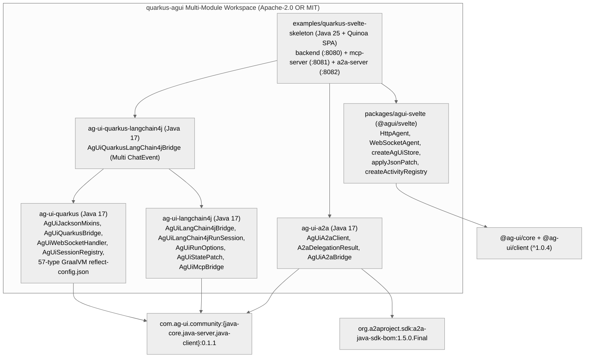
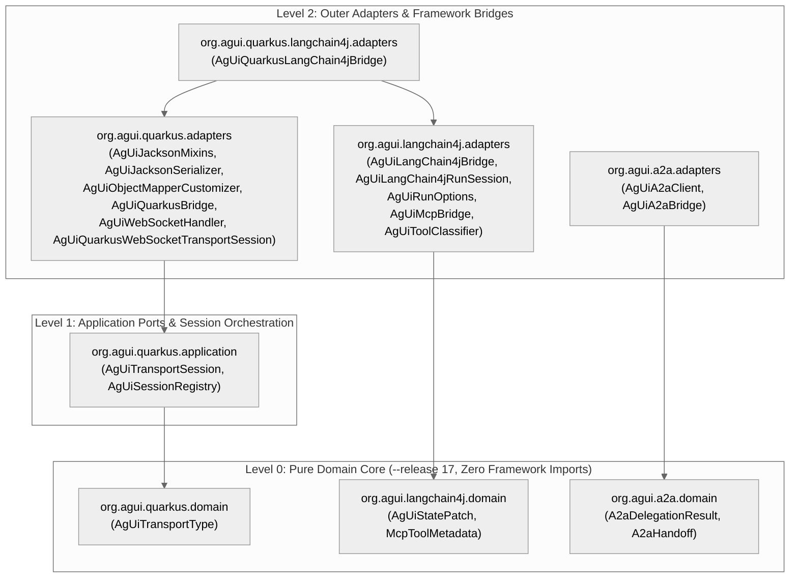

# 🏗️ System & Clean Architecture (`Architecture`)

> **Explanation & Design Reference**  
> Governed by `.archlens/policy.json`, `docs/specs/C4_ARCHITECTURE.md`, `docs/DECISION_MAP.md`, and `ADR-001` through `ADR-009`.

`quarkus-agui` applies **Robert C. Martin's Clean Architecture** across two complementary planes:
1. **Runtime Product Modules (`org.agui:*` & `@agui/svelte`)**: Orthogonal Java 17 protocol adapters and a headless Svelte 5 SDK built over upstream AG-UI and A2A SDKs.
2. **Governance & SDLC Engine (`.agent/scripts/lib/*.mjs`)**: Deterministic 4-ring architecture enforcing TDD gates, Archlens inward dependencies, Spec-Drift ADRs, and SHA-256 Merkle receipts.

---

## 1. Tri-Protocol Runtime Topology (`AG-UI + MCP + A2A`)

The platform unifies three open agentic protocols with strict separation of responsibilities:
- **AG-UI (`:8080` — Agent-to-User)**: Full-duplex WebSockets (`/api/agent/ws`) and HTTP SSE (`POST /api/agent/run`) streaming canonical `RunAgentInput`, token deltas, `ACTIVITY_SNAPSHOT` cards, RFC 6902 `STATE_DELTA` JSON Patches, and native HITL `InterruptOutcome` frames.
- **MCP (`:8081` — Agent-to-Tools/Resources)**: Quarkus MCP Streamable HTTP (`quarkus-mcp-server-http` + `@McpToolBox("nomad")`) exposing domain `@Tool`, `@Resource`, `@ResourceTemplate`, `@Prompt`, and `@CompletePrompt` endpoints.
- **A2A (`:8082` — Agent-to-Agent)**: Official `org.a2aproject.sdk` `1.5.0.Final` discovery (`GET /.well-known/agent-card.json` via `A2ACardResolver`) and JSON-RPC 2.0 `SendMessage` / SSE `SendStreamingMessage` delegation via `AgUiA2aClient` + `VertxA2AHttpClient` (`ADR-009`).

---

## 2. Archlens Concentric Clean Architecture Rings (`.archlens/policy.json`)

### 2.1 Java 17 Library Modules (`org.agui.*`)

`.archlens/policy.json` enforces strict inward dependency direction (`adapters` $\rightarrow$ `application` $\rightarrow$ `domain`) with zero outer-framework imports inside `domain`:

### 2.2 Agentic SDLC Engine Concentric Rings (`.agent/scripts/`)

Every governance engine module is classified across 4 concentric rings tracked by `node .agent/scripts/sdlc-engine.mjs wiki map`:

- **Ring 0: Domain Core & Primitives ($I \in [0.00, 0.50]$)**:
  - `.agent/scripts/lib/core.mjs` ($Ca=15, Ce=0, I=0.00$) — Pure process execution, frontmatter parsing, env loading, and Archlens helpers.
  - `.agent/scripts/lib/audit-chain.mjs` ($Ca=7, Ce=0, I=0.00$) — Immutable SHA-256 Merkle chain and cryptographic Stage 7 receipt signing.
  - `.agent/scripts/lib/cache.mjs` ($Ca=1, Ce=1, I=0.50$) — Deterministic worktree SHA-256 Gate Cache (`computeTreeHash`).
- **Ring 1: Application & Governance ($I \in [0.17, 0.75]$)**:
  - `.agent/scripts/lib/decision-graph.mjs` ($I=0.17$), `.agent/scripts/lib/arch-trace.mjs` ($I=0.25$), `.agent/scripts/lib/adr-drift.mjs` ($I=0.30$), `.agent/scripts/lib/product-dag.mjs` ($I=0.44$), `.agent/scripts/lib/dossier.mjs` ($I=0.60$), `.agent/scripts/lib/readme-sync.mjs` ($I=0.67$), `.agent/scripts/lib/session.mjs` ($I=0.69$), `.agent/scripts/lib/wiki-sync.mjs` ($I=0.75$).
- **Ring 2: Adapters & Enforcement ($I \in [0.17, 0.80]$)**:
  - `.agent/scripts/lib/pm-provider.mjs` ($I=0.17$), `.agent/scripts/lib/git-guard.mjs` ($I=0.50$), `.agent/scripts/lib/installer.mjs` ($I=0.57$), `.agent/scripts/lib/workbench-server.mjs` ($I=0.78$), `.agent/scripts/lib/quality-gate.mjs` ($I=0.80$).
- **Ring 3: CLI Router & Entrypoint ($I = 1.00$)**:
  - `.agent/scripts/sdlc-engine.mjs` ($Ca=0, Ce=16, I=1.00$) — Unified CLI dispatcher invoked by `/sdlc` and the 9 specialist skills.

---

## 3. Key Architectural Mechanisms (`ADR-006` – `ADR-009`)

1. **Zero-POJO-Duplication Wire Fidelity (`ADR-007`)**:
   `AgUiJacksonMixins` and `AgUiObjectMapperCustomizer` adapt upstream `com.ag-ui.community` Java classes to the exact `@JsonTypeInfo` / `ToolCall` / `RunFinishedEvent` JSON wire contract validated by `@ag-ui/core` Zod schemas in `< 10ms` p99 (`INV-05`).
2. **Standard CDI + 57-Type GraalVM Native Metadata (`ADR-006`, `ADR-007`)**:
   Instead of heavyweight Quarkus `-deployment` build-time processors, all 4 Java modules use standard Jakarta CDI `META-INF/beans.xml` discovery, and `ag-ui-quarkus` ships `reflect-config.json` registering all 57 AG-UI event, message, tool-call, JSON-patch, and interrupt types for GraalVM / Mandrel JDK 25 (`< 50MB` RSS, `INV-06`).
3. **Canonical `ACTIVITY_SNAPSHOT` Surface Kit & RFC 6902 State (`ADR-008`)**:
   `AgUiRunOptions` provides `postToolActivityProvider` and `postRunActivityProvider` hooks emitting `ActivitySnapshotEvent` frames (`agui:weather`, `agui:map-places`, `agui:security-advisory`, `agui:fx-budget`, `agui:culture-audio`) alongside `StateDeltaEvent` RFC 6902 JSON Patches (`AgUiStatePatch` on Java; CWE-1321-guarded `applyJsonPatch` on JS).
4. **Official A2A `1.5.0.Final` Client & SSRF-Safe Endpoint Rebinding (`ADR-009`)**:
   `AgUiA2aClient` resolves `/.well-known/agent-card.json` via `A2ACardResolver`, safely rebinds container/proxy URLs via `rebindCardEndpoints` (blocking userInfo spoofing, non-HTTP schemes, and `//authority` injection), and executes bounded `SendMessage` / `SendStreamingMessage` calls over `JSONRPCTransport` + Quarkus `VertxA2AHttpClient`.
5. **4-Layer Git Guard & Causal Decision Graph (`INV-01`, `INV-03`)**:
   `git-guard.mjs` protects `develop` and `main` across `pre-commit`, `commit-msg`, `pre-merge-commit`, and `pre-push` hooks, requiring an active branch session and a signed Stage 7 Merkle Gate Receipt (`docs/AUDIT_CHAIN.jsonl`), while `docs/DECISION_MAP.md` records causal lineage from invariants (`INV-XX`) to ADRs (`ADR-001`–`ADR-009`).
