# 🗺️ Codebase-to-Wiki Traceability & Archlens Ring Map

> **Deterministic AST & Clean Architecture Inventory**  
> Generated and verified by `node .agent/scripts/sdlc-engine.mjs wiki sync` (`sdlc-wiki`) and governed by `.archlens/policy.json`.  
> Every module, exported symbol, concentric ring boundary, skill, capability (`CAP-XX`), and decision record (`ADR-00X`) is mapped below.

---

## 1. Archlens Concentric Ring Dependency Graph

In accordance with Robert C. Martin's **Clean Architecture** and `.archlens/policy.json`, dependencies point strictly inward toward **Ring 0 (Domain Core & Primitives)**.

- **Afferent Coupling ($Ca$)**: Number of modules that depend on this module (inward stability).
- **Efferent Coupling ($Ce$)**: Number of modules this module depends on (outward fan-out).
- **Instability ($I = \frac{Ce}{Ca + Ce}$)**: `0.00` indicates a maximally stable core module; `1.00` indicates a pure outer entrypoint/adapter.

```mermaid
flowchart TD
  subgraph Ring0 ["Ring 0: Domain Core & Primitives"]
    audit_chain_mjs["audit-chain.mjs (11 exports, I=0)"]
    cache_mjs["cache.mjs (6 exports, I=0.5)"]
    core_mjs["core.mjs (14 exports, I=0)"]
  end
  subgraph Ring1 ["Ring 1: Application & Governance"]
    adr_drift_mjs["adr-drift.mjs (6 exports, I=0.3)"]
    arch_trace_mjs["arch-trace.mjs (5 exports, I=0.25)"]
    decision_graph_mjs["decision-graph.mjs (5 exports, I=0.17)"]
    dossier_mjs["dossier.mjs (2 exports, I=0.6)"]
    product_dag_mjs["product-dag.mjs (9 exports, I=0.44)"]
    readme_sync_mjs["readme-sync.mjs (9 exports, I=0.67)"]
    session_mjs["session.mjs (15 exports, I=0.69)"]
    wiki_sync_mjs["wiki-sync.mjs (6 exports, I=0.75)"]
  end
  subgraph Ring2 ["Ring 2: Adapters & Enforcement"]
    git_guard_mjs["git-guard.mjs (5 exports, I=0.5)"]
    installer_mjs["installer.mjs (25 exports, I=0.57)"]
    pm_provider_mjs["pm-provider.mjs (16 exports, I=0.17)"]
    quality_gate_mjs["quality-gate.mjs (26 exports, I=0.8)"]
    workbench_server_mjs["workbench-server.mjs (7 exports, I=0.78)"]
  end
  subgraph Ring3 ["Ring 3: CLI Router & Entrypoint"]
    sdlc_engine_mjs["sdlc-engine.mjs (4 exports, I=1)"]
  end
  sdlc_engine_mjs --> core_mjs
  sdlc_engine_mjs --> cache_mjs
  sdlc_engine_mjs --> audit_chain_mjs
  sdlc_engine_mjs --> decision_graph_mjs
  sdlc_engine_mjs --> product_dag_mjs
  sdlc_engine_mjs --> adr_drift_mjs
  sdlc_engine_mjs --> dossier_mjs
  sdlc_engine_mjs --> git_guard_mjs
  sdlc_engine_mjs --> pm_provider_mjs
  sdlc_engine_mjs --> installer_mjs
  sdlc_engine_mjs --> session_mjs
  sdlc_engine_mjs --> arch_trace_mjs
  sdlc_engine_mjs --> quality_gate_mjs
  sdlc_engine_mjs --> workbench_server_mjs
  sdlc_engine_mjs --> wiki_sync_mjs
  sdlc_engine_mjs --> readme_sync_mjs
  adr_drift_mjs --> core_mjs
  adr_drift_mjs --> decision_graph_mjs
  adr_drift_mjs --> audit_chain_mjs
  arch_trace_mjs --> core_mjs
  arch_trace_mjs --> session_mjs
  cache_mjs --> core_mjs
  decision_graph_mjs --> core_mjs
  dossier_mjs --> core_mjs
  dossier_mjs --> product_dag_mjs
  dossier_mjs --> adr_drift_mjs
  git_guard_mjs --> core_mjs
  git_guard_mjs --> audit_chain_mjs
  git_guard_mjs --> adr_drift_mjs
  installer_mjs --> core_mjs
  installer_mjs --> arch_trace_mjs
  installer_mjs --> git_guard_mjs
  installer_mjs --> pm_provider_mjs
  pm_provider_mjs --> core_mjs
  product_dag_mjs --> core_mjs
  product_dag_mjs --> pm_provider_mjs
  product_dag_mjs --> decision_graph_mjs
  product_dag_mjs --> audit_chain_mjs
  quality_gate_mjs --> core_mjs
  quality_gate_mjs --> session_mjs
  quality_gate_mjs --> pm_provider_mjs
  quality_gate_mjs --> audit_chain_mjs
  quality_gate_mjs --> adr_drift_mjs
  quality_gate_mjs --> git_guard_mjs
  quality_gate_mjs --> arch_trace_mjs
```



---

## 2. Source Modules by Concentric Ring

### 🏛️ Ring 0: Domain Core & Primitives

| Source Module | Lines | $Ca$ / $Ce$ | Instability ($I$) | Exported AST Symbols (Line #) | Wiki Coverage |
| :--- | :--- | :--- | :--- | :--- | :--- |
| `.agent/scripts/lib/audit-chain.mjs` | 343 | 7 / 0 | `0` | `AUDIT_LEDGER_FILE` (L6), `GENESIS_HASH` (L7), `calculateRecordHash` (L9), `appendAuditRecord` (L14), `verifyAuditChain` (L58), `RECEIPT_KEY_FILE` (L150), `loadReceiptKey` (L158), `signReceiptPayload` (L183) +3 more | `wiki/Architecture.md`, `wiki/Codebase-Map.md`, `wiki/Skills-Reference.md` |
| `.agent/scripts/lib/cache.mjs` | 162 | 1 / 1 | `0.5` | `getGateCachePath` (L9), `computeTreeHash` (L17), `getGateCacheHit` (L96), `recordGateCache` (L110), `getGateCacheStats` (L143), `clearGateCache` (L153) | `wiki/Architecture.md`, `wiki/Codebase-Map.md`, `wiki/Skills-Reference.md` |
| `.agent/scripts/lib/core.mjs` | 285 | 15 / 0 | `0` | `loadEnv` (L10), `fileExists` (L40), `readFileSafe` (L48), `execCommand` (L56), `execAsync` (L65), `runParallelTasks` (L80), `parseFrontmatter` (L97), `inspectArchlens` (L120) +6 more | `wiki/Architecture.md`, `wiki/Codebase-Map.md`, `wiki/Skills-Reference.md` |

### 🏛️ Ring 1: Application & Governance

| Source Module | Lines | $Ca$ / $Ce$ | Instability ($I$) | Exported AST Symbols (Line #) | Wiki Coverage |
| :--- | :--- | :--- | :--- | :--- | :--- |
| `.agent/scripts/lib/adr-drift.mjs` | 621 | 7 / 3 | `0.3` | `listADRs` (L40), `createADR` (L80), `decideADR` (L183), `compactADRs` (L256), `checkSpecDrift` (L422), `auditContractDrift` (L510) | `wiki/Architecture.md`, `wiki/Codebase-Map.md`, `wiki/Skills-Reference.md` |
| `.agent/scripts/lib/arch-trace.mjs` | 435 | 6 / 2 | `0.25` | `checkArchDiff` (L7), `parseMermaidDiagram` (L157), `diffMermaidGraphs` (L229), `recordArchTrace` (L253), `scaffoldArchlensPolicy` (L374) | `wiki/Architecture.md`, `wiki/Codebase-Map.md`, `wiki/Skills-Reference.md` |
| `.agent/scripts/lib/decision-graph.mjs` | 332 | 5 / 1 | `0.17` | `DECISION_GRAPH_FILE` (L5), `DECISION_MAP_MD` (L6), `appendDecisionEvent` (L8), `buildDecisionGraph` (L39), `syncDecisionMapMarkdown` (L257) | `wiki/Architecture.md`, `wiki/Codebase-Map.md`, `wiki/Skills-Reference.md` |
| `.agent/scripts/lib/dossier.mjs` | 117 | 2 / 3 | `0.6` | `extractExportSignatures` (L7), `generateTicketDossier` (L23) | `wiki/Architecture.md`, `wiki/Codebase-Map.md`, `wiki/Skills-Reference.md` |
| `.agent/scripts/lib/product-dag.mjs` | 837 | 5 / 4 | `0.44` | `renderCapabilitySpecMarkdown` (L10), `renderProductPrdMarkdown` (L61), `renderProductSrsMarkdown` (L110), `initProductConstitution` (L185), `scaffoldCapabilitySpec` (L387), `parseProductMarkdown` (L563), `planProductDAG` (L637), `controlProductDAG` (L705) +1 more | `wiki/Architecture.md`, `wiki/Codebase-Map.md`, `wiki/Skills-Reference.md` |
| `.agent/scripts/lib/readme-sync.mjs` | 898 | 1 / 2 | `0.67` | `escapeXml` (L105), `slugifyHeadingAnchor` (L114), `detectReadmeArchetype` (L137), `stripArchetypeBlocks` (L182), `renderThemeWordmarkSvg` (L199), `renderVhsDemoTape` (L223), `renderLlmsTxt` (L249), `scaffoldReadme` (L432) +1 more | `wiki/Architecture.md`, `wiki/Codebase-Map.md`, `wiki/Skills-Reference.md` |
| `.agent/scripts/lib/session.mjs` | 674 | 4 / 9 | `0.69` | `getSessionPath` (L16), `getSessionStatus` (L20), `startSession` (L56), `updateSession` (L130), `switchSession` (L198), `listSessions` (L220), `renderDashboard` (L242), `resumeSession` (L279) +7 more | `wiki/Architecture.md`, `wiki/Codebase-Map.md`, `wiki/Skills-Reference.md` |
| `.agent/scripts/lib/wiki-sync.mjs` | 740 | 2 / 6 | `0.75` | `inspectSourceModule` (L36), `resolveArchlensRing` (L104), `buildWikiCodeMap` (L136), `auditWiki` (L320), `renderCodebaseMapMarkdown` (L519), `syncWiki` (L668) | `wiki/Architecture.md`, `wiki/Codebase-Map.md`, `wiki/Skills-Reference.md` |

### 🏛️ Ring 2: Adapters & Enforcement

| Source Module | Lines | $Ca$ / $Ce$ | Instability ($I$) | Exported AST Symbols (Line #) | Wiki Coverage |
| :--- | :--- | :--- | :--- | :--- | :--- |
| `.agent/scripts/lib/git-guard.mjs` | 304 | 3 / 3 | `0.5` | `verifyCommitGuard` (L41), `verifyMergeGuard` (L99), `verifyPushGuard` (L144), `installHooks` (L178), `applyBranchProtection` (L260) | `wiki/Architecture.md`, `wiki/Codebase-Map.md`, `wiki/Skills-Reference.md`, `wiki/Traceability.md` |
| `.agent/scripts/lib/installer.mjs` | 1414 | 3 / 4 | `0.57` | `DEPRECATED_SDLC_SKILLS` (L10), `CANONICAL_SDLC_SKILLS` (L27), `ARCHLENS_SKILL_PACKAGE` (L40), `DEFAULT_GITIGNORE_ENTRIES` (L42), `upsertGitignore` (L52), `pinArchlensMcpConfigs` (L66), `SUPPORTED_AGENTS` (L82), `CONSTITUTIONAL_RULES_SUMMARY` (L144) +17 more | `wiki/Architecture.md`, `wiki/Codebase-Map.md`, `wiki/Skills-Reference.md` |
| `.agent/scripts/lib/pm-provider.mjs` | 1381 | 5 / 1 | `0.17` | `CANONICAL_ISSUE_TEMPLATES` (L6), `scaffoldIssueTemplates` (L108), `loadIssueTemplate` (L130), `formatTemplatedIssue` (L184), `updateLocalKanbanState` (L249), `transitionPMState` (L332), `createTicket` (L652), `resolveOpenPRNumber` (L923) +8 more | `wiki/Architecture.md`, `wiki/Codebase-Map.md`, `wiki/Skills-Reference.md` |
| `.agent/scripts/lib/quality-gate.mjs` | 1710 | 2 / 8 | `0.8` | `runDoctor` (L14), `generateRegressionProof` (L112), `monitorCanaryHealthAndWatchdog` (L273), `installCIWorkflow` (L386), `exportAgentRules` (L450), `scaffoldReproductionTest` (L467), `assessRisk` (L585), `generatePRSummary` (L659) +18 more | `wiki/Architecture.md`, `wiki/Codebase-Map.md`, `wiki/Skills-Reference.md` |
| `.agent/scripts/lib/workbench-server.mjs` | 2667 | 2 / 7 | `0.78` | `parseKanbanMarkdown` (L63), `parseArchTraceMarkdown` (L144), `buildArchDiffPayload` (L178), `generateArchitectureWidget` (L255), `renderWorkbenchHTML` (L853), `ensureWorkbenchRunning` (L2428), `createWorkbenchServer` (L2466) | `wiki/Architecture.md`, `wiki/Codebase-Map.md`, `wiki/Skills-Reference.md` |

### 🏛️ Ring 3: CLI Router & Entrypoint

| Source Module | Lines | $Ca$ / $Ce$ | Instability ($I$) | Exported AST Symbols (Line #) | Wiki Coverage |
| :--- | :--- | :--- | :--- | :--- | :--- |
| `.agent/scripts/sdlc-engine.mjs` | 2204 | 0 / 16 | `1` | `executeRelease` (L369), `runCLI` (L537), `formatCLIResult` (L1981), `cliExitCode` (L2185) | `wiki/Architecture.md`, `wiki/Codebase-Map.md`, `wiki/Home.md`, `wiki/Skills-Reference.md`, `wiki/Traceability.md` |


---

## 3. Canonical SDLC Skills (`.agent/skills/`)

| Skill Name | Skill Definition Path | Purpose & Trigger | Documented In |
| :--- | :--- | :--- | :--- |
| `sdlc` | `.agent/skills/sdlc/SKILL.md` | Universal /sdlc {{args}} command router. Accepts any subcommand directly in chat (/sdlc doctor, /sdlc begin 4912, /sdlc status, /sdlc drift, /sdlc pre-pr, /sdlc gate, /sdlc kanban, /sdlc ui) and maps it 1:1 to sdlc-engine.mjs. | `wiki/Architecture.md`, `wiki/Codebase-Map.md`, `wiki/Home.md`, `wiki/Skills-Reference.md`, `wiki/Traceability.md` |
| `sdlc-adr` | `.agent/skills/sdlc-adr/SKILL.md` | Architecture Decision Record (ADR) lifecycle manager and Spec-Drift Sentinel. Mints, lists, and approves/rejects ADRs in docs/adr/, verifies PRODUCT.md drift, and syncs docs/DECISION_MAP.md. | `wiki/Codebase-Map.md`, `wiki/Skills-Reference.md` |
| `sdlc-doctor` | `.agent/skills/sdlc-doctor/SKILL.md` | Stack detection, doctor --fix auto-healing, 4-Layer Git Guard hooks, .archlens/policy.json scaffolding, and multi-agent installer (Gemini, Claude Code, Cursor, Grok, Windsurf, Copilot). | `wiki/Codebase-Map.md`, `wiki/Skills-Reference.md` |
| `sdlc-gate` | `.agent/skills/sdlc-gate/SKILL.md` | Parallel Fork-Join PR peer reviewer, strict 9-pillar quality gatekeeper, Archlens concentric ring auditor, security/CVE scanner, and Stage 7 signed gate receipt issuer. | `wiki/Codebase-Map.md`, `wiki/Home.md`, `wiki/Skills-Reference.md` |
| `sdlc-release` | `.agent/skills/sdlc-release/SKILL.md` | Synchronizes project documentation (README.md, docs/specs/, CHANGELOG.md, wiki/) and automates Semantic Versioning (SemVer) releases, Git tagging, regression proofs, and canary health watchdog verification. | `wiki/Codebase-Map.md`, `wiki/Home.md`, `wiki/Skills-Reference.md` |
| `sdlc-status` | `.agent/skills/sdlc-status/SKILL.md` | Displays active SDLC session, 8-stage lifecycle progress, spec-drift check, living KANBAN.md board state, engineering ROI telemetry, and live Architecture Diff UI in one unified view. | `wiki/Codebase-Map.md`, `wiki/Skills-Reference.md` |
| `sdlc-tdd` | `.agent/skills/sdlc-tdd/SKILL.md` | Guides Robert C. Martin Test-Driven Development (Red-Green-Refactor, Transformation Priority Premise, F.I.R.S.T. isolation) and executes real Dual-Gate test coverage (>= 85%) and mutation testing (>= 80%) across polyglot stacks. | `wiki/Codebase-Map.md`, `wiki/Home.md`, `wiki/Skills-Reference.md` |
| `sdlc-wiki` | `.agent/skills/sdlc-wiki/SKILL.md` | Technical Writer, 10-30-90 Developer Landing Page (README.md) architect, and AST-to-Wiki documentation engineer. Scaffolds and audits high-converting READMEs from docs/templates/README_TEMPLATE.md, maintains llms.txt, and synchronizes wiki/*.md pages with source AST exports, Archlens Concentric Clean Architecture rings, PRODUCT.md capabilities, and ADRs. | `wiki/Codebase-Map.md`, `wiki/Home.md`, `wiki/Skills-Reference.md` |

---

## 4. Product Capabilities (`PRODUCT.md`)

| Capability ID | Title | Functional Spec | Status | Depends On |
| :--- | :--- | :--- | :--- | :--- |
| **CAP-01** | Quarkus MCP Server (:8081) & Quarkus A2A Server (:8082) in Reference Showcase | `docs/specs/cap-01-mcp-a2a-servers.md` | `AMENDED (ADR-009)` | None |
| **CAP-02** | OpsPilot Quarkus Orchestrator (:8080) & SvelteKit + pnpm 3-Pane Baseline (:5173) | `docs/specs/cap-02-orchestrator-svelte-baseline.md` | `IMPLEMENTED (ADR-002)` | CAP-01 |
| **CAP-03** | In-Place AG-UI Protocol Engine in Orchestrator (Core 6 + MCP/A2A + State + HITL) | `docs/specs/cap-03-inplace-agui-backend.md` | `AMENDED (ADR-008)` | CAP-02 |
| **CAP-04** | Full 3-Pane SvelteKit + Skeleton UI + @lucide/svelte AG-UI Workbench | `docs/specs/cap-04-svelte-agui-workbench.md` | `AMENDED (ADR-008)` | CAP-02 |
| **CAP-05** | Extract ag-ui-core Standalone Java 25 Library & Refactor Showcase | `docs/specs/cap-05-extract-agui-core.md` | `AMENDED (ADR-007)` | CAP-03, CAP-04 |
| **CAP-06** | Extract quarkus-ag-ui-runtime (AgUiBridge, AgUiMcpBridge, AgUiA2aBridge, Mutiny SSE) | `docs/specs/cap-06-extract-quarkus-runtime.md` | `AMENDED (ADR-009)` | CAP-05 |
| **CAP-07** | Extract quarkus-ag-ui-deployment, GraalVM 25 Reflection, Dev UI & Integration Tests | `docs/specs/cap-07-extract-quarkus-deployment-it.md` | `AMENDED (ADR-006)` | CAP-06 |
| **CAP-08** | Migrate Showcase to quarkus-ag-ui Extension & Full E2E + Native Benchmarks | `docs/specs/cap-08-migrate-showcase-e2e-benchmarks.md` | `AMENDED (ADR-008)` | CAP-07 |

---

## 5. Architecture Decision Records (`docs/adr/`)

| ADR ID | Decision Title | Scope | Status | Amends / Supersedes |
| :--- | :--- | :--- | :--- | :--- |
| **ADR-001** | Multi-Module Maven & SvelteKit Clean Architecture for AG-UI Protocol | `technical` | `accepted` | CAP-01, CAP-03, CAP-04, CAP-07 |
| **ADR-002** | Example-First Tri-Protocol (AG-UI + MCP + A2A) Evolution on Java 25, Quarkus 3.40.1.1 & pnpm | `product` | `accepted` | CAP-01, CAP-02, CAP-03, CAP-04, CAP-05, CAP-06, CAP-07, CAP-08 |
| **ADR-003** | Multi-Extension BOM and Concentric Transport Architecture (Core, SSE, WebSockets) | `technical` | `accepted` | CAP-06, CAP-07 |
| **ADR-004** | ADR-004: Nomad Cultural Concierge Showcase & Modular Svelte 5 AG-UI Component Kit | `technical` | `accepted` | None |
| **ADR-005** | ADR-005: Quarkus LangChain4j Reactive AG-UI Bridge, Declarative `@McpToolBox` & SmallRye Health + REST Countries v5 | `technical` | `accepted` | None |
| **ADR-006** | Framework-Agnostic Module Topology (ag-ui-core, ag-ui-a2a, ag-ui-langchain4j, ag-ui-quarkus) and Removal of Quarkus Deployment Processors | `technical` | `accepted` | CAP-06, CAP-07, ADR-003 |
| **ADR-007** | Adopt Upstream AG-UI SDKs (com.ag-ui.community & @ag-ui/client) and Orthogonal Java 17 Quarkus Modules | `technical` | `accepted` | CAP-05, CAP-06, ADR-006 |
| **ADR-008** | Canonical AG-UI ACTIVITY_SNAPSHOT Surface Kit, Complete Trip Dossier Report & local-quarkus-agui CI | `technical` | `accepted` | CAP-03, CAP-04, CAP-08, ADR-004 |
| **ADR-009** | Adopt Official A2A Java SDK 1.5.0.Final Client (A2ACardResolver, ClientBuilder & VertxA2AHttpClient) and Remove Custom HTTP Audit Endpoint | `technical` | `accepted` | CAP-01, CAP-06 |

---

## 6. Verification & Zero-Rot Commands

```bash
# 1. Rebuild AST-to-Wiki Codebase Map and synchronize tables
node .agent/scripts/sdlc-engine.mjs wiki sync

# 2. Audit all wiki/*.md files for broken paths, deprecated skills, or unmapped modules
node .agent/scripts/sdlc-engine.mjs wiki audit --strict

# 3. Inspect JSON Codebase Map & Archlens Ring Instability Metrics
node .agent/scripts/sdlc-engine.mjs wiki map
```
