```mermaid
%%{init: {'theme': 'neutral'}}%%
flowchart LR
    S1["1. Spec & Intake\n(PRODUCT.md / Ticket)"] --> S2["2. Branch & Session\n(stage begin)"]
    S2 --> S3["3. Red-Green-Refactor\n(sdlc-tdd)"]
    S3 --> S4["4. Dual-Gate Proof\n(>=85% Cov / >=80% Mut)"]
    S4 --> S5["5. Drift & Archlens\n(ADR / Concentric Rings)"]
    S5 --> S6["6. Fork-Join Review\n(sdlc-gate)"]
    S6 --> S7["7. Merkle Gate Receipt\n(docs/AUDIT_CHAIN.jsonl)"]
    S7 --> S8["8. Sync, Merge & Release\n(sdlc-wiki / sdlc-release)"]
```

# 🏛️ Quarkus AG-UI Project Wiki (`Home`)

> **Authoritative Diátaxis Documentation Suite (`v0.2.0`)**  
> Synchronized with `README.md`, `PRODUCT.md`, `.archlens/policy.json`, `docs/specs/`, and `docs/adr/` via `sdlc-wiki`.

Welcome to the **Quarkus AG-UI (`quarkus-agui`)** developer wiki. This repository bridges the **AG-UI (Agent–User Interaction Protocol)** ecosystem to **Java 17+**, **Quarkus `3.40.1.1`**, **LangChain4j**, **Official A2A (`1.5.0.Final`)**, and **Svelte 5 Runes** (`@agui/svelte`), demonstrated end-to-end by the **Nomad Cultural & Architectural Concierge** Tri-Protocol (`AG-UI + MCP + A2A`) showcase.

---

## 🗺️ Diátaxis Wiki Sitemap

| Wiki Page | Diátaxis Quadrant | What You Will Find |
| :--- | :--- | :--- |
| **[`wiki/Home.md`](Home.md)** | **Overview & Tutorials** | Vision, Quickstart tutorials (Quarkus SSE/WS + `@agui/svelte` + Nomad Showcase), and 8-Stage Lifecycle summary |
| **[`wiki/Architecture.md`](Architecture.md)** | **Explanation & Design** | Orthogonal Java 17 modules, Archlens Concentric Clean Architecture rings, Jackson MixIns, `ACTIVITY_SNAPSHOT`, A2A `1.5.0.Final`, and SDLC Governance |
| **[`wiki/Skills-Reference.md`](Skills-Reference.md)** | **Reference (API, Skills & CLI)** | Public Java 17 & `@agui/svelte` APIs, canonical `sdlc-*` skills suite, and `sdlc-engine.mjs` CLI reference |
| **[`wiki/Traceability.md`](Traceability.md)** | **How-To & Operations** | `INV-01`–`INV-08`, `CAP-01`–`CAP-08`, `ADR-001`–`ADR-009`, `docs/KANBAN.md` sync, SHA-256 Gate Receipts & release runbooks |
| **[`wiki/Codebase-Map.md`](Codebase-Map.md)** | **AST & Ring Inventory** | Deterministic module-by-module AST export map, $Ca / Ce / I$ coupling metrics, capabilities & ADR index |

---

## 🎯 Product Vision & Core Capabilities (`PRODUCT.md`)

`quarkus-agui` eliminates custom streaming glue code on the JVM by building **4 orthogonal Java 17 (`--release 17`) library modules** directly on upstream `com.ag-ui.community:{java-core,java-server,java-client}:0.1.1` and a **headless Svelte 5 Runes SDK (`@agui/svelte`)** on `@ag-ui/client` + `@ag-ui/core` (`^1.0.4`), governed by `ADR-007`, `ADR-008`, and `ADR-009`:

1. **`ag-ui-bom`**: Unified Maven Bill of Materials managing `org.agui:*:0.2.0`, `com.ag-ui.community:*:0.1.1`, and `org.a2aproject.sdk:a2a-java-sdk-bom:1.5.0.Final`.
2. **`ag-ui-quarkus`**: Quarkus CDI `AgUiObjectMapperCustomizer` (Zod-compatible Jackson MixIns), `AgUiQuarkusBridge` (SmallRye Mutiny `Multi` SSE & JSON streams), reusable `AgUiWebSocketHandler` + `AgUiSessionRegistry`, and 57-type GraalVM `reflect-config.json` (`< 50MB` native RSS).
3. **`ag-ui-langchain4j`**: Framework-agnostic `dev.langchain4j` `TokenStream` & `Agent` adapter (`AgUiLangChain4jBridge`, stateful `AgUiLangChain4jRunSession`, `AgUiRunOptions` `ACTIVITY_SNAPSHOT` hooks, RFC 6902 `AgUiStatePatch`, `AgUiMcpBridge`, and native HITL `InterruptOutcome`).
4. **`ag-ui-quarkus-langchain4j`**: Reactive Quarkiverse `@RegisterAiService` (`Multi<ChatEvent>`) adapter (`AgUiQuarkusLangChain4jBridge`) keeping `ag-ui-quarkus` completely free of LangChain4j dependencies.
5. **`ag-ui-a2a`**: Framework-agnostic A2A `1.5.0.Final` client & event bridge (`AgUiA2aClient`, `A2aDelegationResult`, `AgUiA2aBridge`) wrapping `A2ACardResolver`, `Client.builder(card)`, and `JSONRPCTransport`.
6. **`packages/agui-svelte` (`@agui/svelte`)**: Headless Svelte 5 Runes & JS client providing `HttpAgent`, full-duplex `WebSocketAgent`, CWE-1321-safe `applyJsonPatch`, `createAgUiStore`, `AGUI_ACTIVITY_TYPES` registry, map deep-link builders, and Tri-Protocol wire telemetry.

---

## 🚀 Tutorial 1: Stream a Quarkus Agent over SSE & WebSockets

### Step 1: Import `ag-ui-bom` and Select Orthogonal Adapters

```xml
<dependencyManagement>
    <dependencies>
        <dependency>
            <groupId>org.agui</groupId>
            <artifactId>ag-ui-bom</artifactId>
            <version>0.2.0</version>
            <type>pom</type>
            <scope>import</scope>
        </dependency>
    </dependencies>
</dependencyManagement>

<dependencies>
    <dependency>
        <groupId>org.agui</groupId>
        <artifactId>ag-ui-quarkus</artifactId>
    </dependency>
    <dependency>
        <groupId>org.agui</groupId>
        <artifactId>ag-ui-quarkus-langchain4j</artifactId>
    </dependency>
</dependencies>
```

### Step 2: Expose SSE (`POST /api/agent/run`) and Full-Duplex WebSockets (`/api/agent/ws`)

```java
import com.agui.community.core.agent.Agent;
import com.agui.community.core.agent.RunAgentInput;
import io.quarkus.websockets.next.*;
import io.smallrye.common.annotation.RunOnVirtualThread;
import io.smallrye.mutiny.Multi;
import jakarta.inject.Inject;
import jakarta.ws.rs.*;
import jakarta.ws.rs.core.MediaType;
import org.agui.quarkus.adapters.AgUiQuarkusBridge;
import org.agui.quarkus.adapters.AgUiWebSocketHandler;

@Path("/api/agent")
public class AgentHttpEndpoint {
    @Inject AgUiQuarkusBridge bridge;
    @Inject Agent conciergeAgent;

    @POST
    @Path("/run")
    @Consumes(MediaType.APPLICATION_JSON)
    @Produces(MediaType.SERVER_SENT_EVENTS)
    public Multi<String> streamSse(RunAgentInput input) {
        return bridge.runAsSse(conciergeAgent, input);
    }
}

@WebSocket(path = "/api/agent/ws")
public class AgentWsEndpoint {
    @Inject AgUiWebSocketHandler wsHandler;
    @Inject Agent conciergeAgent;

    @OnOpen
    public void onOpen(WebSocketConnection conn) { wsHandler.onOpen(conn); }

    @OnTextMessage
    @RunOnVirtualThread
    public void onMessage(String rawJson, WebSocketConnection conn) {
        wsHandler.runAndSend(conciergeAgent, rawJson, conn);
    }

    @OnClose
    public void onClose(WebSocketConnection conn) { wsHandler.onClose(conn); }
}
```

---

## 💻 Tutorial 2: Connect a Svelte 5 Runes Frontend (`@agui/svelte`)

```javascript
import {
    WebSocketAgent,
    HttpAgent,
    createAgUiStore,
    createActivityRegistry
} from '@agui/svelte';

const wsAgent = new WebSocketAgent({
    url: 'ws://localhost:8080/api/agent/ws',
    threadId: 'thread-nomad-1'
});
const fallbackSseAgent = new HttpAgent({
    url: 'http://localhost:8080/api/agent/run',
    threadId: 'thread-nomad-1'
});

const activities = createActivityRegistry();
const store = createAgUiStore({ agent: wsAgent, fallbackAgent: fallbackSseAgent, activityRegistry: activities });

// Trigger a streaming agent turn
await store.runAgent('Plan a 4-night architecture and tea trip in Kyoto with a $2,400 USD budget', {
    forwardedProps: { llmMode: 'ollama:llama3.2:latest' }
});

// Resume a Human-in-the-Loop (HITL) Interrupt (e.g., sanctuary reservation > $1,500 USD)
// await store.resumeInterrupt(interruptId, { approved: true });
```

---

## 🧭 Tutorial 3: Launch the Nomad Tri-Protocol Showcase

The reference application in `examples/quarkus-svelte-skeleton` runs three collaborating Quarkus `3.40.1.1` services on Java 25 (`mcp-server` on `:8081`, `a2a-server` on `:8082`, and `backend` + Quinoa SvelteKit 5 Studio on `:8080`):

```bash
# 1. Copy environment template and configure RESTCOUNTRIES_API_KEY if needed
cp .env.example .env

# 2. Build Jib layered containers & launch Docker Compose stack on http://localhost:8080
./examples/quarkus-svelte-skeleton/run-showcase.sh --docker

# Or run all 3 services in local hot-reload dev mode (Quinoa proxies Vite on :8080):
./examples/quarkus-svelte-skeleton/run-showcase.sh --local
```

---

## 🔄 8-Stage Agentic SDLC Lifecycle Overview

Every engineering change in `quarkus-agui` traverses an enforceable 8-stage governance pipeline orchestrated by `.agent/scripts/sdlc-engine.mjs`:


