# 🏛️ Quarkus AG-UI Developer Wiki (`Home`)

Welcome to the **Quarkus AG-UI (`quarkus-agui`)** documentation suite.

Modern AI applications require more than a request-response text endpoint: agents invoke external tools, collaborate with specialist agents, push incremental state updates to the screen, render domain-specific UI cards, and pause for human approval before taking high-impact actions. **Quarkus AG-UI** brings that full experience to the JVM and Svelte ecosystems using open standards rather than bespoke glue code.

---

## 🧭 What Problem Does Quarkus AG-UI Solve?

When teams connect a JVM backend to an interactive AI frontend, three distinct communication boundaries emerge:

1. **Agent <-> User Interface (`AG-UI`)**: How the browser sends prompts, cancellations, or Human-in-the-Loop (HITL) approvals and receives streaming tokens, reasoning traces, typed UI cards (`ACTIVITY_SNAPSHOT`), and RFC 6902 state deltas (`STATE_DELTA`).
2. **Agent <-> Tools & Context (`MCP`)**: How an LLM orchestrator discovers and invokes external tools (`@Tool`), structured URI resources (`@Resource`, `@ResourceTemplate`), and prompt completions (`@CompletePrompt`).
3. **Agent <-> Specialist Agents (`A2A`)**: How an orchestrator discovers remote specialist agents (`/.well-known/agent-card.json`) and delegates multi-step tasks over JSON-RPC 2.0 or SSE.

**Quarkus AG-UI** provides lightweight, orthogonal **Java 17** adapters directly on top of the official `com.ag-ui.community` Java SDK (`0.1.1`) and `org.a2aproject.sdk` (`1.5.0.Final`), paired with a headless **Svelte 5 Runes** client (`@agui/svelte`) built on `@ag-ui/client` + `@ag-ui/core` (`^1.0.4`).

---

## 🗺️ Diátaxis Wiki Sitemap

| Wiki Page | Purpose | Who Should Read It |
| :--- | :--- | :--- |
| **[`wiki/Home.md`](Home.md)** | **Overview, Decision Guides & Tutorials** | Developers evaluating the stack, choosing modules/transports, and building their first streaming endpoint |
| **[`wiki/Architecture.md`](Architecture.md)** | **Explanation & Clean Architecture** | Architects reviewing concentric dependency rings, Jackson MixIn wire fidelity, GraalVM reflection, and A2A security |
| **[`wiki/Skills-Reference.md`](Skills-Reference.md)** | **API, Skills & CLI Reference** | Engineers looking up exact Java 17 classes, `@agui/svelte` store functions, or Agentic SDLC commands |
| **[`wiki/Traceability.md`](Traceability.md)** | **How-To, ADRs & Operations** | Maintainers managing invariants (`INV-01`–`INV-08`), specs, ADRs (`ADR-001`–`ADR-009`), Kanban, and releases |
| **[`wiki/Codebase-Map.md`](Codebase-Map.md)** | **Deterministic AST & Coupling Inventory** | Contributors and AI coding agents inspecting live module exports and $Ca / Ce / I$ stability metrics |

---

## 🧩 Choosing Your Integration Path

Because every module in `quarkus-agui` is orthogonal, you only pull in the adapters that match your runtime and transport requirements:

| Your Goal | Recommended Artifacts | Why This Path |
| :--- | :--- | :--- |
| **Quarkus + Quarkiverse `@RegisterAiService`** | `ag-ui-quarkus` + `ag-ui-quarkus-langchain4j` | Adapts reactive `Multi<ChatEvent>` streams directly into Mutiny SSE or Quarkus WebSockets Next |
| **Quarkus + Custom `com.agui.community.core.agent.Agent`** | `ag-ui-quarkus` | Keeps your runtime completely free of LangChain4j while providing Jackson MixIns, SSE, WebSockets & GraalVM native metadata |
| **Plain JVM (Spring, Helidon, Micronaut, CLI) + LangChain4j** | `ag-ui-langchain4j` | Adapts standard `dev.langchain4j` `TokenStream`s into `Flow.Publisher<Event>` with zero Quarkus dependencies |
| **Delegating to Remote A2A Specialist Agents** | `ag-ui-a2a` | Wraps `A2ACardResolver` + `Client.builder(card)` (`1.5.0.Final`) and projects remote `Task`/`Artifact` updates onto AG-UI |
| **Svelte 5 Runes or Vanilla JS Frontend** | `@agui/svelte` (`packages/agui-svelte`) | Provides `WebSocketAgent`, `HttpAgent`, reactive `createAgUiStore`, CWE-1321-safe `applyJsonPatch`, and activity registries |

### Choosing Between SSE and Full-Duplex WebSockets

- **Server-Sent Events (`POST /api/agent/run` via `AgUiQuarkusBridge` + `HttpAgent`)**: Ideal for stateless HTTP load balancers, simple curl debugging, and request-scoped streaming turns.
- **Full-Duplex WebSockets (`/api/agent/ws` via `AgUiWebSocketHandler` + `WebSocketAgent`)**: Ideal for persistent low-latency studio UIs that need mid-stream run cancellation (`cancel`), heartbeat liveness (`ping`/`pong`), and instant bidirectional state edits over a single socket.

---

## 🚀 Tutorial 1: Stream a Quarkus Agent over SSE & WebSockets

In this tutorial, you will wire the Maven BOM into a Quarkus service and expose the same AG-UI `Agent` over both HTTP Server-Sent Events and full-duplex WebSockets.

### Step 1: Import `ag-ui-bom` and Select Adapters

Add `org.agui:ag-ui-bom` to `<dependencyManagement>` so all `org.agui`, `com.ag-ui.community`, and `org.a2aproject.sdk` versions stay aligned:

```xml
<dependencyManagement>
    <dependencies>
        <dependency>
            <groupId>org.agui</groupId>
            <artifactId>ag-ui-bom</artifactId>
            <version>0.2.0</version>
            <type>pom</type>
            <scope>import</scope>
        </dependency>
    </dependencies>
</dependencyManagement>

<dependencies>
    <dependency>
        <groupId>org.agui</groupId>
        <artifactId>ag-ui-quarkus</artifactId>
    </dependency>
    <dependency>
        <groupId>org.agui</groupId>
        <artifactId>ag-ui-quarkus-langchain4j</artifactId>
    </dependency>
</dependencies>
```

### Step 2: Expose SSE (`POST /api/agent/run`) and WebSockets (`/api/agent/ws`)

`AgUiObjectMapperCustomizer` automatically registers Jackson MixIns for all canonical AG-UI payloads, allowing JAX-RS to deserialize `RunAgentInput` directly and `AgUiQuarkusBridge` / `AgUiWebSocketHandler` to stream compliant events:

```java
import com.agui.community.core.agent.Agent;
import com.agui.community.core.agent.RunAgentInput;
import io.quarkus.websockets.next.*;
import io.smallrye.common.annotation.RunOnVirtualThread;
import io.smallrye.mutiny.Multi;
import jakarta.inject.Inject;
import jakarta.ws.rs.*;
import jakarta.ws.rs.core.MediaType;
import org.agui.quarkus.adapters.AgUiQuarkusBridge;
import org.agui.quarkus.adapters.AgUiWebSocketHandler;

@Path("/api/agent")
public class AgentHttpEndpoint {
    @Inject AgUiQuarkusBridge bridge;
    @Inject Agent conciergeAgent;

    @POST
    @Path("/run")
    @Consumes(MediaType.APPLICATION_JSON)
    @Produces(MediaType.SERVER_SENT_EVENTS)
    public Multi<String> streamSse(RunAgentInput input) {
        return bridge.runAsSse(conciergeAgent, input);
    }
}

@WebSocket(path = "/api/agent/ws")
public class AgentWsEndpoint {
    @Inject AgUiWebSocketHandler wsHandler;
    @Inject Agent conciergeAgent;

    @OnOpen
    public void onOpen(WebSocketConnection conn) { wsHandler.onOpen(conn); }

    @OnTextMessage
    @RunOnVirtualThread
    public void onMessage(String rawJson, WebSocketConnection conn) {
        wsHandler.runAndSend(conciergeAgent, rawJson, conn);
    }

    @OnClose
    public void onClose(WebSocketConnection conn) { wsHandler.onClose(conn); }
}
```

---

## 💻 Tutorial 2: Connect a Svelte 5 Frontend (`@agui/svelte`)

On the client, `createAgUiStore` manages streaming text buffers, reasoning traces, tool timelines, RFC 6902 `agentState` patches, `activities` snapshots, and pending HITL interrupts—while `createActivityRegistry` maps `ACTIVITY_SNAPSHOT` wire types (such as `agui:map-places`) to your UI components:

```javascript
import {
    WebSocketAgent,
    AGUI_ACTIVITY_TYPES,
    createAgUiStore,
    createActivityRegistry
} from '@agui/svelte';

const wsAgent = new WebSocketAgent({
    url: 'ws://localhost:8080/api/agent/ws',
    threadId: 'thread-nomad-1'
});

// Or pass `endpoint: 'http://localhost:8080/api/agent/run'` for SSE transport via HttpAgent
const store = createAgUiStore({ agent: wsAgent, threadId: 'thread-nomad-1' });
const activities = createActivityRegistry().register(AGUI_ACTIVITY_TYPES.MAP_PLACES, 'LocationMapCard');

// Trigger a streaming agent turn
await store.runAgent('Plan a 4-night architecture and tea trip in Kyoto with a $2,400 USD budget', {
    forwardedProps: { llmMode: 'ollama:llama3.2:latest' }
});

// Resume a Human-in-the-Loop (HITL) Interrupt (e.g., sanctuary reservation > $1,500 USD)
// await store.resumeInterrupt(interruptId, 'resolved', { approved: true });
```

---

## 🧭 Tutorial 3: Explore the Nomad Tri-Protocol Showcase

To see AG-UI, MCP, and A2A collaborating in a full production-style application, `examples/quarkus-svelte-skeleton` provides **Nomad — Cultural & Architectural Concierge**, running three Quarkus `3.40.1.1` services on Java 25:

- **`backend` (`:8080`)**: Quarkus orchestrator + bundled SvelteKit 5 Studio UI (served via Quarkus Quinoa from the same port).
- **`mcp-server` (`:8081`)**: Quarkus MCP server providing live Open-Meteo weather, Wikipedia landmarks, and 30-second iTunes acoustic previews.
- **`a2a-server` (`:8082`)**: Official A2A `1.5.0.Final` specialist agent performing Frankfurter ECB multi-currency budget audits and REST Countries v5 travel advisories.

Launch the entire stack via Jib containers or local hot-reload dev mode (full walkthrough in `examples/quarkus-svelte-skeleton/README.md`):

```bash
# 1. Copy environment template and configure RESTCOUNTRIES_API_KEY if needed
cp .env.example .env

# 2. Build Jib layered containers & launch Docker Compose stack on http://localhost:8080
./examples/quarkus-svelte-skeleton/run-showcase.sh --docker

# Or run all 3 services in local hot-reload dev mode (Quinoa proxies Vite on :8080):
./examples/quarkus-svelte-skeleton/run-showcase.sh --local
```

---

## 🔄 8-Stage Agentic SDLC Lifecycle Overview

Every engineering and documentation change in `quarkus-agui` traverses an enforceable 8-stage quality and governance pipeline orchestrated by `.agent/scripts/sdlc-engine.mjs`:

```mermaid
%%{init: {'theme': 'neutral'}}%%
flowchart LR
    S1["1. Spec & Intake\n(PRODUCT.md / Ticket)"] --> S2["2. Branch & Session\n(stage begin)"]
    S2 --> S3["3. Red-Green-Refactor\n(sdlc-tdd)"]
    S3 --> S4["4. Dual-Gate Proof\n(>=85% Cov / >=80% Mut)"]
    S4 --> S5["5. Drift & Archlens\n(ADR / Concentric Rings)"]
    S5 --> S6["6. Fork-Join Review\n(sdlc-gate)"]
    S6 --> S7["7. Merkle Gate Receipt\n(docs/AUDIT_CHAIN.jsonl)"]
    S7 --> S8["8. Sync, Merge & Release\n(sdlc-wiki / sdlc-release)"]
```


